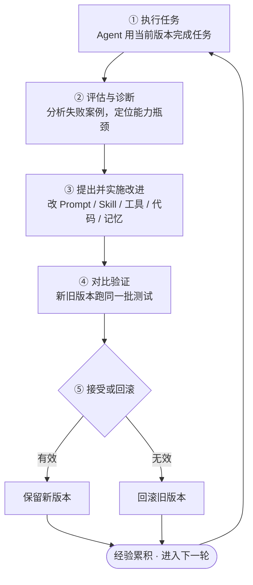
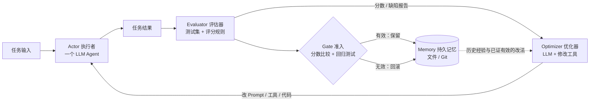
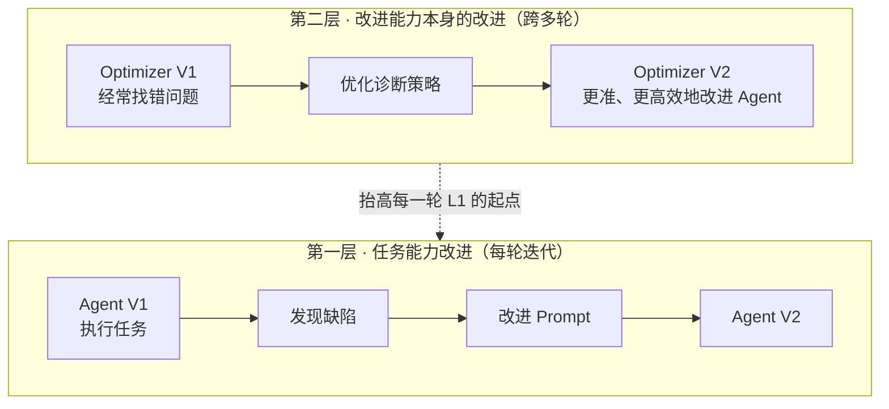
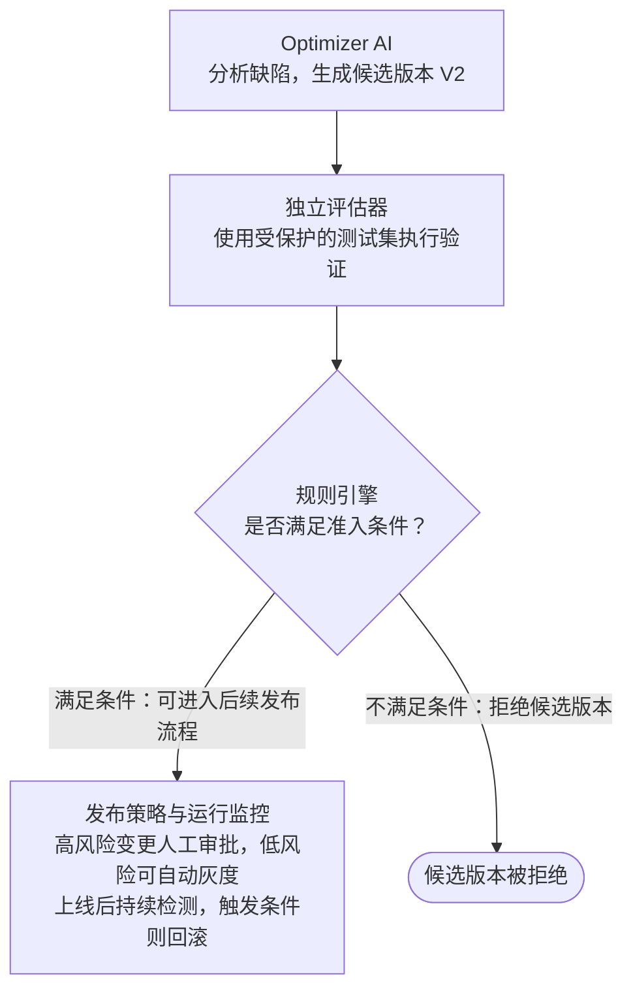

# RSI 学习

## 一、核心心智模型：把 Agent 看成一座可以改造自己的工厂

引用论文：[Awesome RSI Research](https://lee1003-lee.github.io/Awesome-RSI-Research/)

普通 Agent 是一座工厂：输入任务，输出结果。

RSI 系统则是：工厂完成任务后，还会检查自己的生产流程，寻找缺陷，尝试改造生产线，并验证新生产线是不是更好。

### RSI 的基本闭环



一次迭代的路径：执行任务 → 评估与诊断 → 提出并实施改进 → 对比验证 → 接受或回滚 → 进入下一轮。

---

你可以把它理解成：

> RSI = Agent + 可修改的自身能力 + 外部反馈 + 自动优化机制 + 跨轮次积累。

## 二、构建 RSI，需要哪些核心组件？

| 组件 | 核心作用 | 最小实现 |
|---|---|---|
| **Actor**（执行者） | 完成真实任务 | 一个 LLM Agent |
| **Evaluator**（评估器） | 判断结果好坏 | 测试集、评分规则 |
| **Optimizer**（优化器） | 分析缺陷、提出修改 | LLM + 修改工具 |
| **Memory**（持久记忆） | 保存历史经验与有效改进 | 文件、Git |
| **Gate**（准入机制） | 决定保留还是回滚 | 分数比较、回归测试 |



### 五个组件里，Evaluator 决定成败

这里最重要的不是模型有多强，而是 **Evaluator 是否可靠**。

因为 RSI 最大的问题是：**AI 认为自己进步了，不代表它真的进步了。**

例如，AI 修改了自己的 Prompt，随后自己给自己打了 95 分，但实际上任务正确率下降了。

所以评估标准不能任由优化器随意修改。三条约束，按强度递增：

1. **独立测试** —— 评估集与优化过程隔离，Optimizer 读得到分数，改不到题目。
2. **可验证的任务结果** —— 优先用环境终态、单元测试、可执行断言判定，而不是让模型自述「我完成了」。
3. **人工抽检** —— 定期人工复核高分样本，防止指标被绕开。

一旦 Optimizer 能改评分标准，闭环就退化成「自己出题、自己打分、自己判及格」，Gate 也随之失效。

## 三、RSI 真正的递归体现在哪里？

关键在于理解**两层循环**。

### 第一层：任务能力改进

Agent V1 执行任务 → 发现缺陷 → 改进 Prompt → Agent V2

### 第二层：改进能力本身的改进

Optimizer V1 经常找错问题 → 优化诊断策略 → Optimizer V2 能更准确、更高效地改进 Agent



第一层实现的是**持续自我优化**。

第二层让**负责优化的机制本身也变得更强**，这是严格意义上递归自我改进的重要特征。

因此，简单的「反思 → 重试」不等于 RSI；有跨轮次持久更新，也不一定证明实现了真正的递归能力增长。

---

> 以下四个问题，触及 RSI 最核心、也最难解决的一点：**AI 如何证明自己真的变好了，而不是自己认为自己变好了？**
>
> 尤其是第四个问题：如果让 AI 自己决定是否接受改进，它会不会因为判断错误，把一个更差的版本当成更好的版本？
>
> **答案是：会。** 所以一个可靠的 RSI 系统，不能把「提出改进」和「决定改进是否有效」的权力完全交给同一个 AI。

## 四、第二层心智模型：把 RSI 当成一套科学实验系统

| RSI 环节 | 对应科学实验 | 核心问题 |
|---|---|---|
| 评估 | 建立测量方法 | 怎样定义好坏？ |
| 提出改进 | 提出假设 | 为什么认为这样改会更好？ |
| 对比验证 | 对照实验 | 改了以后真的更好吗？ |
| 接受或回滚 | 实验决策 | 证据是否足够支持升级？ |

AI 可以负责提出假设，但不能仅凭自己的判断宣布假设成立。

一套工程化的 RSI 应当遵循三个原则：

1. **评估标准尽量独立于被评估的 AI。** 不能 AI 想改什么，就临时把考核标准改成什么。
2. **改进必须有可观察的证据。** 例如任务正确率提升、工具调用错误减少，而不是 AI 声称自己推理得更好了。
3. **是否升级由事先定义的规则决定。** AI 可以提出建议，但不应单方面修改准入规则。

这并不意味着每一步都要人工审核。真正合理的方案是：**人在设计阶段定义目标和边界，AI 在边界内自主优化，独立验证机制控制版本升级。**

## 五、问题 1：怎么评估 Agent 的好与坏？

首先要区分两个问题：

- **结果评估（Outcome Evaluation）**：任务最终有没有完成？
- **过程评估（Trajectory Evaluation）**：Agent 是怎么完成的？有没有走弯路、调用错误工具或违反约束？

实际构建时，通常采用三种评估方式。

| 评估方式 | 如何判断 | 适用场景 |
|---|---|---|
| 规则 / 代码评估 | 程序自动检查结果 | 编程、计算、结构化数据 |
| LLM-as-a-Judge | 另一个模型依据评分规则判断 | 文案、产品方案、研究分析 |
| 人工评估 | 业务专家或真实用户判断 | 主观性强、高风险任务 |

### 一个具体例子

假设你构建了一个 Agent，帮你自动设计低代码表单。它收到需求：「创建一个招聘管理应用，包含招聘需求、简历推荐、面试和 Offer 跟进。」

怎么判断它完成得好不好？

| 评估维度 | 怎么测量 |
|---|---|
| 功能正确性 | 四个业务环节是否都能正常使用 |
| 数据关联 | 面试表单能否关联正确的候选人 |
| 权限正确性 | 普通用户是否能访问不应看到的数据 |
| 效率 | 完成任务的时间、Token 消耗 |
| 方案合理性 | 专家评估是否符合实际业务流程 |

### 关键细节：不是所有维度都该加权总分

Agent 功能完成度 95 分，但存在严重越权访问问题 —— 即使综合得分很高，也不能算合格。

因此应该建立两类指标：

- **硬性约束**：权限不能越权、敏感数据不能泄露、测试必须通过。
- **优化指标**：正确率更高、耗时更短、Token 更少。

硬性约束相当于准入门槛，优化指标用于比较哪个版本更好。

## 六、问题 2：怎么知道 AI 提出的改进是好的？

这里需要纠正一个很容易产生的理解偏差：

> **AI 提出改进时，并不知道它一定是好的。它提出的只是一个待验证的假设。**

假设 Agent 经常在需求分析中遗漏权限设计。Optimizer 分析了 20 个失败案例，提出：

> 在生成产品方案之前，强制增加一个权限检查步骤。

这听起来合理，但它仍然可能产生负面影响：

- 权限遗漏率下降；
- Token 消耗增加；
- 需求分析耗时增加；
- 某些简单任务被过度分析。

### 一个好的改进提案应包含四项内容

| 项 | 示例 |
|---|---|
| 1. 发现的问题 | Agent 在部分任务中遗漏数据权限设计 |
| 2. 推测的原因 | 当前工作流缺少显式的权限检查环节 |
| 3. 拟采取的改进 | 增加权限检查 Skill |
| 4. 可以验证的假设 | 新版本权限遗漏率下降，其他核心能力不退化，执行成本在允许范围内 |

接下来不是问 AI「你认为这个方案好吗」，而是**直接让新旧版本执行同一批任务**。

| 版本 | 权限检查通过率 |
|---|---|
| Agent V1 | 80% |
| Agent V2 | 92% |

*（示意数据，非真实实验结果。）*

看起来 V2 更好，但还需要排查两种情况：

**第一，是否过拟合？** 假设它反复练习同一批 20 道题，最终全部答对，不代表遇到新的权限需求也能答对。因此需要保留**未参与优化的独立测试集（Holdout Test Set）**。

**第二，是否损害了其他能力？** 权限表现提高了，但生成表单的成功率可能反而下降。因此需要**回归测试（Regression Testing）**，确认以前能够完成的任务没有明显退化。

这也是当前 AI Agent 评估框架强调区分**能力评估**与**回归评估**的原因。

## 七、问题 3：对比验证的标准怎么定义？如何适配不同场景？

真正要理解的是：

> **不存在一套适用于所有 Agent 的统一评分标准，但可以存在一套通用的评估设计方法。**

建议使用下面这个链条：

```
业务目标 → 成功条件 → 评估指标 → 验证方式 → 通过门槛
```

不同场景，评估方法可以完全不同：

| 场景 | 核心目标 | 核心指标 | 验证方法 |
|---|---|---|---|
| Coding Agent | 正确修改代码 | 测试通过率、回归问题 | 自动化测试 |
| RAG Agent | 准确回答问题 | 事实正确率、引用支持率 | 参考答案 + 证据核查 |
| 产品设计 Agent | 设计可用方案 | 需求覆盖率、逻辑一致性 | 规则检查 + 专家评审 |
| Browser Agent | 完成网页操作 | 任务成功率、误操作率 | 真实环境状态检查 |
| 客服 Agent | 解决用户问题 | 解决率、错误处理率 | 工单结果 + 用户反馈 |

这些场景可以共用同一个评估框架，但**不能简单共用同一套权重和阈值**。

### 80 分、90 分这种门槛由谁定义？

没有天然正确的 90 分。门槛应该根据业务要求、历史基线、错误代价以及人工评审结果确定。

例如，一个低代码 Agent 可以设置如下假设性准入规则：

- 必须通过全部高风险权限测试；
- 独立测试集的任务成功率达到项目约定的最低值；
- 新版本相比旧版本有可信的质量提升；
- 时间和成本不超过约定预算。

而且，100 个任务从 82 个成功变成 88 个成功，不一定就足够证明 V2 更好 —— 因为 LLM 输出存在随机性，测试样本也可能有偏差。

更稳妥的办法是：在**相同任务、相同环境**下进行成对比较，必要时重复测试，并估计改进幅度的不确定性。

### 评估标准也需要优化吗？

需要。这恰好引出了 RSI 更深层的问题：如果 AI 的任务能力不断提升，原来的测试题可能逐渐失去区分度。

因此评估体系本身也需要更新：

- 根据真实失败案例补充测试；
- 定期加入新的场景和边界条件；
- 用人工标注数据校准 LLM 评估器；
- 用更难的测试区分更强的版本。

但是，**不能允许正在被优化的 Agent 自行修改决定自己能否通过的评估标准**。否则它可能不是学会了解决问题，而是学会了利用评分规则。

这一问题通常称为 **Reward Hacking**（奖励破解 / 奖励投机）。

## 八、问题 4：接受或回滚，究竟应该由人决定还是 AI 决定？

这是四个问题中最值得深入理解的一个。建议是：

> **由确定性规则进行自动裁决，由人负责制定规则和审批高风险变更；AI 负责提供证据和建议。**

三种决策方式的取舍：

| 决策方式 | 特点 | 建议 |
|---|---|---|
| AI 直接决定 | 模型自己判断要不要升级 | 不适合无约束地用于生产环境 |
| 人工逐次决定 | 人审查每个候选版本 | 适合初期和高风险变更 |
| 规则自动决定 + 人工监督 | 评估程序执行预设准入条件 | 更适合成熟的工程系统 |

### 为什么不能完全相信 AI？

因为 AI 在评估时也可能出现：

1. **评分偏差**：倾向于选择更长、更流畅的答案。
2. **评估标准误解**：把符合某种表述风格误认为任务正确。
3. **奖励投机**：找到了提高分数但并未改善真实能力的方法。
4. **未知场景失效**：测试集通过了，但生产环境出现新的失败模式。

所以不能简单地要求 AI：「严格客观地判断是否改进成功。」**这只是一条 Prompt 指令，不是可靠的工程保证。**

### 更稳妥的架构



注意：即使评估器使用 LLM，也不意味着准入决策必须由 LLM 做。比如 LLM 负责判断「方案是否遗漏需求」，给出评分和证据；程序负责判断「是否达到约定阈值且没有违反硬性约束」。

### 一个关键的现实问题

**确定性规则能够保证按照规则执行，却不能保证规则本身一定正确。**

因此完整的控制机制需要：

- 评估标准和测试答案不能被候选 Agent 篡改；
- 测试尽量在隔离环境运行；
- 高风险变更要求人工审批；
- 上线采用小范围灰度，观察真实任务表现；
- 保留旧版本，出现问题可以回滚。

Darwin Gödel Machine 的研究也采用了实际基准测试来验证自我修改，并使用沙箱和人工监督等安全措施，而不是单纯依赖模型对自身改进的判断。

## 九、再进一步：能否保证 RSI 每次改进都是正确的？

**不能。** 这正是 RSI 从理论走向工程面临的重要限制。

把「可靠性」拆成三个层次：

| 层次 | 能实现什么 | 能否保证 |
|---|---|---|
| 决策执行正确 | 系统严格按照规则接受或拒绝 | 在可信实现和假设下可以 |
| 测试结果可信 | 候选版本在所测任务中表现更好 | 可以积累较强证据 |
| 真实能力全面提升 | 所有未来场景都比旧版本好 | 通常无法保证 |

所以现实中的 RSI，并不是每次迭代都保证产生更强的 Agent。它更像一个**受约束的实验性优化系统**：通过反复提出候选、验证、筛选、积累，逐步提高找到有效改进的概率。

## 十、把四个问题串起来

| 问题 | 核心回答 |
|---|---|
| 怎么评估好坏？ | 用任务结果、过程指标和约束条件来测量 |
| 怎么知道改进是好的？ | 提案只是假设，必须经过独立实验验证 |
| 标准怎么适配场景？ | 框架统一，具体指标由业务成功条件决定 |
| 谁决定接受或回滚？ | 规则引擎负责自动裁决，人负责治理高风险决策，AI 负责建议 |

---

### 下一步最值得深入研究的方向

我认为下一步最值得深入研究的是 **Evaluator 本身的可靠性**。

因为 RSI 存在一个根本性的矛盾：

> 如果 AI 的能力超过了当前评估器能够准确判断的范围，那么评估器怎么知道这个 AI 真的进步了？

这也是为什么 **RSI、LLM-as-a-Judge、Reward Hacking、过程监督（Process Supervision）和可验证奖励（Verifiable Rewards）** 会形成一组紧密相关的研究问题。

理解这个矛盾，才算真正开始理解 RSI 的难点。

