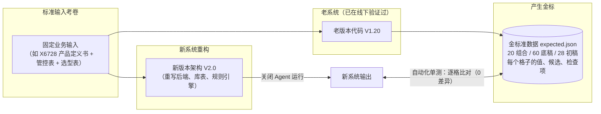

# 什么是金标？为什么重构 Agent 与复杂业务系统必须先立金标

> 在复杂业务系统和 AI Agent 的重构与开发中，有一个让所有程序员和 PM 都会抓狂的经典场景：
> **代码重构写完了，架构变优雅了，微服务也搭好了，但你怎么证明新系统算出来的业务结果跟老系统完全一样？**

靠人肉对比几十张几千行的 Excel？靠去问业务专家“你看这个料选得对不对”？
只要业务体量稍微大一点，人工核对就会瞬间崩溃，不仅耗时耗力，而且任何一处看漏都会直接酿成线上事故。

为了彻底解决这个问题，软件工程里诞生了一个非常坚实的概念——**金标（Golden Master / Golden Fixture，金标准夹具）**。

---

## 1. 什么是“金标”？用大白话打个比方

金标，英文通常叫 **Golden Master** 或 **Golden Fixture**。

如果用大白话来打比方，它就是**高考试卷的“标准参考答案”**，或者**度量衡里的“国际千克原器”**：



* **输入同一份考卷**：比如真实项目 X6728 的输入三件套（产品定义书、管控物料表、选型模板）。
* **让老系统考一次**：老系统（如 V1.20）虽然架构可能很乱、代码可能很糙，但它的业务计算结果是在一线被业务实际认可、跑通了的。
* **把它的答题卡完整封存起来**：老系统算出了哪些组合、选了哪些备选物料、哪个格子填了什么文本、弹出了哪些校验警告，**一字不差地序列化成一份确定性的 JSON 文件**。这份静态文件，就叫**金标**。
* **新系统的判卷依据**：以后新系统（V2.0）无论如何重写、如何重构，只要把同样的考卷丢进去，算出的答案拿来和这份金标逐个格子比对：
  * **完全吻合** $\rightarrow$ 重构成功，业务逻辑分毫不差；
  * **错了一个格子** $\rightarrow$ 新代码写出了 Bug，或者规则被意外改偏了。

---

## 2. 为什么复杂系统重构，第一步必须是“立金标”？

很多团队做重构容易犯一个错误：拿到需求立刻开始建新库、画新前端、写新接口，等最后写完要联调上线了，才发现新老系统的输出怎么对都对不上。

为什么复杂业务重构必须“**工单01先立金标**”？

### ① 业务特例太多，没有一个人能记住全貌
像手机试产搭配这种复杂的硬件工程系统，里面充斥着海量的隐式业务约定：
- *“二三供的频段怎么轮转？”*
- *“主板和派生机型共用料怎么回退？”*
- *“内存 GB 字段有别名怎么归一？”*

这些逻辑散落在老代码的各个 if-else 甚至注释里。如果你试图靠读文档、重新人肉理解去实现，必然漏掉几十个边界特例。
**老系统的运行输出，本身就是最完整、最真实的业务知识库。** 把它的输出冻结成金标，就等于把所有特例一网打尽。

### ② 把“口径争议”提前拆除
现实业务中，老系统算出来的东西往往还和人工手工整理的表有微小的口径差异（比如历史 PR1-3 阶段人工填错了 8 处）。
如果不立金标，后续测试时大家就会在这 8 处地方反反复复吵架：“*为什么新系统算的跟人工表不一样？是谁的错？*”
立金标时，我们同时跑出一份对账报告，**白纸黑字把这 8 处差异定性为‘已知人工历史偏差’**。以后谁也不用再为这 8 处纠结，界限清晰明了。

### ③ 为 AI Agent 提供不可动摇的规则底座
在 V2.0 中，我们引入了大模型 Agent 来做智能删减、智能选区。
**但 AI 是漂移的，规则是确定的。**
如果我们连底层纯规则引擎算出来的格子对不对都无法保证，AI 在上面做决策就等于在沙滩上建大厦——它只会在错误的底子上“一本正经地胡说八道”。
有了金标，我们只需**关闭 Agent 跑纯规则模式**，确保底层规则引擎与金标 100% 逐格一致，才能放心地把上层决策交给 AI。

---

## 3. 怎样才能生产出一份“合格的金标”？

生产金标看起来只是“跑一遍存个 JSON”，但要让它真正成为合格的工业级基准，有几个极其讲究的门道：

| 关键原则 | 为什么这么做？ | 怎么落地？ |
| :--- | :--- | :--- |
| **1. 零侵入老代码** | 如果提取基准时改动了老代码，基准本身就失去公信力了。 | 脚本通过 `sys.path.insert` 只读挂载老系统源码，不改动老系统任何一个字符。 |
| **2. 必须走 Web 真实路径** | 老工程常有 CLI 脚本和 Web 工作台两套逻辑，CLI 往往年久失修。 | 严格调用 Web 核心流程（`generate → initial_state → evaluate`），只抓取 PM 真正看到的数据。 |
| **3. 杀掉所有易变字段（100% 幂等）** | 时间戳（`2026-10-13 16:00:00`）、随机 UUID、机器绝对路径会随时间变化。 | 在保存 JSON 前彻底剔除生成时间和临时路径，并用 `sort_keys=True` 锁死键顺序。 |
| **4. 自校验（连续跑两次 比对字节流）** | 万一漏删了某个时间戳怎么办？ | 脚本内部连续执行两次生成，**逐字节比较两次生成的二进制流**；只要差一个字节，直接报错中断，绝不把有毒的夹具写进仓库。 |
| **5. 输入指纹可溯源** | 别人怎么知道你是用哪几份文件跑出来的？ | 在夹具元数据中完整记录三份输入文件、关键源码、profile 的 **SHA-256 哈希值**。 |

---

## 4. 金标在日常开发中怎么用？

金标生成后，会安静地躺在测试夹具目录中（例如 `tests/fixtures/golden/x6728/expected.json`）。

在后续几周的迭代中，它会变成开发人员最可靠的“护身符”：

```bash
# 每次修改了解析代码、映射表或重写了引擎之后，运行测试：
uv run pytest tests/test_golden_fixture.py
```

终端一敲回车，0.06 秒内：
1. 组合数量是不是依然等于 20？（通过 ✅）
2. 展开候选底稿是不是依然等于 60？（通过 ✅）
3. 默认收敛初稿是不是依然精确等于 28（一供 20，二供 4，三供 4）？（通过 ✅）
4. 每块料的每个字段候选列表是不是完全吻合？（通过 ✅）

**全绿，你就可以吹着口哨提交代码；一旦飘红，断言会精确告诉你第几块板的哪个字段和老版本对不上了。**

---

## 5. 总结

* **什么是金标？** 老系统在标准输入下跑出来的**全量确定性标准答案快照**。
* **为什么要做？** 杜绝人肉对账，防止重构走样，为 AI Agent 提供坚不可摧的确定性地基。
* **核心价值：** 它把主观的“*我觉得重构得差不多了*”，变成了客观的、可以用机器一键验证的“**0 差异，100% 逐格吻合**”。
