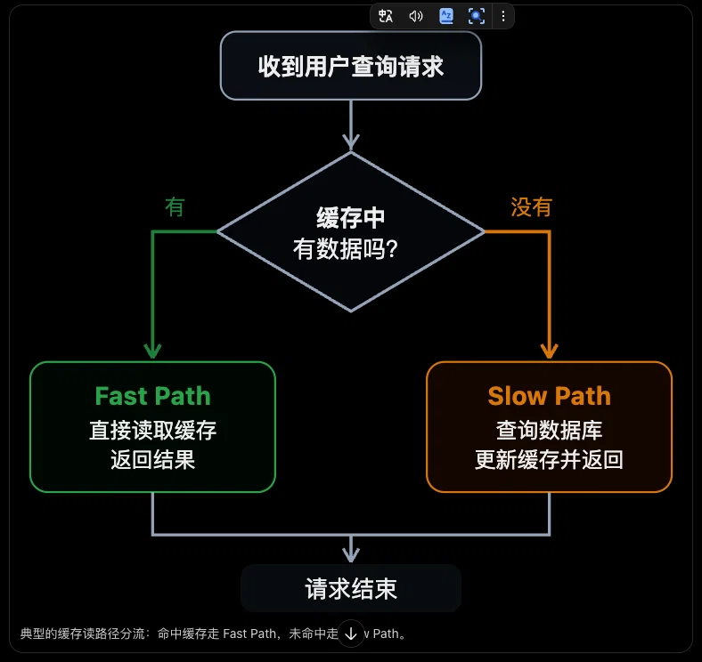
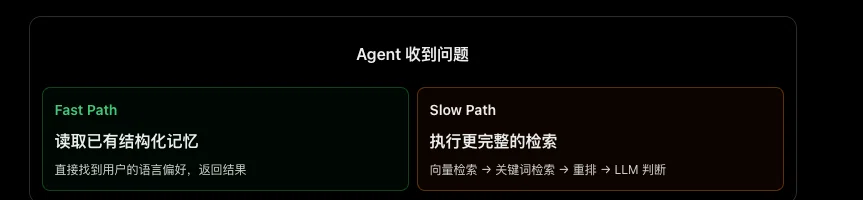

# 快慢路径

## 一句话定义

同一个请求，先用**一次极廉价的确定性检查**问「这个请求的答案我是不是已经知道了」；知道就直接给（**Fast Path**），不知道才付完整成本（**Slow Path**），并且把这次的结果存回去，让下一次能走快路。它省下的不是「一点时间」，是**整段最贵处理**——一次模型调用、一次全库扫描、一次完整规划。

## 为什么会有两条路

任何系统里，处理的成本分布都是极不均匀的：少数请求需要完整推理，多数请求的答案**其实早就算过、或能用一个更钝的信号定下来**。但代码如果只有一条路，那所有请求都只能排同一条队，付同一个价钱。

Fast / Slow Path 干的事，就是把这条队劈成两条，并在岔口立一个**门禁**（gate）：门禁只回答一个是非题，答「是」走便宜的，答「否」走贵的。

这个思想不是缓存发明的，它在计算机系统里反复出现，每次换一层皮：

- **CPU 分支预测 / 微架构 fast path**：命中就是几个 cycle，错了才付 flush 的代价
- **网络栈**：常见协议走快路径实现，罕见组合退回慢路径
- **文件系统**：dentry 缓存在内存里，命中不用碰磁盘
- **数据库**：索引命中 vs 全表扫描
- **Web 服务**：CDN / 本地缓存命中 vs 回源
- **Agent**：记忆直读 vs 检索 + 重排 + LLM 判断

同一条思路，所以值得单独成一页——**它的收益模型和风险模型在所有层都一样**，只有「门禁查什么」在变。

## 图一：分流长什么样（缓存这一层）

逐格拆这张图，它其实是**四要素的最小完整形状**：

| 图中位置 | 要素 | 作用 |
|---|---|---|
| 最上方「收到用户查询请求」 | 入口 | 所有请求都必须先经过分流点，不能有绕过去的支路 |
| 菱形「缓存中有数据吗」 | **门禁（gate）** | 唯一的是非题，也是最容易写错的地方 |
| 左侧绿色「直接读取缓存返回结果」 | **快路径动作** | 一次内存读，零外部 IO |
| 右侧橙色「查询数据库 / 更新缓存并返回」 | **慢路径动作 + 回填** | 完整成本，**并且把结果写回去** |
| 两条线汇合到「请求结束」 | 出口同构 | 调用方不需要知道走了哪条 |

**这张图最容易被忽略的是橙色框里的第二行——「更新缓存」**。它不是顺手优化，是让设计**收敛**的那一步：第一次请求必然走慢路径，回填之后第二次就走快路径。没有回填，快路径永远是冷启动，收益为零。所以判一个快慢路径实现是否完整，看它有没有回填，比看它快多少更准。

## 一个请求在两条路上分别做了什么

| 维度 | Fast Path | Slow Path |
|---|---|---|
| 判断依据 | 一次确定性检查：缓存命中 / 规则或关键词 / 状态查询 / 白名单 | 向量检索 + 关键词检索 + 重排 + LLM 判断 / 完整规划 |
| 调不调模型 | 不调（最多一次 embedding） | 调，一次到多次 |
| 延迟量级 | 微秒～毫秒（本仓 L0/L1 目标 < 50ms） | 数百 ms～数 s（本仓路由单轮 5~8s） |
| 单位成本 | 一次内存或索引查询 | 一次完整推理 / 一次全库扫描 |
| 覆盖率 | 只覆盖「门禁答是」的那部分流量 | 兜住其余全部 |
| 判错的表现 | **不报错**，给一个看起来正常的错结果 | 报错 / 超时 / 低于阈值，监控抓得到 |
| 谁决定走哪条 | 上游检查代码；改规则即改行为 | 模型；改提示词即改行为 |

## 图二：同一结构搬到 Agent 记忆上

同样是两条路，但「门禁查什么」换了：

| | 图一（缓存） | 图二（Agent Memory） |
|---|---|---|
| 门禁 | key 在不在缓存里 | 记忆库里有没有一条**结构化事实**已经能回答这个问题（例：用户的语言偏好） |
| 快路径动作 | 读值返回 | 读结构体，直接拼进回复 |
| 慢路径动作 | 查库 + 回填 | 向量检索 → 关键词检索 → 重排 → LLM 判断，四段串联 |
| 回填什么 | 原始值 | 从这次回答里抽出的**结构化记忆**（下次可直接命中） |

图二这版更值得注意的一点：**快慢两路查的不是同一份存储**。快路径读的是「已经被人（或上一次抽取）结构化过的偏好表」，慢路径读的是「原始语料里的向量与关键词」。这是它与图一的关键差别，也是它更容易判错的原因——**门禁查「有没有对应条目」，而正确性要求「这条目是否仍然适用于当前问题」**，后者门禁答不了。

所以图二这类设计是**可选架构**，不是标配：它成立的隐含前提是「结构化记忆与当前问题之间没有语义错位」。这个前提在本仓没有实现也没有验证（见「待澄清」）。

## 怎么判断该不该有快路径

**判据一：门禁是不是比慢路径便宜一个数量级。** 如果为了判断「要不要走慢路径」你要先做一次向量检索，那分流本身就是新的慢路径——**白白多一跳**。门禁的预算必须小到「答错了也不心疼」。

**判据二：快慢两路看的信号是不是同源。**

| 实例 | 快路看什么 | 慢路看什么 | 同源？ |
|---|---|---|---|
| 缓存读 | `get` 的 key | 同一条 SQL 的 `WHERE` 条件 | 同源 → 等价，只省时间 |
| 意图识别 L0/L1 | 关键词 / 正则是否出现 | 业务对象是否齐备、动作是否覆盖 | **不同源** → 必然存在结论相反的一类输入 |
| SSE 订阅快路径 | 任务状态是否终态 | 队列里最后一条消息 | 同一权威源 → 同源 |
| 路由直通（已订阅事件） | `ActiveAgentRecord` 存在且未过期 | Router 的「这条事件归谁」 | 不同源 → 会错，但下一轮 Router 能纠 |

**判据三：判错能不能被下一轮纠正。** 这条决定门禁该多松。

- **可纠正**：路由直通判错 → 下一轮 Router 重新派发，用户多等一轮。门禁可以松，换来实测收益（Super-agent 去掉直通后：Router 决定耗时 +30%，读缓存 token 2323 万 → 3177 万，+37%）。
- **不可纠正**：缓存命中拿到脏值 → 到下次写才回正；SSE 快路径判错 → 终态永不推送，前端一直转圈；子智能体直跳丢历史 → 丢的信息这一轮回不来。

判据二与判据三**同时**指向「不同源 + 不可纠正」时，那条快路径不值得做。`thoughts/019` 就是这个结论的实证：直跳三条件（单意图 + `confidence=high` + 目标 Agent 在可直跳白名单）全满足，仍因跨 Agent 直跳会丢历史而**最终放弃直跳，优先信息完整性**——宁可多花一次改写。

## 判错的代价落在谁身上

| 实例 | 谁决定走哪条 | 代价落在哪 | 能否自我纠正 |
|---|---|---|---|
| 缓存读 | `get` 返回非 None | 客户端读脏值 | 否，等下次写删缓存 |
| 意图识别 L0/L1 | 正则命中 + 置信度阈值 | 请求进错子智能体 | 否，本轮回答跑偏 |
| SSE 订阅快路径 | 任务状态 == 终态 | 终态永不推送 | 否，用户只看到转圈 |
| 路由直通 | 票据存在且 TTL 未过期 | 多等一轮 | 是，下一轮 Router 纠正 |
| 子智能体直跳 | 单意图 + 高置信 + 白名单 | 丢历史，上下文不完整 | 否，信息不可追回 |

## 三个反直觉点

**一、快路径判错不报错。** 慢路径出错会抛异常、会超时、会被日志抓到；快路径出错只是「结果不太对」——缓存返回过期值、关键词命中但业务对象不齐、终态判断错导致漏推。**这三种失败在监控里全是 200。** 所以快路径的正确率几乎总是**未被测量**的量，风险定价被系统性低估。

**二、命中率决定一切，而不是单次省多少。** 收益 ≈ 命中率 × 单次成本差。命中率 5% 的快路径，哪怕单次省 10 倍，也只摊薄了不到一半的总成本，却引入了 100% 的判错面。上线后要看各条路的命中率分布，再把慢路径的流量往快路径搬——这是**持续调参**，不是一次性设计。

**三、拆快路径等于性能回归，不是清理死代码。** 直觉上「一次内存查表能省多少」，实测是 37% 的读缓存 token 与 30% 的决定耗时。正因为这个量级，删它之前必须先测。

**还有一个隐蔽的副作用：快路径会掩盖慢路径的质量问题。** 被 L1/L2 拦下的流量永远不进 L3，慢路径的准确率指标只覆盖剩下的部分；而廉价通道还会**偷走本该走慢路径的模糊请求**——`thoughts/018` 记的正是这个：引入 L1/L2 之后整体意图准确率**下降**，必须靠阈值与 fallback 修正。

## 我的实例

五处，都不叫「快慢路径」，是事后归纳出来的同一结构：

1. **SSE 订阅**（[[wiki/sources/agent-开发学习笔记|Agent 开发学习笔记]] §9）—— 客户端拿结果有四条路径：live 流（主）/ 快路径（订阅时任务已终态 → 不发队列、立即发一次 complete/error 并关闭）/ 轮询兜底 / error 事件。**这条快路径不是优化，是正确性补丁**：迟到或断线重连的订阅者如果照常进队列，会永远等一条已经发过的终态。
2. **意图识别 L0–L3**（[[wiki/concepts/意图识别分层]]）—— L0 规则 / L1 正则关键词 < 50ms 不调模型，L2 向量 < 100ms 只做 embedding，L3 LLM 兜底。硬约束是三层输出同构（同一个 `IntentRecognitionResult`），下游完全不知道这次是第几层判的——这是快路径能透明存在的前提。
3. **路由直通**（[[wiki/concepts/Super-agent双层架构]]）—— 过滤环节是 Fast Path（确定性代码）+ Slow Path（LLM 语义判断）；已订阅事件由程序直通 Worker，不经 Router，新任务才过 Router 冷启动。
4. **检索的三段漏斗**（[[wiki/sources/agent-开发学习笔记|Agent 开发学习笔记]] §17）—— 布尔倒排硬过滤 → 双塔向量粗排 → LLM 精排，同一结构换到检索语境。
5. **子智能体直跳的反例**（`thoughts/019` + §18）—— 满足三条件仍放弃，因为快路径丢的历史不在它自己的能力范围内。

另外，本仓 §16 的三重门禁（上下文时效 + 续跑意图 + 目标范围白名单）**没有一道检查「历史够不够」**，这正是它与 `thoughts/019` 结论相抵的地方，也是 §18 那类误路由的来源：门禁查的是「这次请求像不像续跑」，不是「这次续跑缺不缺东西」。

## 取舍与边界

- **不该加快路径的两个条件**：门禁信号与慢路径不同源，**且**判错不能被下一轮纠正。两条同时成立就必须走慢路径。
- **不是二分**：SSE 那条有四条路径，慢路径内部本身也分级。把「快 / 慢」当二分会把「降级」这一档丢掉。
- **维护成本会转移**：领域词表变一次，L1 正则就要跟着改；快路径越多，规则面越大，而规则面的正确性没有测试兜底。
- **门禁的失效必须显式设计**：缓存有 TTL，票据有过期与惰性淘汰，规则有版本。没有失效机制的快路径，就是「一次判对，永久判对」的假设——它在数据分布变化时安静地烂掉。

## 待澄清

- **缺定量判据**。现在只有「门禁成本量级」「信号同源性」「判错可纠正性」三条定性规则，**没有判错概率的估计方法**，也没拿快路径命中率对过账。
- **监控盲区无方案**。五处实例全部靠后几轮回答质量或用户报障发现判错，没有主动探针。
- **图二的 Agent Memory 分层是可选架构**（推断/示例）：本仓无此实现，它成立的隐含前提是「结构化记忆与当前问题之间没有语义错位」，这一条未验证，所以不能与五处实例并列当证据。
- **通用 fast / slow path 的权威定义本仓没有落盘**。本页定义是从图一图二与五处实例反推的，不是引用某个外部来源；若以后要对外引用，需要先补一份来源页。

## 证据

- 两张配图：`images/ai/fast-path-slow-path-cache.png`（缓存分流，用户提供）、`images/ai/fast-path-slow-path-agent-memory.png`（Agent Memory 双通路，用户提供）
- [[wiki/sources/agent-开发学习笔记|Agent 开发学习笔记]] §「16. 快速路由到子智能体（Fast Continuation）：双轨架构、三重门禁与惰性淘汰设计」（术语对齐段）、§「9. SSE 实时推送设计」（四路径表）、§「17. …瀑布级联短路」（L0–L3）、§「18. 从确认文本到差旅申请：动作与对象不能被背景酒店关键词抢路由」
- [[wiki/sources/thoughts-路由与智能体协作]] —— `thoughts/019`（直跳三条件、三方案对比、最终放弃）与 `thoughts/027`
- [[wiki/sources/thoughts-意图识别三层]] —— `thoughts/018`（引入 L1/L2 后准确率下降）
- [[wiki/sources/super-agent双层架构]] —— 过滤与路由两行的实测数字
- [[wiki/concepts/旁路缓存]]、[[wiki/concepts/意图识别分层]]、[[wiki/concepts/Super-agent双层架构]]、[[wiki/concepts/SSE流式推送]] 四页的「关键机制」段

## 相关页面

四个实例各自的页面：[[wiki/concepts/旁路缓存]]（缓存与 DB 谁当权威）、[[wiki/concepts/意图识别分层]]（L0–L3 流水线）、[[wiki/concepts/Super-agent双层架构]]（Trigger 两级过滤与订阅直通）、[[wiki/concepts/SSE流式推送]]（终态查询与四路径）。
相邻概念：[[wiki/concepts/Plan-Execute]]（慢路径内部的组织方式）。
已建档 source 页：[[wiki/sources/agent-开发学习笔记]]、[[wiki/sources/thoughts-路由与智能体协作]]、[[wiki/sources/super-agent双层架构]]。
