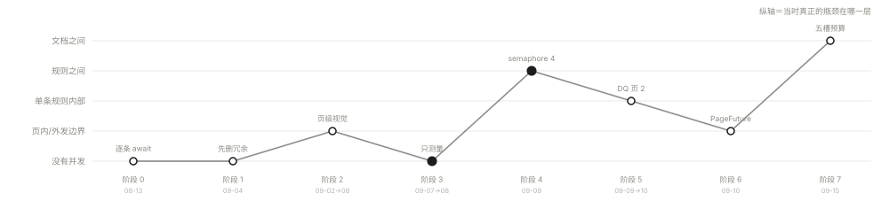
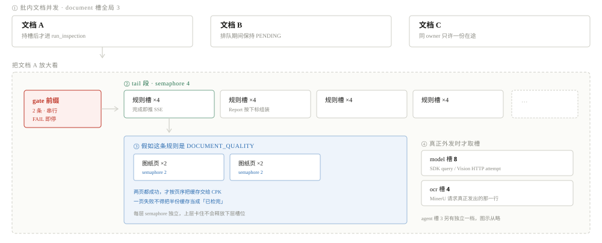
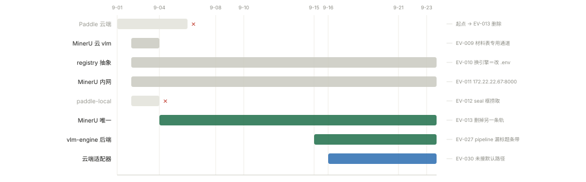
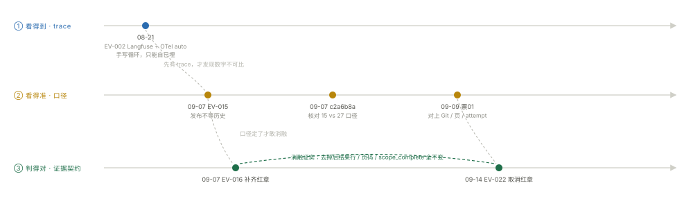

# 业务设计

图解：[letter-auto 架构、规则编排与并发演进](output/letter-auto-architecture.html)（浏览器打开：检测流水线五段 → 五个载体的边界 → 22 条规则定序 → 七步并发演进与瓶颈迁移 → 嵌套资源槽 → 六次 OCR 引擎切换 → 观测三条线；四张分节图同时内嵌在下方对应章节）

## 一句话说清这门业务

拿一份供应商发来的承认书 PDF，按模板执行 22 条规则，输出一份能定位到页码和证据的检测报告。

这件事的难点不在"把 PDF 读出来"，而在**判定必须可核对**。品质工程师拿到报告，要能回答：这条 FAIL 是在哪一页、哪个区域、依据什么看到的。所以整套设计围绕一件事展开——**证据和判定分离**。模型只负责看一眼 PDF 里的某个事实，什么算通过写在 Python 里。

## 四种状态，不是三种

业务上只认 PASS / FAIL 是不够的。一份扫描件糊到看不清，判 FAIL 是错的——那不是供应商不合格，是我们没取到证。所以规则层面有四种状态：

| 状态 | 含义 | 谁来判 |
|---|---|---|
| PASS | 取到证，且符合口径 | judge |
| FAIL | 取到证，且不符合口径 | judge |
| INCONCLUSIVE | 取到证，但证据不足以定论 | judge |
| NOT_CHECKED | 没取到证（通道缺失、超时、页面不可读） | 运行时不生成结果 |

后两种不是"失败"，是**取证的边界**。把它们和 FAIL 混在一起，是这类检测系统最容易犯的错——报告会呈现出"大量不合格"，而实际是"大量没看清"。

## 检测对象只有三种形态

承认书里的页，按证据来源分三类，对应三条取证通道：

- **原生 PDF 文字层**（NATIVE）：直接读，最便宜
- **扫描件**（OCR）：送 MinerU 出结构化事实
- **图纸 / 印章 / 签字**（VISION）：渲染成图交给视觉模型

Probe 声明自己最多能用哪些通道，Rule 声明业务上允许哪些通道，实际可用取交集。一条规则禁止视觉，那就不是"拒绝调用"，而是视觉工具在它的 toolkit 里根本不存在。

## 规则怎么排

22 条规则写死在 `_RULE_ORDER` 里，顺序本身就是语义：

- 前两条查料号（文件名、全文一致性）
- 第三条是封面模板身份，**gate**，不匹配就停
- 之后全部可并行

整个系统只有两个 gate：文件名料号（前置于循环）和封面身份（`gate=True`）。显式的 happens-before 只有一条——图纸关键标记必须等文档质量写完缓存。

这个设计有个容易被忽略的地方：**执行顺序和呈现顺序是两个概念**。SSE 是每条规则一完成就推，用户看到的是完成顺序；Report 按 `_RULE_ORDER` 下标回填，输出顺序恒定。前者要快，后者要稳。

模板（Profile）只装两样东西：规则名单，和该模板的具体参数（必备章节、章目标页、签字角色、阈值）。现在有 8 个模板。加一个模板不需要改代码。

## 判定边界：什么算通过

规则细节散在 Evolution 节点里，这里只记三条反复出现的原则。

**一、观察和判断分开。** 模型只答"看见了什么"，页码由 Python 注入。让模型自己填页码，它会编。

**二、缺失不等于不存在。** 材料表没找到，和材料表存在但读不清，是两个不同的结论，对应不同的 reason_code。

**三、判定不碰 IO。** judge 的签名只有 `(Evidence, TemplateParams)`，不接触 PDF、不接触模型。这条保证了判定可以被离线单测穷举。

## agent runtime：一层很薄的适配层

系统里有三种取证器，同一个签名，代价递增：

| 实现 | 数量 | 用在哪 |
|---|---|---|
| LocalProbe | 7 | 文件名、页码、章节索引、章节完整性、全穴覆盖、BOM |
| ExtractProbe | 11 | 封面身份、签字、报告表、图纸概览、全尺寸、颜色、材料表、印章 |
| AgentProbe | 2 | CPK 校验、可靠性报告 |

22 条规则里只有 2 条用真正的 agent loop。这个比例是刻意压的——步数能事先确定的，就不该交给模型。

AgentProbe 走 Claude Agent SDK 的 `query()`，配置上有几个刻意的选择：内置工具全部移除、只保留一个 in-process MCP server、`strict_mcp_config=True`、`setting_sources=[]` 隔离本机配置、最终输出用 JSON Schema 强约束。工具按通道注册，白名单之外的工具根本不存在。

ExtractProbe 更简单：没有 MCP server，模型拿不到任何工具，读完一段文本或一张图就出 JSON。但它的输入装配比 AgentProbe 复杂——Python 先缩小范围、定页码、算 bbox，再决定给模型看什么。视觉 Probe 有一道硬性检查：没拿到图片就报错，**不允许悄悄降级成文本任务**。那样会产出看起来合理、实际没看图的结论。

三条路（SDK、SDK + 图像、httpx 直连）最后都过同一套输出契约。这部分是这层里最值钱的东西：

**网关会把模型输出包装一层。** 生产里出现过的键名有 `_raw`、`arguments`、`evidence`，按键名白名单只能覆盖一半。所以改用结构判据：顶层只有一个键、且与证据模型字段集完全不相交、且内层能归一成命中字段集的 dict 才解包。解包必须打日志，因为"包装"本身就是模型跑偏的信号。

**空输出不能静默接受。** 模型返回 `{}` 时，pydantic 会全字段取默认值——一个"没看到标记"的 FAIL 就这么产生了。所以空对象一律重试，提示词里明确要求"即使没找到，也要输出 `marks_found=false`"。

**输出与 schema 字段集完全不相交时直接失败。** 这条是 BUG-014 的产物，不检查的话默认值会把取证失败伪装成业务结论。

**SDK 会话内的重试要分类计数。** CLI 对结构化输出做本地校验，失败会返回 `tool_result(is_error=True)` 并在会话内重试。两类失败修法相反：JSON 写坏了，载荷被整份丢弃，Python 永远看不到；JSON 合法但不符合 schema，Python 能收到。只看 turn 数分不开，所以分开计数写进 trace。

## 并发：不是一路加，中间有两次反向

现在是四层嵌套：规则级并行 4、DQ 图纸页 2、印章区域 2、五种全局资源槽（document 3 / model 8 / agent 3 / ocr 4 / upload 2）、批内文档 3。

值得记的不是这些数字，是这条线怎么走过来的。两次反向着实关键：

**第一次是删冗余。** 在谈并行之前，先删掉了材料表的第二次 OCR 提交、删掉了 Paddle 双轨。少打一次 OCR，比把两次并发起来确定得多。

**第二次是先建基线。** 票09 做了一次冷缓存 A/B，结果是 BELOW_TARGET 1.259——基线没达标，但照发。正因为有它，后面票10 的 0.584× 才有口径可比。

之后每次优化都在做同一件事：把瓶颈往下推一层，然后撞到下一层的墙。规则并行之后，最慢的不再是"规则排队"，而是单条最慢的规则；所以接着做 DQ 页并发、做共享 OCR Session；再往后才轮到文档之间的并发。

三个反复出现的"不做什么"也值得记：不把规则槽位从 4 调到 8；不把全尺寸的页并发当成文档质量的页并发；不拿 12 份封面的实验结论当完整容量。上面所有数字都是代码默认值，不是线上实测容量。

## OCR 引擎：接口没动过，实现换了六次

真正稳定的只有 `OcrProvider` 这一层。底下换过：Paddle 云端 → MinerU 云（材料表专用通道）→ registry 抽象 → MinerU 内网 → paddle-local → MinerU 唯一 → vlm-engine 后端 → 云端适配器。

两次判断被自己推翻：EV-009 的"MinerU 只做材料表通道"被 EV-013 扩成唯一引擎；EV-012 花力气接的 paddle-local 两天后被整个删掉。推翻不等于否定——每一步的实测数据都变成了下一次的判断依据。

最危险的一次是 EV-027。pipeline 后端漏掉页面顶部标题条带，但章节完整性因为目录列全了照样 PASS，导致整块材料宣告检查静默跳过，报告上看不到任何失败。取证失败没有被伪装成 PASS，而是被伪装成"这条规则不存在"。

沉淀下来的判据是四条：引擎选型靠消融不靠文档；换引擎必须是配置动作；缓存 key 必须含引擎身份；删掉旧实现后回滚只能靠制品，不能靠开关。

## 观测：三条独立的线

这三件事经常被混为一谈：

**看得到（trace）** —— Langfuse + OTel。因为 agent runtime 是手写的 tool_use 循环，压根不走 SDK 自动埋点，所以只能自己埋。auto 层 hook `messages.create()`，手动层埋业务结构 span。

**看得准（口径）** —— 有 trace 不等于能解释。成功检测要能对上 Git / 页 / attempt / 重试，否则只能猜旧 trace；测基线前先核对口径（15 vs 27），否则两个数字根本没法比。

**判得对（证据契约）** —— 可靠性报告的红章要求从"必须有"改成"不要"，靠的是消融实验：去掉后结果行、页码引用、范围完整性全都不变，那它就该删。

三者任缺一个，另外两个的结论都会被误读。

## 这套设计的取舍

**换来的**：加一条规则只改一处；换成证策略不动 judge；判定可以离线穷举；报告里每个结论都能追到页码和证据。

**付掉的**：模型调用这一层比想象中厚——包装解包、空输出重试、字段集相交检查、重试分类计数，全是补丁，根因是网关和 SDK 的行为不完全可控。三条调用通道并存也是被代理现实逼出来的过渡态，理想是收敛成一条。

**没闭环的**：EV-023 阶段 5（真实 12 份 A/B、灰度与回退演练）还没做；云端 OCR 适配器未接生产默认路径，且契约锁退化（云端不返回 version）；结果发布不等待历史保存这条决策已确认但尚未实施。