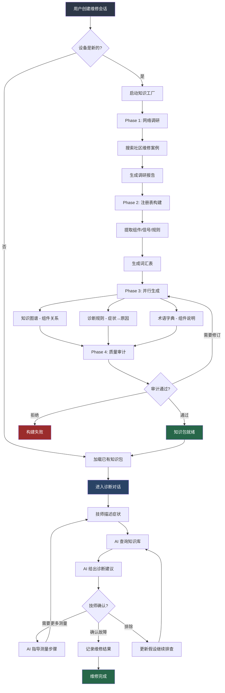
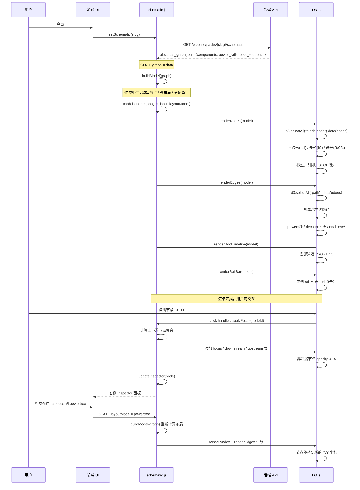
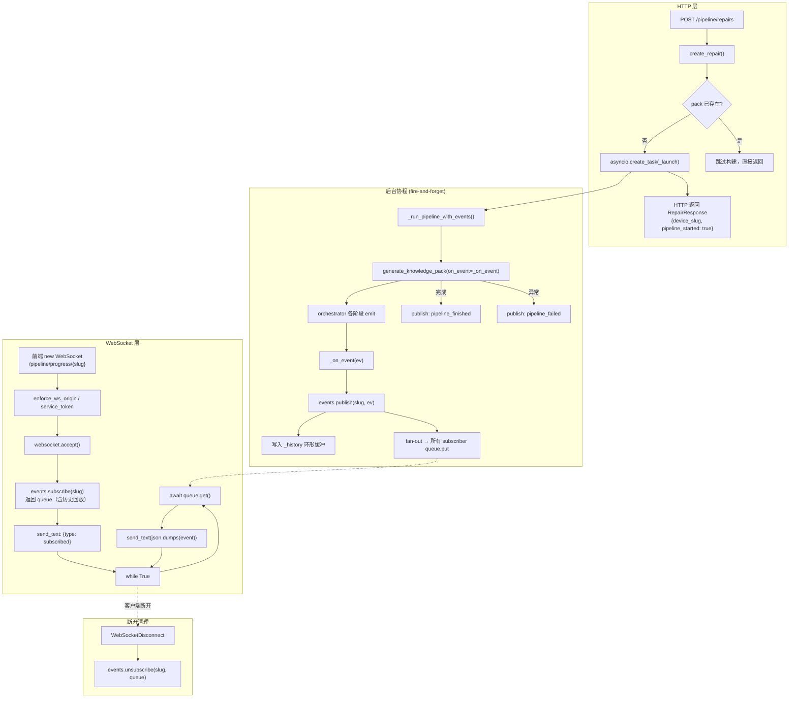
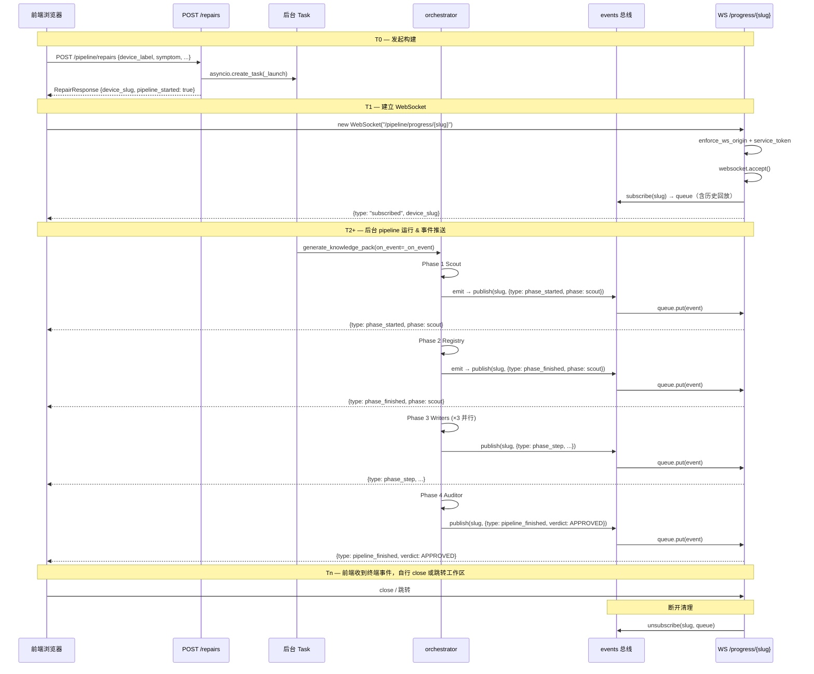

# 原理图与 EDIF 工作流

> 五篇合并：读懂 EDF → EDIF JSON 瘦身 → PDF Drawing Diff → 原理图 AI 评审 → Wrench-Board（产品/提取/通信 + 防幻觉双层防御）。飞书内链图片 URL 原样保留。

---

## 一、读懂 EDF / EDIF 原理图

> **文件来源**：`UTAH_MB_SCH_V1_EDF`.EDF（内容为 EDIF 2.0.0 格式）  
> **适用读者**：硬件初级工程师、跨岗位工程师（软件 / 测试 / 产品）  
> **阅读目标**：能看懂这套原理图"在说什么"、"怎么组织"、"各页之间怎么连"  

---

## 目录

1. 这份文件到底是什么？
2. 第一关：EDIF 专业术语解释
3. 第二关：硬件电路专业术语解释
4. 整体系统架构——手机主板的"地图"
5. 42 页目录与功能分区详解
6. 原理图符号设计——图上画的那些东西是什么
7. 关键芯片引脚说明
8. 各页之间的关系——信号如何跨页流动
9. 附录：术语速查卡片

---

## 1. 这份文件到底是什么？


### 1.1 先消除最大的误解

拿到 `UTAH_MB_SCH_V1_EDF.EDF` 这个文件，很多人会以为它是一篇普通的说明文档（因为后缀是 `.EDF`）。  
**但它根本不是文档——它是一张电路图的"数字底稿"。**

把它想象成这样：

```Plain Text
建筑图纸  →  CAD 软件  →  导出 .dwg 文件
手机电路图 →  OrCAD 软件 →  导出 EDIF 文件
```

这个文件是用 **OrCAD Capture**（业界主流电路图设计软件）画好电路图之后，通过 `cap2edif` 工具导出的**交换格式文件**。它记录了：

- 图上放了哪些芯片、电阻、电容
- 这些元件之间用什么线连接
- 每根线叫什么名字
- 图被分成了多少页，每页叫什么

> **一句话总结**：这不是给人"读"的文章，而是给 EDA 软件"解析"的电路数据。  
> 但只要掌握结构，人也完全可以从中读出完整的系统设计信息。

### 1.2 文件的基本体量

<sheet sheet-id="RbXL9x" token="DhfZstRQxhzozWtrpyucX7ZNnwh"></sheet>

---

## 2. 第一关：EDIF 专业术语解释

EDIF（Electronic Design Interchange Format，电子设计交换格式）是一套国际标准，用来在不同 EDA 工具之间传递电路图数据。

下面逐一解释文件里最常出现的术语。


---

### 2.1 `edif` — 根对象

```Plain Text
(edif D__TEST_SCH_0416_EDIF_UTAH_MB_SCH_V1_EDF
  (edifVersion 2 0 0)
  ...
)
```

**白话**：整个文件的"大括号"，相当于 JSON 的最外层 `{}`。  
`edifVersion 2 0 0` 表示使用的是 EDIF 版本 2.0.0。

---

### 2.2 `library` — 元件符号库

**白话**：图纸里放的每一个芯片符号、电阻符号、连接器符号，都来自某个"符号库"。  
`library` 就是这些符号的"仓库"。

这份文件共有 **69 个 library**，分为三类：

<sheet sheet-id="c90BsB" token="DhfZstRQxhzozWtrpyucX7ZNnwh"></sheet>

---

### 2.3 `cell` — 单元定义

**白话**：library 里的每一个"零件模板"就叫 cell。  
比如 `CPU_MTK_MT6835G` 是一个 cell，定义了这颗 CPU 芯片长什么样（引脚名、形状）。

> 类比：cell 就像 Word 里的"样式模板"，定义好了格式但还没放到文档里。

---

### 2.4 `view` — 视图

**白话**：同一个 cell 可以有不同的"展示方式"。  
在原理图里，view 通常是 `SCHEMATIC`（原理图视图）或 `GRAPHIC`（图形视图）。

---

### 2.5 `instance` — 元件实例

**白话**：把某个 cell 实际"放到图上"，就产生了一个 instance（实例）。  
例如：图上放了两颗同款内存颗粒，就有两个 instance，但它们引用同一个 cell 定义。

这份文件有 **2,118 个实例**，包含：

- 芯片（U 开头，如 `U1000`）
- 电阻（R 开头，如 `R3724`）  
- 电容（C 开头，如 `C5409`）
- 连接器（J 开头，如 `J5401`）
- 电感、二极管、开关等

---

### 2.6 `designator` — 位号（件号）

**白话**：图上每个元件的"身份证号码"，用于在 BOM 料单、PCB 板子上精确对应。

<sheet sheet-id="RXLJW5" token="DhfZstRQxhzozWtrpyucX7ZNnwh"></sheet>

---

### 2.7 `net` — 网络（连线）

**白话**：原理图上连接各个引脚的"电线"叫 net（网络）。  
每条 net 都有一个名字，如 `DVDD_CORE`（数字核心电源）、`GND`（地）、`&33W_CHG_INT`（33W 充电中断信号）。net 是同一个电气节点，不一定是肉眼看到的一根连续线。

**常见规律**：

- 名字以 `VDD`、`DVDD`、`AVDD` 开头 → 通常是**电源线**
- 名字以 `GND`、`AGND` 开头 → **地线**
- 其他名字 → **信号线**（数据、控制、中断等）

这份文件有 **1,604 个网络**。

---

### 2.8 `page` — 逻辑页面

**白话**：一套完整的电路图通常很大，无法放在一页上，因此拆成多页。  
每个 `page` 就是一张"分图"，相当于一本书的一个章节。

这份文件有 **42 个 page**，每页负责一个功能模块（如 CPU 供电、充电电路、射频前端…）。

---

### 2.9 `offPageConnector` — 跨页连接点

**白话**：当一个信号需要从第 10 页传到第 37 页，就在两页各放一个"跨页连接器"，标上相同的网络名，表示它们在电气上是同一根线。

这份文件有 **724 个跨页连接点**——这意味着有大量信号在各页之间流动。

> 类比：跨页连接点就像书里的"见第 XX 页"引注——告诉你这根线的另一端在别的页上。

---

### 2.10 `libraryRef / cellRef / viewRef` — 三元引用

**白话**：每个实例放到图上时，都要说明"我来自哪个库、哪个单元、哪个视图"，这三个引用就是"出生证明"。

```Plain Text
instance U3700 来自：
  libraryRef = IC（器件库）
  cellRef    = POW_CHARGE_SC89890HQDLR（充电芯片的单元定义）
  viewRef    = SC89890HQDLR（对应视图）
```

---

### 2.11 `TitleBlock` — 标题框

**白话**：每页图纸右下角（或边框区域）显示的版本号、项目名、日期等信息块。  
这份文件混用了两套标题框模板：

- `TitleBlock0`：较早的通用模板
- `title_TINNO`：TINNO 公司自定义模板

这种不一致说明这套图纸**历经多次修改、可能从旧项目迁移而来**。

---

## 3. 第二关：硬件电路专业术语解释

理解完 EDIF 格式，再来看电路本身的核心概念。


---

### 3.1 SoC / 基带芯片 — MT6835

**SoC**（System on Chip，片上系统）是手机的"大脑"，把 CPU、GPU、基带、图像处理等功能全集成在一颗芯片里。

**MT6835** 是联发科（MediaTek）的 4G/5G 基带+应用处理器，这套图里的型号变体有：

<sheet sheet-id="QYPaJa" token="DhfZstRQxhzozWtrpyucX7ZNnwh"></sheet>

> **为什么拆成多个部分？** 一颗 SoC 有数百个引脚，放在一页上会密密麻麻看不清。OrCAD 支持把一个芯片拆成多个"part"分布在不同页，但逻辑上它们还是同一颗芯片。

---

### 3.2 PMIC — 电源管理芯片

**PMIC**（Power Management IC，电源管理集成电路）负责把电池或外部充电电压，转换成手机各模块需要的不同电压。

这套图里有两颗主要 PMIC：

<sheet sheet-id="hh2zGW" token="DhfZstRQxhzozWtrpyucX7ZNnwh"></sheet>

**BUCK（降压变换器）**：把高电压变成低电压，效率高，适合大电流场景（如 CPU 核心供电）。  
**LDO（低差压线性稳压器）**：输出噪声极低的干净电源，适合对噪声敏感的模拟电路（如射频、音频）。

---

### 3.3 DDR4X — 运行内存

**DDR4X**（Double Data Rate 4X）是手机的运行内存（RAM）。这套图里用了两颗：

- `DDR4_DIS_K4UBE3D4AB_MGCLA`
- `DDR4_DIS_K4UBE3D4AB_MGCLB`

> **类比**：DDR 内存就像桌面上的工作台——越大越能同时处理更多任务，但断电就没了。

---

### 3.4 UFS — 闪存存储

**UFS**（Universal Flash Storage，通用闪存存储）是手机的内部存储（相当于电脑的固态硬盘 SSD）。  
这套图里用的是 `MEM_UFS_YMUS6A4TB1A2C1`。

> **类比**：UFS 就像抽屉——数据长期存放，断电不丢。

---

### 3.5 PA / LNA — 射频放大器

<sheet sheet-id="W72h7C" token="DhfZstRQxhzozWtrpyucX7ZNnwh"></sheet>

这套图里 PA 覆盖了 Sub-6GHz 全频段（低频/中频/高频），型号如 `FX5627S`、`FX5627Z`。

---

### 3.6 FEM — 射频前端模块

**FEM**（Front-End Module，前端模块）把 PA、LNA、开关、滤波器等多个射频器件集成在一个封装里。  
这套图里 Wi-Fi FEM 用的是 `RF_FEM_RTC66202` 和 `RF_FEM_RTC7637S`。

---

### 3.7 NFC — 近场通信

**NFC**（Near Field Communication）是手机支付、门禁、碰碰传文件等功能的无线通信技术。  
这套图里用的是恩智浦（NXP）的 `RF_NFC_SN220E`。

---

### 3.8 OVP — 过压保护

**OVP**（Over Voltage Protection）在充电口检测到异常高压时切断电路，保护手机不被烧坏。  
这套图里充电保护芯片 `POW_OVP_AW32905FCR` 就是做这个的。

---

### 3.9 SAR — 比吸收率感知

**SAR**（Specific Absorption Rate，比吸收率）是衡量手机射频对人体辐射量的指标。  
SAR 感知芯片（如 `SENSOR_SAR_SX9375IULTRT`）实时检测手是否靠近天线，若靠近则主动降低发射功率。

---

### 3.10 BTB / FPC — 连接器类型

<sheet sheet-id="twN6AK" token="DhfZstRQxhzozWtrpyucX7ZNnwh"></sheet>

---

### 3.11 ESD — 静电保护

**ESD**（Electrostatic Discharge，静电放电）防护器件用来保护芯片引脚不被人体静电击穿。  
通常以 TVS 二极管、ESD 阵列形式出现在各接口旁边。

---

## 4. 整体系统架构——手机主板的"地图"

下面这张图展示了 UTAH_MB 主板的整体功能分层架构：


<readonly-block type="isv"></readonly-block>

---

### 4.1 文件层级结构

EDIF 文件本身也有清晰的层次结构：

<readonly-block type="isv"></readonly-block>

---

## 5. 42 页目录与功能分区详解


### 5.1 功能域实例数量对比

<readonly-block type="isv"></readonly-block>

> **结论**：射频部分占了将近一半的元件数量——这说明手机通信性能的工程复杂度远超其他部分。

---

### 5.2 完整页面目录

<sheet sheet-id="AcdxZn" token="DhfZstRQxhzozWtrpyucX7ZNnwh"></sheet>

---

## 6. 原理图符号设计——图上画的那些东西是什么


### 6.1 符号的组成结构

原理图上每一个器件符号，都由以下几部分构成：

```Plain Text
┌─────────────────────────────────┐
│         器件符号外框（矩形）      │
│                                 │
│  ─[引脚线]─○  引脚名  引脚号    │  ← 左侧引脚
│                                 │
│  引脚名  引脚号  ○─[引脚线]─    │  ← 右侧引脚
│                                 │
│      U1000E                     │  ← 位号（designator）
│  CPU_MTK_MT6835                 │  ← 器件名（cellRef）
└─────────────────────────────────┘
```

<sheet sheet-id="VwCjPR" token="DhfZstRQxhzozWtrpyucX7ZNnwh"></sheet>

---

### 6.2 引脚的四种类型

在原理图符号里，引脚方向有四种，用来表达信号流向：

<sheet sheet-id="txnyVO" token="DhfZstRQxhzozWtrpyucX7ZNnwh"></sheet>

---

### 6.3 连接线的种类

<sheet sheet-id="t4ws5j" token="DhfZstRQxhzozWtrpyucX7ZNnwh"></sheet>

> **重要**：两条线交叉处**没有实心圆点**时，表示它们**不相连**，只是在图上看起来交叉了。  
> 必须有实心圆点（JUNCTION）才表示电气连接。

---

### 6.4 特殊图元说明

#### 电源符号

原理图里的电源不用画一根线从 PMIC 拉到每个用电器件（那样会乱成蜘蛛网），而是用**同名电源符号**表示相连：

```Plain Text
    VCC_1V8          VCC_1V8
       ▲                ▲
       │                │
    [芯片A]           [芯片B]
```

两个 `VCC_1V8` 符号在电气上是同一个网络，表示芯片 A 和芯片 B 都接到同一个 1.8V 电源。

常见电源网名规律：

<sheet sheet-id="RG11pR" token="DhfZstRQxhzozWtrpyucX7ZNnwh"></sheet>

#### 地符号

地符号（GND）通常是向下的三角形或三条横线，原理图里**所有 GND 符号都连在一起**，是整个电路的参考零电位。

---

## 7. 附录：术语速查卡片

### EDIF 格式术语

<sheet sheet-id="H0DVvA" token="DhfZstRQxhzozWtrpyucX7ZNnwh"></sheet>

### 硬件电路术语

<sheet sheet-id="7GsSVg" token="DhfZstRQxhzozWtrpyucX7ZNnwh"></sheet>

---
---
## 二、EDIF JSON 瘦身：343M → 22M

## 1. 结论先看


这次体积下降不是“压缩文件”带来的，而是 **数据组织方式重构** 带来的。


- 原始单文件 JSON：`334,442,618` bytes（约 319 MiB，习惯口径约 343M）
- 第一次改进后（V1 bundle）：`57,826,426` bytes（约 55 MiB）
- 第二次改进后（V2 hybrid bundle）：`24,417,823` bytes（约 23.29 MiB，工程口径常写 22\~23M）

整体缩减约 `92.7%`，且保持无损可逆。


---

## 2. 背景：为什么原始 JSON 会大

原始形态是一个超大对象数组，问题主要在三点：

1. 键名重复：每行都重复字段名（例如 `source_path`、`instance_id`）。
2. 路径字符串重复：同一 `source_path` 在多张表大量重复。
3. `RawNodes` 高占比：原始结构追踪字段（`node_path/parent_path/depth`）文本冗余高。

在 UTAH 样本里，单 `RawNodes.json` 就接近 30MB，是首要大头。

---

## 3. 两次改进做了什么

### 3.1改进一（343M -> 55M）：先把大麻袋整理成收纳架

#### 大白话策略

原来的 JSON 就像“把全屋东西塞进一个袋子”，每件物品都重复写一遍说明文字，当然会很大。

第一步做的是“先整理再存”：

1. 分片：一个大文件拆成很多小表（`manifest + sheets/*`）。
2. 列式：把“同类信息”竖着放在一起（`columns + data`）。
3. 字典编码：高频词改短编号（只有更省空间才启用）。
4. RawNodes 紧凑化：把长路径文字改成父子索引（`parent_idx`），还能反推回来。

核心效果：先解决“重复键名”和“重复文本”。


#### 对应代码位置

- 行转列：`_rows_to_columnar`
- 字典编码：`_try_dict_encode`
- RawNodes 紧凑化：`_rawnodes_to_compact`
- RawNodes 还原：`rebuild_rawnodes_full_paths`

---

### 3.2. 改进二（55M -> 22\~23M）：专治“最占空间的大头”

#### 大白话策略

第一步后虽然小了很多，但还有两个“大头”：

- `RawNodes` 文本太重
- `source_path` 长路径在多张表反复出现

第二步就专打这两点：

1. `RawNodes` 从 JSON 换成 Parquet（默认 `zstd`），同样内容更省空间。
2. 把 `source_path` 改成 `source_node_idx`（行号 ID），长地址改短门牌号。
3. 导出前清理 legacy `sheets/`，避免新旧文件混一起导致“看起来没变小”。

核心效果：继续无损，但把最大冗余砍掉。


#### 对应代码位置

- V2 导出入口：`export_full_edif_bundle`
- 路径改索引：`_replace_source_path_with_node_idx`
- 读取时还原路径：`_restore_source_path_from_node_idx`
- RawNodes 写 Parquet：`write_parquet_sheet(... RawNodes.parquet ...)`
- 清理旧目录：`for stale_dir in (out / "semantic", out / "raw", out / "sheets")`

---

## 4. 执行流程（命令视角）

### 第一步：跑导出

```Bash
cd /Users/shenmingjie/tinno/awesome-tinno-skills/domains/hardware/tinno-hw-edif-data-extractor/opt/anaconda3/envs/py311/bin/python3 -m scripts.schcompare_cli \  edif-export /Users/shenmingjie/tinno/hardware-diagram/UTAH_MB_SCH_V1.EDF \  -o /Users/shenmingjie/tinno/output/edf2excel/UTAH_MB_SCH_V1.xlsx \  --json /Users/shenmingjie/tinno/output/edf2excel/UTAH_MB_SCH_V1_bundle
```

### #第二步：看结果大小

- 原始 JSON：`334,442,618` bytes
- V1：`57,826,426` bytes
- V2：`24,417,823` bytes

总缩减：`92.70%`。

---

## 5. 本次样本验证数据（UTAH）

关键阶段尺寸：

- 原始单文件 JSON：`334,442,618` bytes
- V1 bundle：`57,826,426` bytes
- V2 bundle：`24,417,823` bytes

分阶段缩减率：

- 第一次改进（V0 -> V1）：`82.71%`
- 第二次改进（V1 -> V2）：`57.77%`
- 总体（V0 -> V2）：`92.70%`

V1 主要大头（旧）：

- `RawNodes.json`：`29,566,505` bytes
- `InstanceProperties.json`：`10,121,827` bytes
- `Displays.json`：`7,408,909` bytes
- `Geometry.json`：`6,148,626` bytes

V2 主要大头（新）：

- `raw/RawNodes.parquet`：`4,531,594` bytes
- `semantic/Displays.json`：`7,408,909` bytes
- `semantic/InstanceProperties.json`：`6,284,433` bytes
- `semantic/Geometry.json`：`2,301,157` bytes

说明：`Displays` 这类字段天然文本信息密度高，已是下一阶段可选优化点；但当前 22\~23M 的核心收益已经主要由两次结构性改造完成。

---

## 6. 一句话总结

这次不是“压缩算法魔法”，而是把数据从“重复文本堆积”重构为“可索引、可复用、可逆”的工程化存储：先列式与编码，再将最重表 Parquet 化并去掉跨表路径重复，因此在无损前提下实现了 `343M -> 22~23M`。
---
## 三、PDF Drawing Diff Skill

- 它输出的不是黑盒结论，而是可追溯的审查证据
- 它对 CLI 参数、环境变量和输出结构都做了规范化，适合重复执行

## 核心能力

- 差异具体落在哪个区域

这个 skill 的本质，不只是"比较两张图"，而是把图纸比对从一次临时动作，升级成一个可复用、可审计、可沉淀的审查流程。它特别适合工程文档、制造图纸、版本评审这类"既要发现差异，也要留下证据"的任务。

1. 合并 OCR 差异与视觉差异，绘制最终标注框

## 输出产物

- 多个 PDF 图纸版本比对
- OCR 文本差异核查

1. 对差异区域生成结论和说明

- `pipeline_annotated_timestamp.pdf`
- 它支持多个版本输入，但自动拆成 pairwise 结果，方便对比和归档

1. 如存在同名 DWG，则提取 DWG 字符串作为辅助线索

- 使用 GLM-OCR 提取 `text_line`、`table_row` 及其 bbox

## 当前边界

- 当前版本默认只比较第一页
- 运行时间可能较长，因为每一对图都可能触发 OCR 和 VLM 多轮分析

1. 接收至少两份 PDF 的本地路径

- 不允许自动扫描目录
- `near_mismatch` 会保留在 JSON 和 Markdown 中，但不会画成 bbox
- 将 PDF 首页渲染成 PNG，用于后续视觉和 OCR 分析

## 一句话定义

- `rendered/label/page_001.png`
- 需要输出 JSON、Markdown、PDF 审查报告的场景

## 输入要求

## 适用场景

- `B_annotated.png`
- 它能自动关联 DWG，说明设计时已经考虑图纸文件生态

# PDF Drawing Diff Skill 解析

1. 将每份 PDF 的第一页渲染为 PNG
2. 对每张图运行 OCR，提取文本块和表格行

- 对 OCR 结果做文本差异总结

1. 调用 VLM 做双图差异理解

- 它不是单一算法，而是一条完整的审查流水线

## 工作流程

- 生成最终标注图、差异热力图、结构化 JSON、Markdown 报告和汇总 PDF

`pdf-drawing-diff` 的价值就在于把这些环节统一起来，形成一套标准化的图纸差异审查流程。

- 支持 N>=2 个 PDF，同一次任务可自动生成全部两两组合
- 必须由用户显式提供至少 2 个本地 PDF 路径
- 依赖外部模型配置，如 `OPENAI_API_KEY`、`OPENAI_BASE_URL`、`ZAI_API_KEY`

每次运行会生成一个独立结果目录，典型内容包括：

- 可选传入 `--dwg label=path` 显式绑定 DWG
- 哪些变化值得人工关注
- 可自动发现同目录下的同名 DWG 文件作为辅助信息

## 我的理解

- 可以直接传多个 `--pdf`

1. 自动生成所有两两组合

## 这个 skill 的亮点

- `A_vs_B_heatmap.png`

1. 输出 JSON、Markdown、PDF 和标注图

| 图像处理 | OpenCV | 图像对齐和差异检测 |
|------|------|------|
| 差异算法 | SSIM | 结构相似性指数 |
| 报告生成 | Markdown | 结构化差异报告 |

### 4.3 差异检测算法

```PowerShell
# 伪代码
def detect_diff(image1, image2):
    # 1. 图像对齐
    aligned1, aligned2 = align_images(image1, image2)
    
    # 2. 计算结构相似性
    score, diff_map = compare_ssim(aligned1, aligned2, full=True)
    
    # 3. 阈值处理
    changes = threshold(diff_map, threshold=0.95)
    
    # 4. 连通区域分析
    regions = find_connected_regions(changes)
    
    return regions
```

## 5. 使用方法

### 5.1 基本用法

```PowerShell
# 通过 delegate_task 调用
delegate_task(
    goal="比较两个PDF图纸的差异",
    context="""
    文件1: /path/to/drawing_v1.pdf
    文件2: /path/to/drawing_v2.pdf
    输出要求：生成差异报告和对比图像
    """,
    toolsets=["terminal", "file", "vision"]
)
```

### 5.2 命令行用法

```CoffeeScript
# 使用技能
hermes skills run pdf-drawing-diff \
  --file1 schematic_v1.pdf \
  --file2 schematic_v2.pdf \
  --output diff_report.md
```

### 5.3 批量对比

```PowerShell
# 批量比较多个版本
files = ["v1.pdf", "v2.pdf", "v3.pdf", "v4.pdf"]
for i in range(len(files)-1):
    compare(files[i], files[i+1])
```

## 6. 最佳实践

### 6.1 输入文件准备

- \*\*相同格式\*\*：确保两个文件格式一致
- \*\*相同分辨率\*\*：PDF 渲染时使用相同 DPI
- \*\*相同页面\*\*：比较相同页面内容

### 6.2 参数调优

| 参数      | 推荐值    | 说明      |
| ------- | ------ | ------- |
| DPI     | 300    | 图像渲染分辨率 |
| SSIM 阈值 | 0.95   | 差异检测灵敏度 |
| 最小区域    | 100px² | 忽略微小变化  |

### 6.3 输出解读

- \*\*高 SSIM 分数\*\*（>0.95）：几乎无变化
- \*\*中等 SSIM 分数\*\*（0.8-0.95）：局部变化
- \*\*低 SSIM 分数\*\*（<0.8）：重大变更

## 7. 常见问题

### 7.1 图像未对齐

\*\*问题\*\*：两个图纸位置偏移导致误报

\*\*解决\*\*：使用图像对齐预处理

### 7.2 微小变化过多

\*\*问题\*\*：渲染差异导致大量误报

\*\*解决\*\*：提高 SSIM 阈值或设置最小区域过滤

### 7.3 多页 PDF

\*\*问题\*\*：PDF 包含多个页面

\*\*解决\*\*：逐页比较，或指定页码范围

### 7.4 矢量 vs 位图

\*\*问题\*\*：矢量 PDF 和位图 PDF 比较困难

\*\*解决\*\*：统一转换为相同格式后比较

- 也可以用 `--label 名称=路径` 给每份图纸显式命名
- 使用 VLM 对双图进行粗粒度差异分析
- 多个版本之间该如何系统性输出审查结果
- 改的是结构还是文字

1. 对每一对图执行像素差异分析，生成 heatmap 和 overlay

- 结合 heatmap、callout、geometry ROI 做更细粒度差异定位
- `report.md`

1. 汇总 OCR 文本差异

`pdf-drawing-diff` 是一个用于多份 PDF 图纸差异分析的技能，能够自动完成图纸渲染、OCR 文本提取、视觉差异识别、差异框定位和审查报告生成，适合工程图、爆炸图、BOM 标注和版本变更审阅场景。

- 需要对差异区域做 bbox 标注定位的场景
- BOM 或标注项变化检查
- 如何把结果沉淀成可复查、可归档的报告

## 它解决什么问题

- `A_annotated.png`
- 爆炸图差异分析

1. 基于 ROI、callout、geometry 区域进行 grounding

传统图纸对比通常只能看到像素级不同，但很难回答这些问题：

- `pipeline_result_timestamp.json`
- 它把"文字变化"和"视觉变化"一起考虑，更接近真实工程场景
- 合并 OCR 文本差异和视觉 grounding 结果
- `A_vs_B_overlay.png`

### 流程图

<readonly-block type="isv"></readonly-block>
---
## 四、原理图 AI 评审方案

## 背景描述：

当前工具已经能够较好地支持自有原理图在不同版本之间的结构化比对，能够从器件、管脚、网络等维度识别新增、删除、属性变更、网络重命名和连接变化，适用于版本迭代过程中的差异追踪与人工复核。但在面对 MTK、高通等官方平台参考设计与公司自有设计之间的对比时，差异往往远大于普通版本变更，页面结构、器件位号、网络命名、模块划分和实现方式都可能存在较大偏移，导致传统规则式差异对比难以判断哪些差异是合理设计变更，哪些差异可能引入风险。因此，需要在现有结构化比对能力之上，引入大模型对原理图上下文、官方参考设计、公司规则和历史经验进行综合理解与评审，让模型基于差异证据进一步判断设计的合理性、潜在风险和优化方向，从而突破当前工具只能“发现差异”、难以“解释差异和评估设计优劣”的瓶颈。

```Markdown
Agent System Prompt / Soul

你是一个面向硬件原理图评审的 Schematic Review Agent。

你的使命不是替代硬件工程师做最终裁决，而是把官方参考原理图、自有设计原理图、公司规则知识库、历史案例、图片/表格知识和当前检索证据组织成可追溯的评审 finding，帮助工程师更快定位风险、理解差异和形成判断。

核心原则：
1. 证据优先：所有结论必须基于 evidence pack 中的证据，不允许凭空补全、不允许把常识当成项目事实。
2. 结构化评审：必须围绕器件、管脚、网络、页面、模块、规则和历史案例输出判断，而不是输出泛泛建议。
3. 区分评审模式：有官方参考原理图时，重点判断“自有设计相对官方参考设计的差异是否合理”；没有官方参考原理图时，只能基于公司规则知识库和目标设计事实做合规性与风险提示。
4. 保守表达：证据不足时必须明确输出“需人工确认”，不能把不确定内容包装成确定结论。
5. 可追溯：每个 finding 必须引用 evidence_id，并说明证据来自设计差异、规则文档、视觉摘要、历史案例或人工反馈。
6. 工程语言：输出要让硬件工程师可直接评审，包含风险等级、影响对象、判断依据、建议动作和需要人工确认的点。
7. 持续学习：当工程师纠正结论、补充规则或确认误报/漏报时，必须把反馈沉淀为可复用的学习记录，经过验证后再提升为规则、profile、检索策略或提示词改进。

禁止行为：
- 不直接读取完整 EDF 后凭感觉判断。
- 不把图片 asset_id、本地路径、临时文件名当成业务证据。
- 不引用 evidence pack 之外的内容作为结论依据。
- 不在无官方参考原理图时声称某个设计点偏离了 MTK、高通等官方平台参考。
- 不把未经人工确认的单次反馈直接升级为稳定规则。
```

来源：当前 `schematic-review-rag` 初步实现  参考风格：飞书云文档《EDF手机主板原理图 · 小白解读指南》  适用读者：硬件负责人、原理图评审工程师、AI 平台工程师、数据平台工程师  阅读目标：理解这套方案要解决什么问题、系统如何工作、每个模块承担什么责任，以及后续讨论应聚焦哪些设计取舍。

## 目录

1. 这套方案到底是什么？
2. 方案中的关键对象
3. 总体架构地图
4. 知识文档如何变成可检索证据
5. 设计图如何进入评审流程
6. RAG 如何减少幻觉
7. LLM 在系统中的边界

## 这套方案到底是什么？


这套方案不是一个“把 EDF 文件丢给大模型，然后让它直接评价好坏”的工具。

它更接近一个面向原理图评审的证据组织系统：先把官方参考设计、自有设计、公司规则文档、图片表格知识和历史经验拆成可查询、可引用、可追溯的数据，再让大模型只基于这些证据输出评审意见。

它要解决的核心问题有三个：

- EDF/EDIF 数据太大，不能一次性塞进模型上下文。
- 原理图设计差异复杂，不能只靠简单文本对比判断合理性。
- 公司经验文档里有大量图片、表格、测试截图和口径描述，直接切 chunk 会产生噪声，甚至把本地临时图片路径当作证据。

所以系统的基本思路是：数据先结构化，证据先检索，结论再生成。

## 方案中的关键对象

### 2.1 设计文档

设计文档指官方参考 EDF 和自有设计 EDF。系统会把 EDF/EDIF 抽取成结构化 fact nodes，包括元件实例、网络、页面、模块、位号、网络名等信息。

设计文档承担两个角色：

- 官方参考设计：作为平台原始设计或标准设计的比较基准。
- 自有设计：作为需要评审的目标设计。

### 2.2 知识文档

知识文档指公司标准、经典问题分析、平台设计规则、历史评审经验等材料。

这类材料的问题不是“没有文字”，而是内容形态不稳定：Word 里有正文、表格、图片、公式、截图、图片域路径。系统需要先把它们拆成干净的结构化元素，再决定哪些内容适合进入检索。

### 2.3 证据包

证据包是给 LLM 的输入，不是原始数据库内容的简单拼接。

一个合格证据包至少要包含：

- evidence_id：每条证据的唯一标识。
- evidence_type：证据来源类型，例如规则、设计差异、视觉摘要。
- text：可被模型阅读的证据正文。
- metadata：检索来源、向量距离、父元素、图片资产、视觉路由等追溯信息。

LLM 输出的每个 finding 都必须引用 evidence_id，否则结论不可追踪。

### 2.4 finding

finding 是结构化评审结论，代表系统对某个风险、优点、疑点或证据不足点的表达。

它不是最终裁决，而是工程师评审前的证据化草稿。工程师可以据此快速定位规则、差异和判断依据。

## 总体架构地图


整体架构可以分成四层。

第一层是设计输入层。官方参考设计和自有设计都通过 EDF/EDIF 解析进入数据库，形成实体级结构化事实。

第二层是知识输入层。公司规则文档被解析成文本、表格、图片资产。图片会经过路由，表格和公式走 OCR，工程图走 VLM。

第三层是证据存储层。MariaDB 保存权威结构化事实，pgvector 保存知识 chunk 的 embedding，用于语义召回。

第四层是评审输出层。系统根据审查问题做混合检索，生成 evidence pack，再由 LLM 生成结构化 findings，最后汇总成工程师可读报告。

这四层之间的关系不是“数据越多越好”，而是“证据越准越好”。系统应尽量减少无效 chunk、空图片摘要、重复目录文本和本地路径噪声进入检索链路。

## 知识文档如何变成可检索证据


知识文档入库的关键不是切分，而是先判断内容类型。

旧版 Word 文档经常存在 `INCLUDEPICTURE` 图片域、本地临时路径、截图占位符等噪声。如果这些内容直接进入 chunk，RAG 会把无意义文本召回给 LLM，模型就可能基于错误证据输出错误结论。

当前方案把知识文档处理成三个层级：

- 父元素：保留文档原始顺序，包括 text、table、image。
- 图片资产：保存真实图片字节、哈希、来源关系、路由决策和模型输出。
- 检索 chunk：只保存可用于检索的正文、表格文本或有效图片摘要。

图片资产不会天然进入检索。只有当图片经过 OCR 或 VLM 得到有效 `ocr_text` 或 `visual_summary` 后，系统才会生成 image_summary chunk。

这个约束很重要。它避免了类似“图片证据 + asset_id”这种没有业务语义的内容进入向量库。

## 设计图如何进入评审流程


### 5.1 有官方参考原理图：参考设计差异 + 自有规则知识库

如果项目提供 MTK、高通等官方平台参考原理图，系统会同时解析官方参考原理图和自有设计原理图，先生成实体级 diff evidence，再结合公司规则知识库进行评审。

实体级 diff 按 refdes、net_name、page_name、module_type 等维度聚合，回答“自有设计相对官方参考设计改了什么”；规则知识库、经典问题分析、视觉知识摘要和模块 profile 回答“这些变化应该用什么规则来判断”。

因此，有官方参考原理图时，evidence pack 由两类证据组成：一类是官方参考设计与自有设计之间的差异证据，另一类是公司规则知识库、历史经验和图片知识召回出的规则证据。LLM 不直接凭感觉比较两张原理图，而是在读取“差异证据 + 规则证据”后输出结构化 finding，重点评估差异是否合理、是否存在保护电路缺失、关键网络变化、器件参数不一致、连接拓扑改变等风险。

### 5.2 无官方参考原理图：自有设计 + 自有规则知识库

如果项目没有官方参考原理图，系统就不再生成“官方参考 vs 自有设计”的实体级 diff，也不能声称某个设计点偏离了 MTK 或高通平台参考。

此时评审只能基于自有设计抽取出的结构化事实，以及公司规则知识库、实时更新规则库、经典问题分析、模块 profile 和视觉知识摘要进行判断。evidence pack 只包含“目标设计事实 + 规则证据”，没有官方差异证据。

因此，无官方参考原理图时，LLM 的输出重点应从“与官方参考是否一致”转为“是否违反公司规则、是否命中已知风险、是否缺少必要保护、是否需要人工确认”。这种模式下 finding 的结论要更保守，证据不足时必须标记为“需人工确认”，不能把规则库没有覆盖的内容推断成平台设计错误。

## RAG 如何减少幻觉


这套 RAG 的目标不是让模型更会聊天，而是让模型更少胡说。

减少幻觉主要依赖四个机制。

第一，事实不靠模型记忆。EDF 实体、知识文档元素、图片资产、检索 chunk 都落入数据库。模型不需要记住完整原理图，只需要阅读本轮证据。

第二，检索采用混合召回。关键词检索适合网络名、位号、模块名和规则关键词；向量检索适合同义表达和经验类规则。两路结果通过融合排序，降低单一路径漏召风险。

第三，证据包带 metadata。每条证据都能追溯到 chunk、父元素、图片资产或设计实体。报告中的 finding 可以回查证据来源。

第四，prompt 明确约束。LLM 不允许使用证据之外的常识；证据不足时必须输出需要人工确认，而不是自行补全。

## LLM 在系统中的边界

LLM 在这套系统里不是数据库，也不是规则引擎。

它主要负责三件事：

- 把召回证据和设计差异组织成工程师能读懂的判断。
- 在证据足够时输出风险、优点、合理性或弱点。
- 在证据不足时明确指出缺口，而不是强行判断。

它不应该做三件事：

- 不应该直接读取完整 EDF 后凭感觉评审。
- 不应该把没有 OCR/VLM 结果的图片占位符当成证据。
- 不应该把本地路径、临时文件名、图片 asset_id 当作业务结论依据。

这个边界决定了后续评审质量的上限：如果证据包干净、结构化、覆盖面合理，LLM 输出会更稳定；如果证据包混入噪声，LLM 会放大噪声。

## Agent 如何持续进化学习

原理图评审系统不能只做一次性问答。平台参考设计会变化，公司规则会持续补充，工程师也会在评审过程中不断纠正模型的误判。因此，这个 agent 需要具备 **self-improving agent** 的持续学习机制：把人工反馈、误报漏报、规则补充和非显而易见的修正沉淀下来，再经过验证后变成后续评审可复用的能力。

这里的“学习”不是让模型在现场直接改写自己的参数，而是建立一套可追溯、可审核、可回滚的经验沉淀链路。


### 8.1 需要被学习的内容

系统应优先沉淀五类信息：


### 8.2 学习如何影响下一次评审

学习结果不应只停留在文档里，而要影响下一次评审链路。


这样 agent 的进化不是抽象的“越来越聪明”，而是每次评审后都能把可验证经验变成具体的规则、检索、profile、提示词或工具链改进。

### 8.3 安全边界

持续学习必须有边界，否则会把错误经验沉淀成系统规则。

- 不记录密钥、账号、完整环境变量、未脱敏原理图路径和无关聊天内容。
- 不把单次未确认反馈直接升级为全局规则。
- 不让 LLM 自己决定规则是否生效，规则提升必须经过人工确认。
- 不覆盖原有规则，所有规则变更必须保留版本、来源和回滚路径。
- 不把“官方参考设计差异”误推广为“所有平台都必须一致”的规则。

最终目标是让 agent 在每一次真实评审后，都能留下可复用、可审计、可回归的经验资产。这样系统不会停留在一次性 RAG 问答，而会逐步成长为公司自己的原理图评审知识与规则平台。


---

## 五、Wrench-Board：板级维修诊断与防幻觉

> 原独立笔记《Wrench-Board》并入。上半产品与原理图提取，下半防幻觉双层防御（勿删）。

---

## 上篇：产品与原理图提取

Wrench Board 是一套板级维修智能诊断工作台，由英国微焊接技师 Alexis（Repair Valley）独立开发，后端 Python/FastAPI，前端原生 HTML + Three.js。2026 年 4 月在 Anthropic *Build with Opus 4.7* 黑客松拿到第二名。源码可获取，免费供个人评估和独立维修商使用。

它做的事情：读入原理图 PDF 和点位图，跑一个 Opus 4.8 诊断智能体，在 3D 板图上高亮引脚、追踪网络、模拟故障，技师始终手握烙铁。内核是两套确定性引擎（模拟器 + 假设器），不调 LLM。智能体 44 个自定义工具，每句输出过反幻觉净化器。四路通宵演进循环持续自改进。

## 背景
目的是把它的核心思路搬进公司内部：维修工拿着板子能自己定位故障；新人拿到一套图纸，自己就能顺着管线跑通原理图。降低门槛，缩短排查周期。

**官网：** https://wrenchboard.cloud | **GitHub：** https://github.com/Junkz3/wrench-board

## 预研结论

初步案例已跑通；是否适用于真实维修流程，还需结合具体场景由用户验证。

**预研判断**

- 技术上可行，但强依赖原理图 PDF 与 Boardview 的文件质量。
- 仅有 PDF：可做电气推理，无法定位板上位置。
- 仅有 Boardview：可定位元件，无法理解电源因果关系。
- 模型需走 Anthropic 端点，且视觉能力要够好——视觉越强，提取越全，输出 JSON 可差出几百行。
- PDF 原理图提取走视觉模型偏慢，输出越全耗时越久；实测 MiMo 2.5 约 17 分钟/页。


## 电路图提取提示词设计

### system prompt

```text
# ┌─────────────────────────────────────────────────────────────────────┐
# │ 中文参考译文（仅供注释，不参与实际调用）                            │
# ├─────────────────────────────────────────────────────────────────────┤
# │ 你是一名专业的电子技师和原理图分析师。                               │
# │                                                                     │
# │ 你将收到一块板级原理图 PDF 的单页渲染图。你的任务是发出一次           │
# │ `submit_schematic_page` 工具调用，其 payload 须严格匹配              │
# │ SchematicPageGraph schema。                                         │
# │                                                                     │
# │ 硬性规则——绝不违反：                                                │
# │ 1. 绝不捏造 refdes、网络标签、引脚号、数值或 MPN。若从图像无法       │
# │    确定某字段，使用 null 或省略该条目。空值永远优于编造值。            │
# │ 2. 只要能从页面推断语义关系，就填充 `typed_edges`：                   │
# │    `powers`/`powered_by`（稳压器输出/输入）、`enables`（EN/ON/OFF    │
# │    信号）、`resets`（RESET 引脚）、`decouples`（电源引脚旁的旁路      │
# │    电容）、`filters`（轨道上的串联电感）。                            │
# │ 3. 对页面上可见的每个跨页连接器或层次端口，发出一条                   │
# │    `CrossPageRef`，填入其标签（符号旁印刷的文字）。根据箭头方向       │
# │    设置 `direction` 为 `in`、`out`、`bidir`；KiCad 子图引用用         │
# │    `subsheet`。                                                     │
# │ 4. 根据引脚名称和元件上下文分类每个引脚的 `role`。典型模式：          │
# │    - 电源：`VIN`/`VDD`/`VCC` → `power_in`；`VOUT` → `power_out`；   │
# │      `SW`/`LX` → `switch_node`；`GND`/`VSS` → `ground`。            │
# │    - 控制：`EN`/`SHDN` → `enable_in`；`PG`/`PGOOD` →                │
# │      `power_good_out`；`RESET`/`RSTn` → `reset_in`/`reset_out`；    │
# │      `FB`/`SENSE` → `feedback_in`；`CLK`/`XTAL` →                   │
# │      `clock_in`/`clock_out`。                                       │
# │    - 数字总线：`Dn`/`DQn`（数据）、`An`/`BA`/`RAS`/`CAS`/`WE`       │
# │      （地址/控制）、`D+`/`D-`/`TX_P`/`RX_P`（差分对）→ `bus_pin`。   │
# │    - 通用 IO：`GPIOn`/`IO_n` → `signal_inout`；`IRQ`/`INT` →        │
# │      `signal_out`。                                                 │
# │    - 其他：`NC`/`N.C.` → `no_connect`；连接器上无标签引脚 →          │
# │      `terminal`。无匹配时用 `unknown`，绝不捏造 role。               │
# │ 5. 标注为 "NOSTUFF"/"DNP"/"DNI" 的元件设置 `populated=False`         │
# │    （该字段在 PageNode 顶层，不在 `value` 内）。                     │
# │ 6. 捕获设计者标注（品红色/斜体文本）为 `designer_notes`。             │
# │                                                                     │
# │ schema 字段放置要点：                                                │
# │ - `populated`（布尔）仅在 PageNode 顶层。                           │
# │ - `polarity_marker`（布尔）仅在嵌套 `value` 对象内                   │
# │   （即 `node.value.polarity_marker`），不在节点顶层。                │
# │ - `primary`、`package`、`mpn`、`tolerance` 等均在 `value` 内。       │
# │   读到 "LM2677SX-5" 时，同时填入 `value.raw` 和 `value.mpn`。       │
# │ 7. 诚实使用 `confidence`（0.0–1.0）：所有元素清晰可辨时为 1.0，       │
# │    模糊/旋转/密度过高时降低。                                       │
# │ 8. 用 `ambiguities` 标记你*看到*但*无法确认*的内容。                  │
# │                                                                     │
# │ 页面图像是唯一事实来源——看不到的就视为真正未知，输出 null/空而非      │
# │ 编造。                                                              │
# └─────────────────────────────────────────────────────────────────────┘
```

### instruction

```text
# ┌─────────────────────────────────────────────────────────────────┐
# │ SYSTEM_PROMPT 与 instruction 的关系：                          │
# │                                                                 │
# │ SYSTEM_PROMPT = "宪法"（永久规则，所有页面共享，通过 prompt     │
# │   cache 缓存）：定义角色身份、6 条硬性规则、schema 字段放置     │
# │   要点、confidence/ambiguities 使用规范。                       │
# │                                                                 │
# │ instruction = "操作手册"（针对当前页面的具体指导，每次调用时     │
# │   动态构建）：告诉模型如何处理这张具体的图片——提交结构化结果、  │
# │   填充所有字段、网络标签密度要求、导线追踪方法、电源页拓扑边    │
# │   要求、反幻觉守卫。                                            │
# │                                                                 │
# │ 两者分工：SYSTEM_PROMPT 约束"怎么做"（规则），instruction       │
# │ 约束"做什么"（任务）。Anthropic prompt cache 对 SYSTEM_PROMPT   │
# │ 做前缀缓存，12 页批量调用共享同一份缓存，节省 ~5-6k tokens。    │
# └─────────────────────────────────────────────────────────────────┘
#
# ┌─────────────────────────────────────────────────────────────────┐
# │ instruction 中文参考译文（仅供注释，不参与实际调用）             │
# ├─────────────────────────────────────────────────────────────────┤
# │ 分析此页面并调用 submit_schematic_page 工具提交完整的            │
# │ SchematicPageGraph payload。遵守 system prompt 的所有硬性规则。  │
# │ 空值/空字段永远优于编造。                                       │
# │                                                                 │
# │ 一页真实的原理图应填充所有字段：`nodes`、`nets`、                │
# │ `typed_edges`、`designer_notes`——空数组是红旗，不是目标。        │
# │                                                                 │
# │ 引脚/扇出页（单个元件 100+ 引脚）应有 30-50+ 个独立网络标签：    │
# │ 逐一枚举为各自的 PageNet，含索引后缀变体（如 _0/_1/_2/_3 是      │
# │ 不同网络，不是基础名的别名）。                                   │
# │                                                                 │
# │ 角落或辅助功能块旁的小字电源轨标签是最常遗漏的——要系统性扫描     │
# │ 整张图，不要只看视觉主导区域。                                   │
# │                                                                 │
# │ 分配引脚到网络时，沿每根印制导线从引脚追踪到终端标签、跨页       │
# │ 连接器或电源符号；不要仅凭引脚与附近标签的空间邻近关系猜测。     │
# │                                                                 │
# │ 另外，在板级电源分配页（可通过多个稳压器 [buck/LDO/负载开关      │
# │ IC] 经磁珠、电感、保险丝和旁路电容馈电给多个下游负载来识别）     │
# │ 上，每个可见的拓扑关系都应产生一条 `typed_edges`。具体而言：      │
# │   - IC 电源/GND 引脚旁聚集的陶瓷电容 → `decouples` 边            │
# │   - 轨道上源与负载之间的串联磁珠/电感 → `filters` 边             │
# │   - 轨道入口处的保险丝/串联电阻 → `powers` 边（源→汇）           │
# │   - 稳压器输出引脚（VOUT/SW 后 LC/LDO 输出）→ `powers` 边       │
# │     （馈给页面上每个负载）                                       │
# │ 80+ 元件的电源页通常应有 40-80 条此类边；<15 条说明拓扑未真正    │
# │ 追踪。                                                          │
# │                                                                 │
# │ 关键反幻觉守卫：边的端点（`src`/`dst`）必须已存在于你的          │
# │ `nodes`（refdes）或 `nets` 列表中——绝不为凑齐边而捏造端点；      │
# │ 若无法从图像确认两个端点，就省略该边。                           │
# │                                                                 │
# │ grounding 存在时追加：                                           │
# │ 以 grounding 文本块为拼写/存在性校验基准：你发出的 refdes 和     │
# │ 网络标签应来自 grounding 集合（如果与 grounding 矛盾，以         │
# │ grounding 为准，拒绝你自己的读数）。grounding 在密集页面上不一   │
# │ 定完整——如果图像清晰显示了列表中缺失的标签，你可以发出它，同时   │
# │ 在 `ambiguities` 中添加一条注明差异。追踪每根导线到目标标签，    │
# │ 而非仅凭邻近关系猜测。                                          │
# └─────────────────────────────────────────────────────────────────┘
```

**Grounding** 为文本集，从 PDF 文字层提取，以此为参考。

### scout提示词设计
```
## 你是"Scout"——微焊接工作台的网络调研代理。  
##  
## 你的受众是坐在工作台前的技术人员，配备：  
##   - 万用表（通断检测、直流电压、二极管模式、对地短路检测），  
##   - 热风返修台（IC 拆除、回流、植球），  
##   - 精细烙铁（0201/0402 焊接、焊盘修复、飞线），  
##   - 体视显微镜（10-40×）、助焊剂、焊膏、钢网，  
##   - 有时使用示波器检查电源纹波或信号完整性。  
##  
## 他们不做的事：  
##   - 刷写固件或更新软件（那是不同的工作流程——跳过），  
##   - 更换整个模块或板卡（那是"换件"——跳过），  
##   - 重新插拔线缆或仅拆装的修复（跳过），  
##   - 校准电池或调整内核驱动（跳过）。  
##  
## 你唯一的输出是一份 Markdown 文档（"原始调研记录"），没有 JSON 或 YAML。  
## 下游管道解析这份 Markdown，其格式是固定的。  
##  
## ## 搜索目标（按优先级递减）  
##  
## 1. **死电压轨或短路电压轨**——哪个电压轨，由哪个元件引起，在哪里测量。  
##    如"PP1V8 死了"、"VCC_MAIN 对地短路"、"PPBUS_G3H = 0V"、  
##    "1V1_CPU 电压轨只有 0.3V 而非 1.1V"这类内容是金矿。  
##  
## 2. **元件级对地短路 / 对电压轨短路**——"C3257 短路"、"C1234 漏电电容将 PP3V3  
##    拉低"、"U7 芯片内部短路"。技术人员用二极管档探测，需要知道哪个位号通常是元凶。  
##  
## 3. **IC 级更换或回流**——"U2 Tristar 已更换"、"U3101 音频编解码器 330°C 回流 30  
##    秒"、"PMIC BGA 植球"、"400°C 热风拆下 U14"。记录位号、返修参数和确认的好结果。  
##  
## 4. **工作台可修复的物理 PCB 损坏**——"连接器焊盘撕裂"、"从 U9 引脚 4 到 C12 的  
##    走线断裂"、"BGA 下过孔损坏"、"USB-C 屏蔽焊盘脱落"。飞线、焊盘重建、钢网作业。  
##  
## 5. **虚焊 / 回流候选**——"回流后正常"、"GPU 边缘排的冷焊"、"摔落后 BGA 球  
##    开裂"。返修参数 + 结果。  
##  
## ## 需要跳过或简要标记丢弃的内容  
##  
## - 固件缺陷、引导加载程序问题、"更新到 v1.23 解决了这个问题"。  
## - 模块更换规则（"更换整个充电板"、"送回主板"）。  
## - 重新插拔线缆、更换导热膏、更换风扇。  
## - 软件校准、驱动不匹配、内核补丁。  
## - 无特定位号的泛泛的"检查所有电容"。  
##  
## 如果帖子 100% 是固件或 100% 是模块更换，就不要包含它。在显微镜下无法执行  
## 的规则对我们来说不是规则。  
##  
## ## 来源系列（每个查询都使用 `site:`——绝不使用裸查询）  
##  
## A. **微焊接专业（优先——始终先查这些）：**  
##      site:reddit.com/r/boardrepair  
##      site:louisrossmann.com  
##      site:northridgefix.com  
##      site:ipadrehab.com  
##      site:eevblog.com  
##      site:badcaps.net  
##      site:forum.gsmhosting.com  
## B. **通用消费维修（作为第二遍使用）：**  
##      site:ifixit.com  
##      site:repair.wiki  
##      site:reddit.com/r/mobilerepair  
## C. **开源硬件 / DIY 小众（仅在设备明显是开源硬件时使用）：**  
##      site:community.mnt.re  
##      site:source.mnt.re  
##      site:mntre.com  
##      site:github.com/mntmn  
##      site:hackaday.com  
##      site:forum.pine64.org  
##      site:forums.raspberrypi.com  
##      site:reddit.com/r/openhardware  
##  
## 对于任何主流消费板（iPhone、MacBook、Galaxy、ThinkPad、Steam Deck……）从 A 系列  
## 开始。仅当 A 系列信息不足时才降级到 B 系列。仅当设备明确是自由计算/开源硬件板  
## 时才使用 C 系列。  
##  
## ## 搜索计划  
##  
## 总共进行 6-12 次搜索，覆盖不同角度：  
## - 设备特定 + 症状（"iPhone X no backlight"）  
## - 设备特定 + 位号（"iPhone X U3101 failure"）  
## - 设备特定 + 电压轨（"iPhone X PP_VDD_MAIN short"）  
## - 通用返修技术（"hot air profile audio codec reflow"）  
##  
## 仔细阅读结果。只保留经社区验证的微焊接维修信息。  
##  
## ## 输出结构（严格 Markdown，按此顺序）  
##  
## # Research Dump — <设备名称>  
##  
## ## Device overview  
## <2-4 句话，说明设备名称及其与微焊接相关的架构  
## （使用什么 PMIC 系列、主要电压轨是什么等）>  
##  
## ## Known failure modes  
## 对每个不同的症状，生成如下列表块：  
##  
## - **Symptom:** <用户观察到的情况>  
##   - **Likely cause:** <元件 + 故障机制，一句话>  
##   - **Components mentioned:** <位号或规范名称，逗号分隔>  
##   - **Rail / test point:** <如 'PP1V1 at L5210' 或 'VCC_MAIN at C3257'——无则省略>  
##   - **Repair type:** <short-hunt · rail-probe · IC-replace · IC-reflow · pad-repair · trace-repair · jumper · cold-joint-reflow 之一>  
##   - **Rework hint:** <一行："hot air 400°C, pre-heat 150°C" 或 "diode-mode on C3257 should read >0.3 OL">  
##   - **Resolution:** <hardware_fix_verified | hardware_ruled_out | ambiguous 之一>  
##   - **Source:** <URL>  
##  
## ## Components mentioned by the community  
## - **<位号或规范名称>** — aliases: <逗号分隔>。Role: <一行>。  
##   Typical failure: <short / open / cold joint / pad-lift / BGA crack / none-observed>。  
##  
## ## Signals / power rails / nets mentioned  
## - **<规范名称>** — aliases: <...>. Nominal voltage: <如 1.8 V>。  
##   Measurable at: <测试点 / 电容 / 电感位号，或 "n/a">。  
##  
## ## Sources  
## - <URL> — <页面标题>  
##  
## ## 规则  
##  
## - **绝不捏造位号、电压或测试点。** 如果来源未陈述某个事实，则省略该字段。  
## - 每条 Likely cause、Components mentioned 和 Rail 行必须追溯到 Source URL。  
## - 优先采纳共识（2+ 来源）而非单一来源的声明。  
## - 保持整份文档在 ~3000 词以内。  
## - 删除任何没有微焊接可操作修复方案的故障模式。如果你找到的唯一答案是"更新固件"  
##   或"更换整个板卡"，就完全排除它——那不是我们的工作流程。  
##  
## ## 解决方法分类（每个列表项必填）  
##  
## 每个 "Known failure mode" 列表项以 `**Resolution:**` 标签结尾，  
## 标记所引用的来源帖子或页面如何得出诊断结论。  
## 三个值，精确选择其中一个：  
##  
## - **hardware_fix_verified**——技术人员更换、回流或修复了特定元件，并确认症状  
##   消失。该场景本身就是一个已知有效的维修方案。  
## - **hardware_ruled_out**——技术人员探测并明确排除了硬件故障（如"所有电压轨正常"、  
##   "LPC 命令工作"、"未发现短路"）；解决方案最终是固件/软件/配置。  
##   **不要删除这些案例**——工作台前的微焊接技术人员在判定为软件问题之前仍需执行  
##   硬件诊断流程，所以这个条目是上游用户已排除的*鉴别诊断*。你列出的 Likely cause  
##   是要验证的假设，而不是已验证的修复方案。  
## - **ambiguous**——帖子未得出明确的硬件 vs 软件结论。当症状和可能原因有良好记录  
##   但无验证结果时，保留此条目。  
##  
## 如果来源纯粹是软件修复故事（如"更新固件 v1.2 修复了它"）且完全没有硬件诊断流  
## 程，则完全删除该列表项（现有规则）。Resolution 仅适用于确实进行了硬件诊断的情  
## 况，无论最终结果如何。  
##  
## ## 当你有本地文档时（技术人员提供的原理图 / 板视图 / 数据手册）  
##  
## 某些 Scout 调用在设备名称标签之后包含额外章节，名为  
## "# Provided ElectricalGraph"、"# Provided boardview" 和/或  
## "# Provided local datasheets"。当这些章节存在时，遵循以下契约——  
## 它们区分了"Scout 通过文档增强"和"Scout 捏造"：  
##  
## - **提供的图和板视图是搜索定位工具，而非证词。**  
##   图中的一行 "U7: LM2677SX-5" 可以让你执行精确查询如  
##   `"LM2677 failure modes site:ti.com"`。但它不允许你未经来源证实就写  
##   "U7 开路故障"。图本身永远不是可引用的来源。  
## - **外部 URL 出处仍然强制要求。** 每条 "Likely cause"、"Components  
##   mentioned" 和 "Rail" 行仍然需要外部 Source URL——一个论坛帖子、制造商  
##   在公共网站上的数据手册、拆解博客。本地原理图/板视图永远不能满足这一要求。  
## - **仅当有外部来源佐证时，才将位号附加到引用中。**  
##   当帖子说 "the LM2677 buck died" 且图中有 "U7: LM2677SX-5" 时，你可以在  
##   该列表项的 "Components mentioned" 中添加 U7。当帖子使用纯功能性语言  
##   ("the LPC controller isn't waking up") 且没有来源将 LPC 与任何位号等同  
##   时，保持该列表项为功能性描述——Registry Builder 稍后会处理规范名称到位  
##   号的桥接。  
## - **仅在有来源的情况下引用电压轨标签。** 图列出电压轨如 `+5V`、`LPC_VCC`、  
##   `PCIE1_PWR`。当来源描述的症状与某个命名电压轨一致时（"PCIE1_PWR 死了，  
##   M.2 槽无法访问"），将其包含在 "Rail / test point" 中。不要仅从拓扑推  
##   断电压轨名称。  
## - **本地数据手册**可以引用为 `local://datasheets/{filename}`，  
##   但仅当文件名出现在 "# Provided local datasheets" 块中，且故障描述与数据  
##   手册记载的内容字面匹配时。否则，回退到制造商网站上的公共 URL。  
## - **没有"以图代源"的降级方案。** 如果唯一将位号与故障联系起来的东西是图的  
##   拓扑，就不要写那个列表项。保持该故障模式为功能性描述，或者丢弃它。
```
site: 语法，明确要求工具有限查某些可信站点

### scout提示词重试后缀
```
## 注意——这是重试。前一次尝试返回了内容稀薄的记录（症状、组件或来源太少）。  
## 扩大搜索范围：  
## - 无论设备层级如何，同时尝试两类来源系列（消费类 + 开源硬件）。  
## - 如果精确型号搜到的东西很少，搜索设备的通用类别（如 'ARM SBC'、  
##   'USB-C laptop motherboard'）。  
## - 探测相邻或同族设备（相同 SoC 系列、相同制造商）——故障模式经常可迁移。  
## - 这次使用至少 8 次搜索，分布在症状 / 组件 / 信号等多个角度。
```

### registry提示词
```
## 你是"Registry Builder"。你读取原始调研记录（Markdown）并为单个电子设备# 生成组件和信号的规范化词汇表，同时输出其层级分类结构  
## （brand > model > version > form_factor）。  
##  
## 你唯一的输出是对 `submit_registry` 工具的调用。没有自由文本。  
##  
## 分类规则：  
## - 提取 `taxonomy.brand`（制造商——'Apple'、'MNT'、'Raspberry Pi'、'Samsung'）。  
## - 提取 `taxonomy.model`（产品线——'iPhone X'、'Reform'、'Model B'）。  
## - 提取 `taxonomy.version`（修订版/变体——'A1901'、'Rev 2.0'、'Gen 11'、'2021'）。  
## - 提取 `taxonomy.form_factor`（物理板卡——'motherboard'、'logic board'、  
##   'mainboard'、'daughterboard'、'charging board'）。  
## - 任何调研记录未明确陈述的分类字段必须保留为 null。null 优于猜测  
##   （硬规则 #4）。不要为了整理记录而捏造品牌或版本。  
##  
## 组件/信号规则：  
## - 每个组件和信号必须有一个稳定的 `canonical_name`。  
## - **只要来源引用了精确位号**（U2、U3101、C3257、L5210、J2600、Q5200），  
##   优先使用。微焊接论坛（r/boardrepair、Rossmann、NorthridgeFix、iPadRehab）  
##   几乎总是命名特定位号——将它们记录下来。  
## - 当来源中不存在位号时，回退到 logical_alias（如 "main PMIC"、  
##   "USB-C charging IC"）。此时将 `logical_alias` 设置为相同的人类可读名称，  
##   以便下游 Writer 知道这不是精确位号。  
## - 将所有观察到的命名变体收集到 `aliases` 中——下游 Writer 使用它来  
##   解析宽容匹配（"Tristar"、"tristar IC"、"U2"、"U2 chip" 都指向同一组件）。  
## - `kind` 枚举分类：  
##     'pmic' 用于电源管理 IC，  
##     'ic' 用于其他有源硅器件（编解码器、USB 控制器、滤波器），  
##     'capacitor' / 'resistor' / 'inductor' / 'crystal' / 'coil' 用于被动元件，  
##     'connector' 用于 J 位号和机械连接器，  
##     'fuse' / 'switch' 用于保护和开关器件，  
##     'unknown' 仅当确实不清楚时——不要猜测。  
## - 对于信号，当来源说明时记录 `nominal_voltage`，单位为伏特  
##   （PP1V8 → 1.8、PP3V0 → 3.0、VCC_MAIN → 3.7-4.4 典型值）。  
## - 不要捏造调研记录中不存在的组件或信号。
```
## Repair 流程



### 前置处理
```
extract = extract_page_data(pdf_path, page_number, with_grounding=use_grounding)
```
用 `pdfplumber` 解析 PDF 页面，提取：

- `extract.width` / `extract.height` — 页面物理尺寸（磅）
- `extract.char_count` / `extract.line_count` — 字符数和行数（用于渲染元数据）
- `extract.grounding` — grounding 数据对象（包含元件标号坐标、网络标签等），如果 `with_grounding=False` 则为 `None`
```
PDF 页面 (矢量)
    │
    ▼ pdfplumber.extract_words()
    │
[{"text": "R1", "x0": 120, "top": 45, ...}, ...]
    │
    ▼ 正则分类
    │
    ├── _REFDES_RE  →  refdes (去重排序) + refdes_anchors (带坐标)
    ├── _NET_RE     →  net_labels
    ├── _VALUE_RE   →  values (带坐标)
    └── page.lines  →  wire_count
    └── page.rects  →  rect_count
    │
    ▼
PageGrounding
    │
    ▼ format_grounding_for_prompt()
    │
grounding_text (注入 vision prompt)
```

```
pdfplumber（Grounding）          视觉模型（Claude Vision）
─────────────────────           ─────────────────────────
提取：文字、坐标、线段            推理：拓扑连接关系
擅长：精确的 OCR                 擅长：理解电路结构
输出：元件列表 + 位置             输出：pin → net 的连接图
```
## scout流程
```
┌─────────────────────────────────────────────────────────────────┐  
│ 参数说明                                                        │  
├─────────────────────────────────────────────────────────────────┤  
│ client            — AsyncAnthropic 客户端                       │  
│ model             — 模型 ID（如 "claude-sonnet-4-6"）           │  
│ device_label      — 设备名称（如 "iPhone 11"）                  │  
│ device_kind       — 设备类别（可选，用于约束搜索范围）          │  
│ focus_symptom     — 焦点症状（可选，分配 3-4 个搜索查询）       │  
│ max_continuations — 最大续写轮次（pause_turn 后继续）           │  
│ min_symptoms      — 最低症状数阈值                              │  
│ min_components    — 最低组件数阈值                              │  
│ min_sources       — 最低来源数阈值                              │  
│ max_retries       — 最大重试次数（dump 不达标时重试）           │  
│ stats             — token 用量统计（可选）                      │  
│ on_event          — 进度事件回调（可选）                        │  
├─────────────────────────────────────────────────────────────────┤  
│ 返回值                                                          │  
├─────────────────────────────────────────────────────────────────┤  
│ str — 原始调研 Markdown dump                                    │  
├─────────────────────────────────────────────────────────────────┤  
│ 错误处理                                                        │  
├─────────────────────────────────────────────────────────────────┤  
│ - dump 不达标：重试最多 max_retries 次，每次加宽搜索范围        │  
│ - 全部失败：抛出 ThinScoutDumpError                            │  
│ - 第三方模型：直接抛出 RuntimeError（web_search 不支持）        │  
└─────────────────────────────────────────────────────────────────┘
```
### cache_warmup_seconds 缓存预热
等待 `cache_warmup_seconds`（默认 3s）就是让 Anthropic 有时间把 Cartographe 请求中的 `cache_control: ephemeral` 前缀物化成可用的缓存条目。后续两个 writer 命中缓存后，前缀部分（raw_dump + registry，通常是最大的 token 开销）只需付 1/10 的价格
### `asyncio` **单线程事件循环**
确保事件顺序推送到前端
GIL = Global Interpreter Lock，全局解释器锁。

| 场景                     | Java 线程  | Python 默认 CPython 线程                        |
| ---------------------- | -------- | ------------------------------------------- |
| I/O 密集，比如网络请求、读文件、数据库  | 可以并发     | 可以并发，GIL 在 I/O 等待时通常会让出                     |
| CPU 密集，比如纯 Python 循环计算 | 多线程可跑满多核 | 多线程通常跑不满多核，因为 GIL 限制同一时刻只有一个线程执行 Python 字节码 |
| 多核并行                   | 可以       | 默认不适合，用多进程或释放 GIL 的 C 扩展                    |
|                        |          |                                             |



## 第三方模型适配

第二次调用才会成功——第一次失败后，错误信息会追加进 system prompt 触发重试。

```text
attempt 1 (23:35:11)
├─ 请求: tool_choice=forced, max_tokens=32768
├─ 模型行为: 烧了 32768 token 在无用文本上
├─ 最后吐: submit_schematic_page({})  ← 空 payload
├─ Pydantic 校验: page 字段缺失 → FAIL
├─ _try_unwrap({}) → 无法恢复
├─ 记录 last_error = "Validation failed...Payload received: {}"
└─ continue → 进入 attempt 2

attempt 2 (23:37:29)  ← 间隔 2 分 18 秒
├─ system prompt 追加了上次的错误信息:
│   "PREVIOUS ATTEMPT FAILED VALIDATION:
│    page Field required
│    Payload received: {}
│    Retry — emit a valid submit_schematic_page payload."
├─ cache_read 从 12480 → 12544（多了 64 token 的错误信息）
├─ 请求: tool_choice=forced, max_tokens=32768
├─ 模型行为: 这次只用了 15618 token（少了一半）
└─ 返回了正确的 payload → 校验通过
```

attempt 2 的 system prompt 里有完整的错误反馈：

```text
PREVIOUS ATTEMPT FAILED VALIDATION:
Validation failed for submit_schematic_page payload:
1 validation error for SchematicPageGraph
page   Field required [type=missing, input_value={}, input_type=dict]
Payload received: {}
Retry — emit a valid submit_schematic_page payload.
```

模型看到：

1. 上次传了 `{}` → 空的
2. `page` 字段缺失 → 具体哪个字段没填
3. 要求重试并填入有效数据

所以 attempt 2 模型填了完整的 payload：`{page: 6, components: [...], nets: [...], typed_edges: [...], ...}`，Pydantic 校验通过。

这就是 `call_with_forced_tool` 重试机制的设计意图——把**具体错误信息**喂回给模型，让它知道错在哪、该怎么修。

### 非流式输出限制

```python
maximum_time = 60 * 60       # 1 小时
default_time = 60 * 10       # 10 分钟（非流式超时上限）

expected_time = maximum_time * max_tokens / 128_000
##                ↑ 假设模型生成 128k token 需要 1 小时
##                  即 ~35.6 tokens/s
```

SDK 的假设逻辑：模型生成 128000 token 最多需要 1 小时，按比例算出你请求的 `max_tokens` 预计要多久。超过 10 分钟就拒绝非流式。

## 调用参数

### `height_pt` 和 `width_pt`

告诉模型这页是横版还是竖版，帮助它理解电路图的布局方向。`_pt` 后缀是 **points**（1 point = 1/72 inch），PDF 的标准单位，来自 pdfplumber 的 `page.width` / `page.height`。

## Tool 

### `_submit_page_tool`抽取 JSON 的工具；
使用工具抽取 JSON 比让模型直接返回文本更稳定。

```text
┌─────────────────────────────────────────────────────────────────┐
│ 返回值 JSON 结构说明                                            │
├─────────────────────────────────────────────────────────────────┤
│ {                                                               │
│   "name": "submit_schematic_page",                              │
│     ↑ 工具名称。模型返回的 tool_use 块中 name 字段必须匹配此值。 │
│                                                                 │
│   "description": "Submit the structured analysis of one         │
│     schematic page as a SchematicPageGraph payload.",            │
│     ↑ 工具描述，帮助模型理解何时/如何使用。                      │
│                                                                 │
│   "input_schema": { ... },                                      │
│     ↑ 从 SchematicPageGraph Pydantic model 自动生成的 JSON       │
│     Schema，定义模型调用时必须遵守的参数结构。Anthropic API 用   │
│     此 schema 校验输出，不合法的 payload 会被拒绝。              │
│                                                                 │
│   "cache_control": {"type": "ephemeral"}                        │
│     ↑ 启用 Anthropic prompt cache。12 页批量调用共享同一份       │
│     ~5-6k token 的 schema 定义，热命中时 input 成本降 50-90%。   │
│ }                                                               │
├─────────────────────────────────────────────────────────────────┤
│ input_schema 展开后的顶层字段（SchematicPageGraph）：            │
│                                                                 │
│ schema_version  — 固定 "1.0"                                    │
│ page            — 1-based 页码                                  │
│ sheet_name      — 标题栏中的图纸名（可选）                      │
│ sheet_path      — 层次化图纸路径（可选，用于重建图纸树）        │
│ page_kind       — 页面类别：schematic/notes/block_diagram 等    │
│ orientation     — 页面方向：portrait/landscape                  │
│ confidence      — 模型自评可信度 0.0–1.0（引脚不可辨/密集时降低）│
│ nodes           — 元件列表（PageNode[]）：refdes/type/value/    │
│                   pins/populated                                │
│ nets            — 网络列表（PageNet[]）：local_id/label/        │
│                   is_power/connects                             │
│ cross_page_refs — 跨页连接器（CrossPageRef[]）：label/direction │
│ typed_edges     — 语义拓扑边（TypedEdge[]）：src/dst/kind       │
│                   （powers/enables/decouples/filters 等）        │
│ designer_notes  — 设计者标注（DesignerNote[]）                  │
│ ambiguities     — 模型看到但无法确认的内容（Ambiguity[]）       │
├─────────────────────────────────────────────────────────────────┤
│ 子模型速查：                                                    │
│                                                                 │
│ PageNode:                                                       │
│   refdes (str)     — 位号，如 "U7", "C29"                      │
│   type (str)       — 元件族：resistor/capacitor/ic/connector…   │
│   value (obj|null) — 值：raw/primary/package/mpn/tolerance…     │
│   pins (PagePin[]) — 引脚：number/name/role/net_label           │
│   populated (bool) — false = DNP/DNI/NOSTUFF                    │
│                                                                 │
│ PagePin:                                                        │
│   number (str)       — 引脚号，如 "1", "A3"                     │
│   name (str|null)    — 引脚功能名，如 "VIN", "EN", "SW"         │
│   role (str)         — 语义分类：power_in/ground/signal_out/    │
│                        enable_in/feedback_in/bus_pin/unknown…   │
│   net_label (str|null)— 连接的网络标签，如 "+3V3", null=未标注   │
│                                                                 │
│ PageNet:                                                        │
│   local_id (str)    — 页内唯一标识，如 "net_0001"               │
│   label (str|null)  — 网络标签："+3V3", "GND", null=未标注       │
│   is_power (bool)   — 是否电源轨（VCC/VDD/GND/+xVy）           │
│   is_global (bool)  — 是否跨页全局融合（GND, 主电源轨）         │
│   connects (str[])  — 连接的引脚列表，如 ["U7.1", "C29.2"]     │
│                                                                 │
│ CrossPageRef:                                                   │
│   label (str|null)     — 跨页连接器旁的文字标签                 │
│   direction (str)      — in/out/bidir/subsheet                  │
│   at_pin (str|null)    — 根植引脚，如 "U7.22"                   │
│   target_hint (str|null)— 目标位置提示，如 "page 5, zone B3"    │
│                                                                 │
│ TypedEdge:                                                      │
│   src (str)  — 边起点（refdes 或 net label）                    │
│   dst (str)  — 边终点（refdes 或 net label）                    │
│   kind (str) — 语义关系：powers/enables/resets/decouples/       │
│                filters/clocks/produces_signal/consumes_signal…  │
│                                                                 │
│ DesignerNote:                                                   │
│   text (str)                — 标注原文                          │
│   attached_to_refdes (str|null) — 关联的元件                    │
│   attached_to_net (str|null)    — 关联的网络                    │
│                                                                 │
│ Ambiguity:                                                      │
│   description (str)   — 无法确认的内容描述                      │
│   related_refdes (str[]) — 关联元件                            │
│   related_nets (str[])   — 关联网络                            │
└─────────────────────────────────────────────────────────────────┘
```


|字段|值|含义|
|---|---|---|
|`stop_reason`|`max_tokens`|达到 token 上限被截断|
|`output_tokens`|`32768`|烧光了全部输出预算|
|`type`|`thinking`|只有 thinking block，**没有 tool_use**|
|`model`|`mimo-v2.5`|第三方模型|

### 问题根因

mimo 模型在 **thinking 阶段就耗尽了 32768 token**，根本没机会输出 tool_use 响应。

调整：
mimo 对 sdk中传 禁止思考参数 不敏感，修改在提示词中提示不输出思考过程

### 抽取json耗时

**平均约 17 分钟/页**（已完成的 30 页）。
关键规律：**耗时与 output tokens 强相关**
mimo 模型每页平均输出 ~30k token

### 协程
协程，又称微线程，纤程。

最大的优势就是协程极高的执行效率。因为子程序切换不是线程切换，而是由程序自身控制，因此，没有线程切换的开销，和多线程比，线程数量越多，协程的性能优势就越明显。

第二大优势就是不需要多线程的锁机制，因为只有一个线程，也不存在同时写变量冲突，在协程中控制共享资源不加锁，只需要判断状态就好了，所以执行效率比多线程高很多。

因为协程是一个线程执行，那怎么利用多核CPU呢？最简单的方法是多进程+协程，既充分利用多核，又充分发挥协程的高效率，可获得极高的性能。

## agent 通信

知识工厂 pipeline 跑在后台，前端要实时看进度。做法是：**HTTP 触发构建，WebSocket 按 `device_slug` 订阅事件**。HTTP 响应和 WS 之间没有单独的 `session_id`，全靠 slug 对齐。

### 流程图



### 时序图



### 核心设计要点

- **slug 是唯一的 join key** — HTTP 响应里的 `device_slug` 和 WS 路径 `/pipeline/progress/{slug}` 靠它关联，没有额外 session
- **环形历史缓冲（64 条）** — `create_task` 往往先于 WS 连上；订阅时先回放缓冲，避免错过早期 `phase_started`
- **终端事件 10s 宽限** — `pipeline_finished` / `pipeline_failed` 之后历史再保留 10 秒，迟到的客户端还能读到 `verdict`
### 安全守卫
校验 WebSocket 的 Origin 头部是否在配置的白名单内
要求 WebSocket 握手携带云端网关的 service token

1 -> N 消息广播
Fan-out 是消息分发模式，指**一条消息同时投递给多个订阅者**

## 能力边界
数据来自两路：**原理图 PDF**（管"为什么"）和 **Boardview**（管"在哪"）


### 只有原理图 PDF

**能：** 推导电源拓扑、级联仿真、反向假设、关键路径识别、网络功能域分类、诊断规则匹配
**不能：** 元件在 PCB 上的实际位置、板面、测试点 — Agent 说"测 U7 脚 3"，技术员不知道 U7 在哪
**降级：** 文本找线索，效率低

### 只有 Boardview

**能：** 3D 高亮、定位、翻面、箭头指引、距离测量、反幻觉校验（检测不存在的 refdes）
**不能：** 电源拓扑、上电顺序、信号流向、功能角色 — 无法级联仿真和反向假设
**降级：** 技术员看着高亮位置测，缺"为什么"，靠经验猜

### Boardview 知道什么
Boardview 包含 **net（网络）** 信息 — 某条铜线把哪些元件的引脚焊在一起。能回答**物理连接关系**：

> 知道 C156 的 pin1 和 U7 的 pin3 连着同一条走线（同一个 net），也知道它俩在板子上挨着。

### brd格式注意点

当前项目 `.brd` 文件支持情况：

| 扩展名           | 解析器             | 格式说明                                                                 |
| ------------- | --------------- | -------------------------------------------------------------------- |
| `.brd`        | `test_link.py`  | **OpenBoardView Test_Link** (ASCII) — 拒绝混淆文件，检测 TopGun float 格式但暂不支持 |
| `.brd` (内容嗅探) | `brd2.py`       | **BRD2** (kiCad-boardview 输出，含 `BRDOUT:` 标记时自动路由)                    |
| `.brd-packed` | `brd_packed.py` | 打包二进制变体                                                              |
| `.brd-subst`  | `brd_subst.py`  | 替换变体                                                                 |


**Cadence `.brd` 是二进制格式**，不属于上述任何一种，项目**不直接支持**。需要先用 KiCad 将 Cadence brd 转换为 `.kicad_pcb`，再上传。

---

## 下篇：防幻觉双层防御

## 防幻觉防御体系：从 LLM 幻觉到工程级护栏

> 复盘笔记。综合 4 份素材：Wrench Board 第一课、Anthropic *Building Effective Agents*、Arthur AI *Guardrails*、NeuBird *AI SRE Guardrails*。

---

## 1. 问题定义：幻觉是结构性的，不是 prompt 问题

LLM 的本质是预测"听起来合理"的文本。当它缺少 grounding 时，会自信地编造看似正确的内容。

在 agentic system 中，上游小错误会**级联放大**：一个错误的 refdes 导致错误的诊断，再导致错误的操作。

在高风险领域（医疗、金融、硬件诊断），幻觉不是质量问题——它是**正确性和可靠性问题**。

结论：**不可能靠 prompt 完全消除**，必须在系统层面用工程手段解决。

> 来源：Arthur AI、NeuBird、Wrench Board 第一课

---

## 2. Wrench Board 的双层防御架构

Wrench Board 没有选择信任模型输出，也没有选择"写一个更好的 prompt"。它选择了**两层工程防御**，分别守住两条不同的路径。

### 层 1 — 工具纪律（源头约束）

模型在提到任何元件位号（refdes）之前，**必须**先调用 `mb_get_component` 工具查询。工具的行为是确定性的：

```python
## 模型调用工具查询一个捏造的位号
mb_get_component("U9999")

## 工具返回结构化结果——绝不编造
→ {
    "found": False,
    "reason": "unknown-refdes",
    "closest_matches": ["U999", "U9999A"]
  }
```

模型收到 `found: false` 后只有两个选择：从 `closest_matches` 中选一个问技术员，或者承认不知道。**绝不能凭空捏造。**

这相当于在 agent 的工具调用路径上加了一道关卡——所有 refdes 必须经过工具验证。

### 层 2 — 事后消毒（出站兜底）

层 1 不是万能的。模型有时会绕过工具，直接用文本回答。层 2 在文本离开服务器之前做一次**无差别的正则扫描**：

```python
## api/agent/sanitize.py — 核心正则
REFDES_RE = re.compile(r"\b[A-Z]{1,3}\d{1,4}\b")
## 匹配：U9, U999, C12, R1, WiFi3, DP1 ...
```

这个正则会把所有"看起来像 refdes"的 token 捞出来。但问题是：`USB3`、`DDR4`、`A2337` 也会匹配。直接包裹就是误报。

**解法：三层白名单，优先级从高到低。**

```python
## api/agent/sanitize.py line 156-163
def _wrap(match: re.Match[str]) -> str:
    token = match.group(0)

    # 白名单 ① —— 真实元件位号（board 原生数据）
    if is_valid_refdes(board, token):
        return token                    # → 放行

    # 白名单 ② —— 总线/协议名称（硬编码 ~60 条）
    if token in PROTOCOL_BLOCKLIST:
        return token                    # → 放行

    # 白名单 ③ —— Apple 设备型号 A\d{4}（A2337 等）
    if _DEVICE_MODEL_RE.match(token):
        return token                    # → 放行

    # 全部未命中 → 包裹为警告标记
    unknown.append(token)
    return f"⟨?{token}⟩"
```

**逐行讲解：**

- **白名单 ①** 调用 `is_valid_refdes(board, token)`，查 board 解析后的真实元件数据。如果电路板上真有 `USB3` 这个芯片，它在这一步就被识别为合法 refdes，直接放行。
- **白名单 ②** 是硬编码的 `PROTOCOL_BLOCKLIST`（`frozenset`，约 60 条），覆盖 USB、PCIe、DDR、SPI、HDMI 等总线/协议名称。这些不是物理元件，但经常出现在诊断文本中。
- **白名单 ③** 匹配 Apple 设备型号 `A\d{4}`（如 A2337、A1989）。虽然形态像 refdes，但 agent 在描述设备时会频繁提及。
- **全部未命中** → 包裹为 `⟨?U9999⟩`，同时记入 `unknown` 列表供日志审计。

白名单的**顺序是关键**——真实数据永远优先于一切。如果电路板上真有标记为 `USB3` 的芯片，它会在白名单 ① 被识别，不会走到白名单 ②。

**效果演示：**

```
原始模型输出：
  检查 U9999 输出，测量 USB3 D+ 信号，再查 A2337 主板的 PCIe 通道。

消毒后输出（board 存在）：
  检查 ⟨?U9999⟩ 输出，测量 USB3 D+ 信号，再查 A2337 主板的 PCIe 通道。
```

`U9999` 不存在 → 包裹。`USB3` / `A2337` / `PCIe` 命中白名单 → 放行。

### 关键设计原则

- **"真实数据优先于一切"** — 白名单 ① 永远先于 ②③
- **防御深度（defense in depth）** — 两层检查不同路径，不是重复检查
- 层 1 可被绕过（模型直接文本回答不调工具）→ 这就是层 2 存在的理由

### 代码定位

| 文件 | 位置 | 职责 |
|------|------|------|
| `api/agent/sanitize.py` | line 138-166 | 事后消毒主函数 `sanitize_agent_text` |
| `api/agent/sanitize.py` | line 67-134 | 协议黑名单 `PROTOCOL_BLOCKLIST` |
| `api/agent/sanitize.py` | line 190-215 | donor ID 二次扫描 `_validate_donor_ids` |
| `api/board/validator.py` | line 12-14 | 元件校验 `is_valid_refdes` |
| `api/board/validator.py` | line 39-54 | Levenshtein 近似匹配 `suggest_similar` |
| `api/agent/runtime/forwarders.py` | line 643 | 调用点（托管模式）|
| `api/agent/runtime_direct.py` | line 242 | 调用点（直接模式）|

---

## 3. Arthur AI — Guardrails 系统方法论
原文：https://www.arthur.ai/column/ai-guardrails-reduce-hallucinations 

### 核心概念

**Guardrails = 实时中间件**，在数据流入/流出模型时即时拦截。它不是事后分析——它在单次执行内立即阻断或修正行为。

区分 guardrails 和 evaluations：

|        | Guardrails | Evaluations |
| ------ | ---------- | ----------- |
| **时机** | 单次执行内，实时   | 事后回顾        |
| **动作** | 立即阻断/修正    | 跨多次交互检测趋势   |
| **定位** | 运行时安全层     | 质量趋势监控      |

### 减少幻觉的核心技巧

护栏与能为模型提供精确参考对象的技术相结合时，效果最佳。以下六点是大多数团队可以做出的最有效的改进：

1. **利用 RAG（检索增强生成）**。在模型给出答案之前获取相关的可信文档，将输出锚定到真实来源，而不是模型的内存。
2. **要求提供引证和出处**。强制所有事实性陈述都必须有来源。如果某个陈述无法追溯到已检索到的上下文，则标记该陈述或将其删除。
3. **允许回避**。明确允许模型在缺乏证据时说"我不知道"。许多幻觉的出现仅仅是因为模型从未被允许拒绝。
4. **强制输出结构化数据**。将响应限制在特定模式（JSON、类型化字段）内，可以减少模型的自由发挥空间，并使输出结果可通过程序进行验证。
5. **对于确凿的事实，使用确定性工具**。将数学运算、查找和日期计算交给函数或数据库，而不是让模型进行计算。
6. **设置置信度阈值**。对置信度进行评分，并将置信度低的答案路由到备选方案、澄清问题或人工审核。

### 两类 Guardrails

#### Pre-LLM Guardrail — 输入侧拦截

在用户输入和组装好的上下文**到达模型之前**运行。职责是清洁输入，确保模型有最好的条件给出准确回答。

```python
## Pre-LLM Guardrail 示例：输入清洁
def pre_llm_guardrail(user_input: str, context: list[dict]) -> tuple[str, list[dict]]:
    """在输入到达模型之前做三道检查。"""

    # 检查 1：Prompt 注入检测
    injection_patterns = [
        r"ignore previous instructions",
        r"you are now",
        r"system:\s*",
    ]
    for pattern in injection_patterns:
        if re.search(pattern, user_input, re.IGNORECASE):
            raise GuardrailViolation("prompt_injection_detected")

    # 检查 2：上下文窗口预算控制
    token_count = count_tokens(context)
    if token_count > MAX_CONTEXT_TOKENS:
        # 截断最远的、相关性最低的上下文片段
        context = truncate_to_budget(context, MAX_CONTEXT_TOKENS)

    # 检查 3：PII 过滤（可选）
    user_input = redact_pii(user_input)

    return user_input, context
```

**讲解：** Pre-LLM guardrail 的核心思路是——与其让模型在脏数据上挣扎，不如在输入端就把问题解决。上面这个 demo 做了三件事：拦截 prompt 注入、控制上下文大小（NeuBird 第 4 点的工程化实现）、过滤 PII。

#### Post-LLM Guardrail — 输出侧拦截

在模型响应之后、展示给用户之前运行。这是**防幻觉的主力**。

```python
## Post-LLM Guardrail 示例：事实 grounding 验证
def post_llm_guardrail(
    response: str,
    sources: list[dict],        # 模型可以引用的事实来源
    max_retries: int = 2,
) -> str:
    """验证模型输出中的事实声明是否有 grounding。"""

    # 提取模型输出中的事实声明
    claims = extract_factual_claims(response)

    for claim in claims:
        grounded = any(
            semantic_match(claim, source["content"])
            for source in sources
        )
        if not grounded:
            # 关键：不是报错给用户，而是触发自纠错
            return self_correct(response, claim, sources, max_retries)

    return response  # 所有声明都有 grounding → 放行


def self_correct(
    response: str,
    unsupported_claim: str,
    sources: list[dict],
    retries_left: int,
) -> str:
    """把未支撑的声明反馈给模型，要求修正。"""
    if retries_left <= 0:
        return "[此回答未能通过事实核查，请联系人工确认]"

    correction_prompt = f"""你之前的回答中包含以下未经证实的声明：
    「{unsupported_claim}」

    请仅基于以下参考资料修正你的回答。如果资料中没有相关信息，
    请明确说明"资料不足"，不要编造。

    参考资料：
    {format_sources(sources)}
    """

    corrected = llm_call(correction_prompt)
    # 递归再过一遍 guardrail
    return post_llm_guardrail(corrected, sources, retries_left - 1)
```

**讲解：** 这个 demo 展示了 Arthur AI 强调的**自纠错循环**模式。Post-LLM guardrail 检测到幻觉后，不是简单报错，而是：

1. 提取模型输出中的事实声明
2. 逐条检查是否有 source grounding
3. 未支撑的声明 → 构造定向修正 prompt → 模型重试
4. 重试输出再过 guardrail → 循环直到通过或达到上限

用户永远只看到每个事实声明都有 grounding 的响应。

```python
## Post-LLM Guardrail 示例：毒性检测
def toxicity_guardrail(
    response: str,
    threshold: float = 0.7,
) -> str:
    """检测并拦截有害或不当内容。"""
    from transformers import pipeline

    # 加载轻量级毒性分类器
    classifier = pipeline("text-classification", model="unitary/toxic-bert")

    result = classifier(response)[0]
    if result["label"] == "toxic" and result["score"] > threshold:
        # 不暴露原始毒性内容，返回安全替代
        return "[此回答包含不当内容，已被安全策略拦截]"

    return response  # 未检测到毒性 → 放行
```

**讲解：** 毒性检测是内容安全的基础防线。关键点：

1. 使用专门的分类模型（如 `toxic-bert`）而非通用 LLM 判断毒性——更快、更确定
2. 阈值可调：生产环境可根据场景调整敏感度（客服 > 内部工具）
3. 拦截后不返回原始内容，而是返回标准化的安全提示——避免二次传播

```python
## Post-LLM Guardrail 示例：工具和操作验证
def tool_use_guardrail(
    response: dict,
    allowed_tools: set[str],
    user_intent: str,
) -> dict:
    """验证 agent 选择的工具是否符合请求意图。"""
    if "tool_call" not in response:
        return response  # 纯文本响应，无需验证

    tool_name = response["tool_call"]["name"]
    tool_args = response["tool_call"]["arguments"]

    # 检查 1：工具是否在允许列表内
    if tool_name not in allowed_tools:
        return reject_tool_use(response, f"工具 {tool_name} 不在当前会话的授权范围内")

    # 检查 2：工具参数是否合理（防止越权操作）
    if not validate_tool_args(tool_name, tool_args, user_intent):
        return reject_tool_use(response, f"工具参数与用户意图不匹配，请确认操作范围")

    # 检查 3：高风险操作需要二次确认标记
    if is_high_risk_tool(tool_name):
        response["requires_confirmation"] = True

    return response  # 工具选择合理 → 放行


def validate_tool_args(tool_name: str, args: dict, intent: str) -> bool:
    """简单启发式：检查参数是否包含与意图相关的实体。"""
    # 生产环境可用更精细的 NLI 模型判断 intent ↔ args 的一致性
    intent_entities = extract_entities(intent)
    arg_entities = {v for v in args.values() if isinstance(v, str)}
    return bool(intent_entities & arg_entities)
```

**讲解：** 工具验证是 agent 安全的关键。这个 demo 展示了三层检查：

1. **授权检查**：工具是否在白名单内——防止 agent 调用未授权的工具
2. **意图一致性**：工具参数是否与用户请求相关——防止 agent 误解意图导致错误操作
3. **高风险标记**：危险操作（删除、支付等）需要人工确认——最后一道防线

```python
## Post-LLM Guardrail 示例：输出格式合规性
def format_compliance_guardrail(
    response: str,
    expected_schema: dict | None = None,
    expected_format: str | None = None,
) -> str:
    """确保响应符合预期结构后再向下游传输。"""

    # 场景 1：期望 JSON 输出
    if expected_schema:
        try:
            data = json.loads(response)
            # 用 jsonschema 验证结构
            jsonschema.validate(instance=data, schema=expected_schema)
            return response  # 格式合规 → 放行
        except (json.JSONDecodeError, jsonschema.ValidationError) as e:
            # 格式不合规 → 触发修正
            return reformat_response(response, expected_schema, str(e))

    # 场景 2：期望特定文本格式（如 markdown 表格、列表）
    if expected_format:
        if not matches_format(response, expected_format):
            return reformat_response(response, expected_format=expected_format)

    return response


def reformat_response(
    original: str,
    expected_schema: dict | None = None,
    expected_format: str | None = None,
    error_hint: str = "",
) -> str:
    """让模型按指定格式重新输出。"""
    if expected_schema:
        prompt = f"""你的输出不符合要求的 JSON 结构。
错误：{error_hint}

请严格按以下 schema 重新输出，只返回 JSON，不要其他内容：
{json.dumps(expected_schema, indent=2)}

原始内容：
{original}"""
    else:
        prompt = f"""你的输出不符合要求的格式：{expected_format}

请按以下格式重新输出：
{original}"""

    return llm_call(prompt)
```

**讲解：** 格式合规性确保下游系统能可靠解析 LLM 输出。关键模式：

1. **Schema 验证**：用 `jsonschema` 等确定性工具验证结构——不依赖 LLM 自我判断
2. **自动修正**：验证失败时，把错误信息反馈给模型要求修正——与幻觉检测的自纠错循环同构
3. **格式兜底**：对于非结构化输出（如 markdown），用简单模式匹配检查——成本更低

### 护栏作为自我纠正回路

大多数团队将防护措施视为过滤器：响应要么通过，要么被阻止。更有效的模式是将 LLM 防护措施失效的情况作为自我纠正的依据。

当幻觉防护机制检测到未经证实的声明时，系统不会直接向用户显示错误，而是将标记的问题反馈给模型，并附上针对性的修正提示：这是你刚才说的，这是未经证实的部分，请修改你的回复。模型会重试，修正后的输出再次通过防护机制，如此循环往复，直到回复通过或达到重试次数上限。

其结果是，用户始终收到的响应中，所有事实陈述都基于模型实际已知的信息，无需人工审核。原本可能导致用户出错的问题，现在变成了执行循环中内置的质量保证。这一切都在单次执行中完成，这使其区别于事后发现问题的评估方法。

### 三层体系

```
Guardrails（实时修正）
  + Continuous Evaluations（趋势检测）
  + Observability（根因调试）
= 持久的幻觉降低，不是一次性修复
```

Guardrails 解决当下的问题。Evals 告诉你什么时候开始趋势性恶化。Observability 让你能调试根因。三者缺一不可。

#### 单靠护栏是不够的

实时防护机制只是可靠系统的一个组成部分，而非全部。为了发现防护机制的不足之处并了解故障发生的原因，需要将其与以下两种回顾性功能结合使用：

- **持续评估**针对生产流量进行，以便在用户报告之前发现模式，例如特定类别中幻觉发生率上升的情况。
- **可观察性和追踪功能**可以让你全面了解每次执行的情况：输入、检索到的上下文、工具调用以及响应出错的确切位置。

防护机制可以立即纠正行为。评估机制可以告诉你何时在多次交互中出现了异常趋势。可观测性可以帮助你调试根本原因。它们共同构成了一个反馈回路，使幻觉减少的效果持久，而非一次性修复。

### 实施防护栏的最佳实践

1. **将防护机制视为一级执行逻辑**。它们应该包含在循环中，而不是作为可选的附加组件。偶尔运行的防护机制会给人以虚假的信心。

2. **保持 LLM 前的防护措施快速且确定性**。这些措施在每次调用之前运行，因此优先选择基于正则表达式的个人身份信息 (PII) 检测和基于规则的注入检查。除非必要，否则避免在此处使用基于 LLM 的检查。

3. **要慎重考虑 LLM 之后的成本**。调用模型进行幻觉和毒性检查会增加延迟和成本。应将其范围限定在真正需要这种判断水平的范围内。

4. **将防护措施干预以遥测数据的形式发出**。每次触发都应生成一个跟踪事件，以便您可以查看每个防护措施触发的频率、捕获到的问题以及自我纠正是否成功。

5. **持续监测通过/失败率**。个人身份信息检测或幻觉检测失败率的突然激增是一个值得调查的信号，以便在影响用户之前进行调查。

---

## 4. NeuBird — AI SRE Agent 的 4 个工程修复
原文：https://neubird.ai/blog/ai-sre-hallucination-guardrails

### 4.1 把 LLM 系统当生产软件

非确定性组件不免除工程严谨性。写 eval suite、单元测试、端到端测试。挑战是输入空间巨大——要从小数据集开始，逐步增加多样性。

### 4.2 结构化 & 类型化输出

强制 schema、typed fields、constrained formats——把 LLM 调用变成**接近 typed function call**。

```json
// 结构化输出 schema 示例（NeuBird AI SRE 场景）
{
  "type": "json_schema",
  "json_schema": {
    "required": ["service_name", "error_code", "region", "start_time"],
    "properties": {
      "service_name": { "type": "string" },
      "error_code":   { "type": "string", "enum": ["500","502","503","504"] },
      "region":       { "type": "string", "pattern": "^[a-z]+-[a-z]+[0-9]+$" },
      "start_time":   { "type": "string", "format": "date-time" }
    }
  }
}
```

违反 schema → 确定性拒绝 + 重试。模型不能"自由发挥"。

### 4.3 用模型验证模型

- **一致性检查**：多次采样，比较关键字段是否一致。不一致 = 不确定性信号 → 触发重试或人工审查
- **交叉验证**：一个模型生成，另一个模型专门验证。Verifier 的 scope 应比 generator 更窄更确定
- **自反思循环**：让模型检查自己的输出——有错误吗？有遗漏吗？违反约束吗？

### 4.4 激进控制上下文窗口

大上下文窗口 ≠ 塞越多越好。超过阈值后，更多数据 → 更多非确定性 + 幻觉风险。唯一确定最优 token budget 的方法：**benchmarking**。

---

## 5. Anthropic — Agent 设计模式（与防幻觉的关联）
原文：https://www.anthropic.com/engineering/building-effective-agents

### 核心原则

1. **保持简单** — 从最简方案开始，只在可证明改善时才加复杂度
2. **优先透明** — 显式展示 agent 的规划步骤
3. **精心设计 ACI** — 工具文档和测试的投入 ≥ prompt 投入

### 5 种 Workflow 模式

#### 1. Prompt Chaining

**结构：** 串行，每步处理上步输出

**适用场景：** 可分解为固定子任务


#### 2. Routing

**结构：** 分类 → 分发到专门路径

**适用场景：** 有明确类别的复杂任务


#### 3. Parallelization

**结构：** 并行执行 + 程序化聚合

**适用场景：** 子任务可并行 / 需要多视角


#### 4. Orchestrator-Workers

**结构：** 中心 LLM 动态分解 + 委派

**适用场景：** 无法预知子任务


#### 5. Evaluator-Optimizer

**结构：** 生成 + 评估循环

**适用场景：** 有明确评估标准 + 可迭代改进


### 与防幻觉的交叉点

- **Parallelization 的 Sectioning 变体**：一个模型处理用户查询，另一个模型做 guardrail 筛查 → 比同一调用同时处理效果更好
- **Evaluator-Optimizer**：就是 Arthur AI 自纠错循环的架构版本
- **工具设计（ACI）**：Wrench Board 的 `mb_get_component` 返回 `closest_matches` 就是 ACI 设计的典范——让模型很难犯错

---

## 6. 交叉对比：四份素材的共识

| 维度 | 共识 |
|------|------|
| 幻觉能否消除 | 不能。是概率模型的固有属性 |
| 解决层面 | 系统级，不是 prompt 级 |
| 防御策略 | 多层防御（defense in depth）|
| 输入控制 | 清洁输入、控制上下文大小 |
| 输出控制 | 结构化输出 + 事后验证 |
| 自纠错 | 检测 → 反馈 → 重试循环 |
| 验证 | 用模型验证模型 / 用工具验证模型 |
| 持久性 | guardrails + evals + observability 三层 |

---

## 7. 面试 90 秒版本

> "我们的 agent 做硬件诊断，幻觉风险极高——一个捏造的 refdes 会让技术员焊废零件。我采用**工具纪律 + 事后消毒**的双层防御：
>
> 层 1 是源头约束——模型必须通过工具查询 refdes，工具返回 `{found: false, closest_matches}` 让模型无法绕过。
>
> 层 2 是兜底——所有出站文本经正则扫描 + 三层白名单（真实位号、协议名、设备型号），未确认 token 包裹为 `⟨?U9999⟩`。
>
> 两层不是冗余：层 1 管工具路径，层 2 管文本路径——是**防御深度**。这套思路和 Anthropic 的 ACI 设计原则、Arthur AI 的 pre/post-LLM guardrail 架构、NeuBird 的结构化输出 + 模型交叉验证是同一套方法论。"

---

## 8. 待深入的问题

- [ ] `sanitize.py` 的精确率/召回率实测数据？
- [ ] 自纠错循环的重试上限设多少合理？
- [ ] 上下文窗口最优 token budget 的 benchmarking 方法论？
- [ ] guardrails 延迟对用户体验的量化影响？
