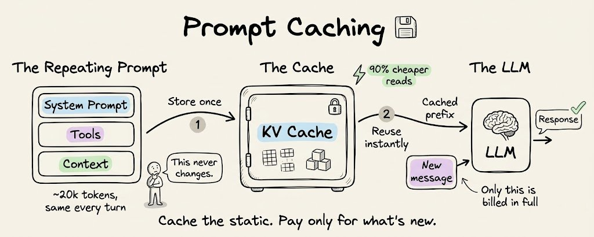
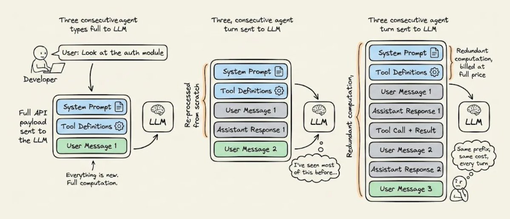
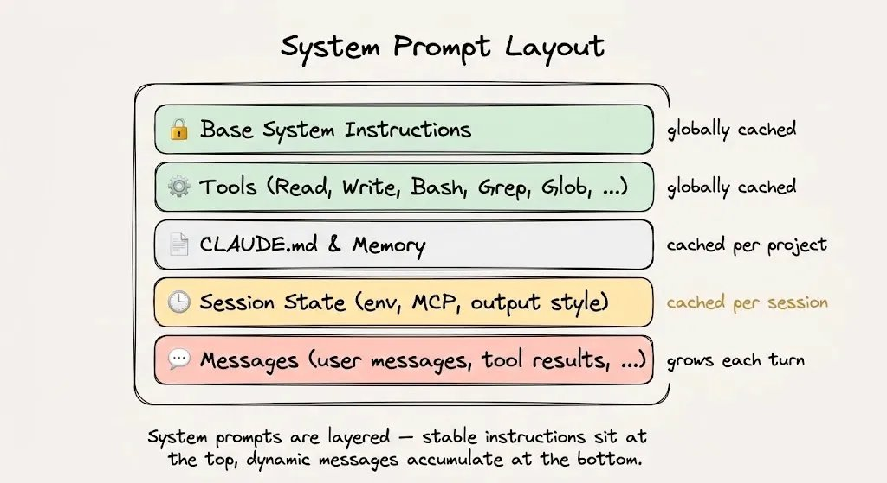
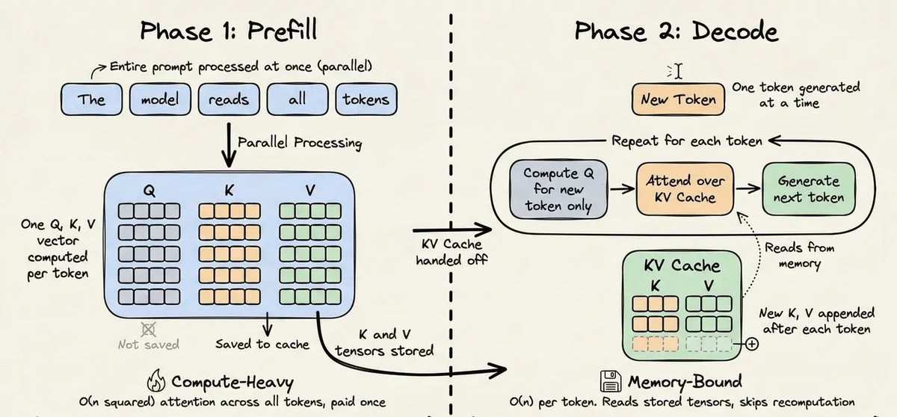
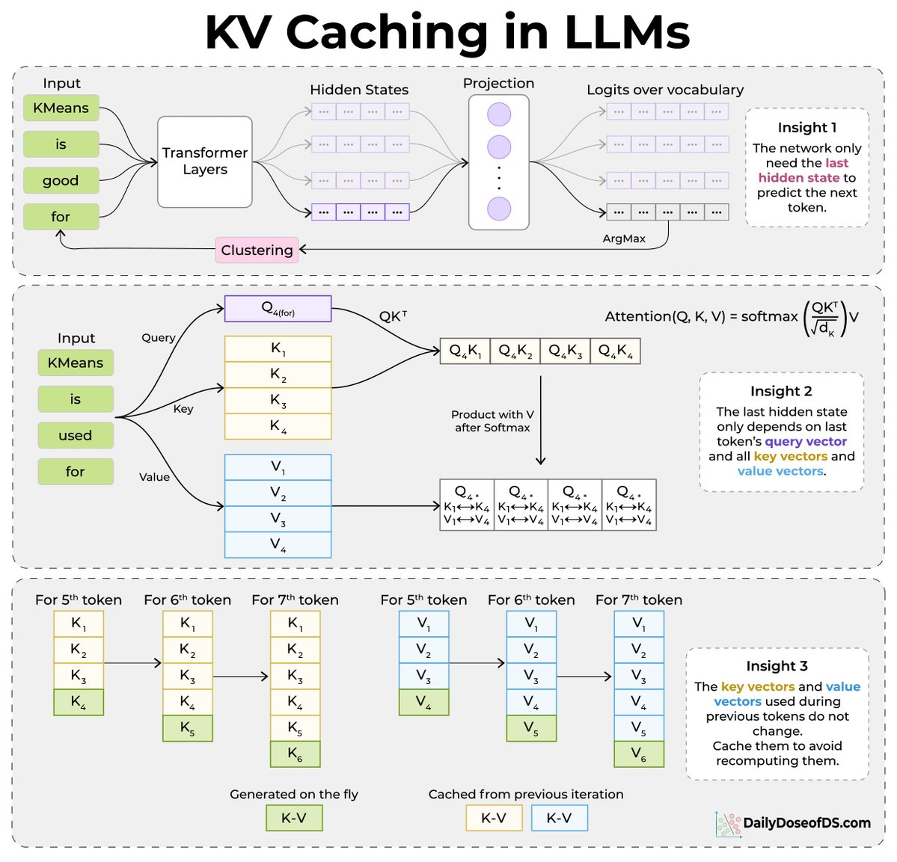
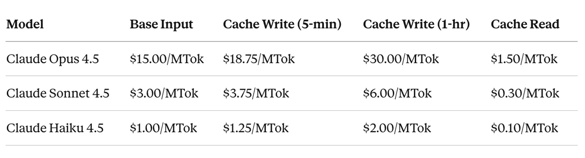
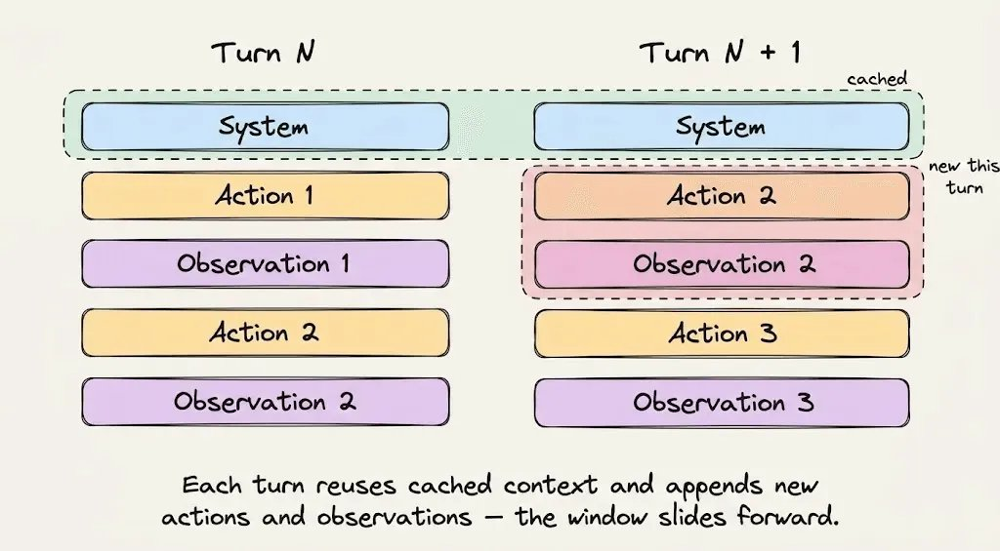
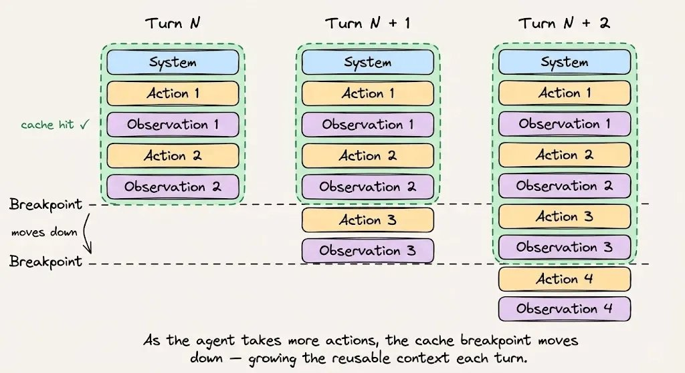
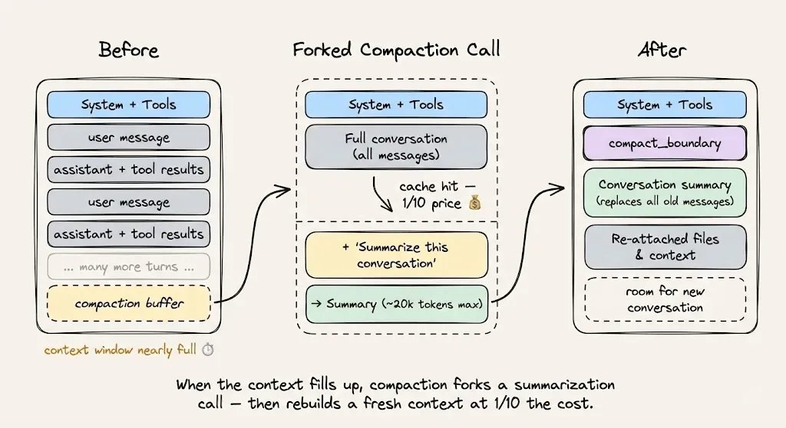

# 大模型工程基础

本文是大模型工程侧的基础笔记总览。当前主章围绕 **Prompt Caching / KV Cache**：为什么 agent 多轮会重复计费、静态前缀如何被复用、以及如何据此做成本与架构取舍。后续可在同文件继续扩展推理阶段、部署与评测等相关主题。

> 🔗 原帖链接： [https://x.com/\_avichawla/status/2044670188998803855](https://x.com/_avichawla/status/2044670188998803855)

## 主章：提示词与 KV 缓存



**一个关于 Claude 如何做到 92% cache hit-rate 的案例研究**

每当一个 AI agent 执行下一步时，它都会把整段对话历史重新发回给 LLM。

这其中包括 system instructions、tool definitions，以及它在三轮之前就已经处理过的 project context。所有这些内容，都会在每一轮里被重新读取、重新处理、重新计费。




对于长时程的 agentic workflow 来说，这类重复计算，往往就是你整套 AI 基础设施里最昂贵的一项成本。

如果一个 system prompt 有 20,000 个 token，并且跨 50 个 turn 持续复用，就意味着有 100 万个 token 的重复计算在按全价计费，却没有创造任何新增价值。而且这种成本会在每个用户、每个 session 上不断累加。

解决方法就是 prompt caching。但如果你想把它真正用好，就得先理解它在底层到底是怎么工作的。

## 静态上下文 vs. 动态上下文

在优化 prompt 之前，你首先得搞清楚，哪些内容会变，哪些内容不会变。

每一次 agent request，本质上都由两类完全不同的部分组成：



- 跨多个 turn 保持不变的 static prefix：包括 system instructions、tool definitions、project context 和 behavioral guidelines。
- 每一轮都会增长的 dynamic suffix：包括 user message、assistant response、tool output 和 terminal observation。

正是这个划分，让 prompt caching 成为可能。基础设施会保存 static prefix 对应的数学状态，因此当后续请求复用了完全相同的 prefix 时，就可以直接跳过那部分计算，从内存中读取结果。

一旦你把这个机制真正想明白，这篇文章里后面所有架构层面的设计选择，都会变得非常自然。

---

## KV Cache 是怎么工作的？

要理解为什么 caching 会如此有效，你得先知道 transformer 在处理 prompt 时，底层到底做了什么。

每一次 LLM inference request，都分成两个阶段：



- Prefill phase 负责处理整段输入 prompt。模型会在上下文中的所有 token 上运行稠密矩阵乘法，构建内部表示。这一阶段是 compute-bound 的，也是最昂贵的部分。
- Decode phase 负责逐 token 生成输出。每产生一个新 token，它就会被追加到序列中，模型再继续预测下一个 token。这个阶段更多是 memory-bound，因为它主要是在读取历史状态，而不是重复做重型计算。

在 prefill phase 里，transformer 会为每个 token 计算三个向量：Query、Key 和 Value。attention mechanism 就是通过这些向量，决定每个 token 与其他 token 的关系。对于任意一个 token 来说，它的 Key 和 Value 向量只依赖它前面的 token；一旦计算完成，就不会再改变。



没有 caching 时，这些 Key 和 Value tensor 会在每次请求结束后直接被丢弃，而下一次请求又会从头重新计算。对于一个 20,000-token 的 prefix 来说，这意味着有整整 20,000 个 token 的 attention computation 完全是在白做。

KV cache 的作用，就是把这些 tensor 持久化到 inference server 上，并用 token sequence 的 cryptographic hash 作为索引。当新的请求带着相同 prefix 进来时，只要 hash 命中，系统就会直接把这些 tensor 从内存中取出来，于是这一段 token 的 prefill computation 就可以被完全跳过。

这会把每个生成 token 对应的计算复杂度，从 O(n²) 降到 O(n)。而如果一个 20,000-token 的 prefix 要跨 50 个 turn 重复使用，这种收益会非常可观。

## 经济效益

真正让这种架构设计变得如此关键的，是它背后的定价方式。

Cache read 的价格是基础 input 价格的 0.1 倍，也就是每个命中的 cached token 都能享受 90% 的折扣。Cache write 的价格则是 1.25 倍，也就是为了把 KV tensor 写进去，需要多付 25% 的溢价。若使用扩展到一小时的缓存，则价格是 2.0 倍。

下面这张图展示了在 Anthropic Claude 各个模型上，这套定价具体长什么样：



这套数学只有在 cache hit-rate 足够高时才成立。而在生产环境里，最好的示范案例就是 Claude Code。

## 一次 30 分钟的 Claude Code 编程会话

Claude Code 的整个设计，几乎都围绕一个目标展开：让 cache 始终保持热状态。

下面是一场真实的 30 分钟编程会话，从计费视角看起来是什么样子。

Minute 0：Claude Code 会先加载它的 system prompt、tool definitions，以及项目里的 `CLAUDE.md` 文件。这部分 payload 超过 20,000 个 token，而因为所有 token 都是第一次出现，所以这是整场会话里最贵的时刻。但这笔钱你只需要付一次。

Minutes 1 到 5：你开始下发指令，Claude Code 会调度 Explore Subagent 去浏览代码库、打开文件、运行 grep 命令。所有这些内容都会追加进 dynamic suffix。但那段 20,000-token 的 static prefix，此时已经变成从 cache 中读取，价格从 `$3.00/MTok` 下降到 `$0.30/MTok`。

Minutes 6 到 15：Plan Subagent 拿到的是一个经过摘要的 brief，而不是原始结果，因为直接传原始输出会没有必要地膨胀 dynamic suffix。它生成 implementation plan，你确认之后，Claude Code 开始真正修改代码。每一轮都会从 cache 中读取 static prefix，命中率一路爬升到 90% 以上，而每一次访问也都会刷新 TTL，持续把 cache 保持在热状态。

Minutes 16 到 25：你继续要求修改，这意味着更多 tool calls、更多 terminal output，以及更多上下文被累积进 dynamic suffix。到这个时候，整个 session 已经处理了几十万 token，但每一轮都仍然是在从 cache 里读取那段 20,000-token 的基础部分。

Minute 28：你在 terminal 里运行 `/cost`。如果没有 caching，按照 Sonnet 4.5 的定价，200 万 token 大概要花 6 美元。有了 cache，而且运行效率达到 92%，其中 184 万 token 都是 cache read，最终总成本只剩 1.15 美元。单个任务就直接降低了 81% 的成本。


这就是 hot cache 的样子。你只需要为那段静态基础内容付费一次，之后就可以几乎免费地持续读取。真正持续被计费的，只有后面不断增长的 dynamic tail。

## 基于哈希的缓存有多脆弱

关于 prompt caching，有一件最反直觉的事：

“`1 + 2 = 3`” 可以命中 cache，但 “`2 + 1`” 就会直接 miss。

基础设施会从开头开始，对整段 token sequence 做哈希。只要这个序列中的任何一点发生变化，哪怕只是两个元素的顺序互换，哈希值就会改变，于是整段 prefix 都会按原价重新计算。



这不是一个无关紧要的实现细节，而是 Claude Code 里几乎所有工程决策都围绕其展开的核心约束。

下面这些，都是生产环境里真实出现过、导致 cache 失效的问题：

- 往 system prompt 里注入 timestamp，导致每次请求都会生成一个全新的 hash。
- 某个 JSON serializer 在不同请求之间对 tool schema key 的排序不一致，直接让 prefix 失效。
- 一个 AgentTool 在 session 中途更新了参数，瞬间清空了整段 20,000-token cache。

由此会直接导出三条规则：

1. 不要在 session 中途修改 tools。因为 tool definition 本身就是 cached prefix 的一部分，只要增加或删除一个 tool，下游所有缓存都会失效。
2. 永远不要在 session 中途切换模型。Cache 是 model-specific 的，这意味着你如果想在对话中途切到一个更便宜的模型，就必须从零开始重建整段 cache。
3. 永远不要通过修改 prefix 来更新状态。Claude Code 的做法不是去编辑 system prompt，而是把 reminder tag 追加到下一条 user message 上，这样 prefix 本身就能保持不变。

## 把这套方法用到你自己的 agent 上

无论你是在用 Claude Code，还是从零开始搭建自己的 agent，底层规则都完全一样。

请按照下面这个顺序来组织 prompt：

1. 把 system instructions 和 behavioral rules 放在最上面，而且不要在 session 中途改动。
2. 一开始就把所有 tool definition 都加载进去，不要中途增删。
3. 接着放 retrieved context 和 reference document，并在整个 session 生命周期里尽量保持稳定。
4. 把 conversation history 和 tool output 放在最底部，这一部分就是你的 dynamic suffix。



如果你在 Anthropic API 上启用了 auto-caching，那么随着对话持续增长，cache breakpoint 也会自动往前推进。如果没有这个能力，你就得自己手动追踪 token 边界，而只要边界判断错一次，就可能完全错过缓存。

当你快接近 context limit，需要做 context compaction 时，可以采用 cache-safe forking：保留同一个 system prompt、同一组 tools，以及已有的 conversation history，然后把 compaction instruction 作为一条新消息追加进去。这样 cached prefix 仍然可以复用，而真正新增计费的，只有这条 compaction instruction 本身。



如果你想确认 caching 是否真的在生效，需要在每次 API response 里重点观察这三个字段：

- `cache_creation_input_tokens`：写入 cache 的 token 数量。
- `cache_read_input_tokens`：从 cache 中读取的 token 数量。
- `input_tokens`：没有经过 caching、被正常处理的 token 数量。

你的 cache efficiency 可以用这个公式来算：

`cache_read_input_tokens / (cache_read_input_tokens + cache_creation_input_tokens)`

把它像监控 uptime 一样持续跟踪。

## 核心结论

Prompt caching 不是一个“打开开关就生效”的功能，而是一种你必须围绕它来做设计的架构纪律。

它的核心思想其实很简单：让静态内容稳定地待在顶部，让动态内容只在底部持续增长。基础设施会对 prefix 做哈希，把 KV tensor 存起来，并在后续每一次读取时为你提供 90% 的价格折扣。

但真正的门槛在细节上。不要把 timestamp 注入 system prompt，不要重排 tool definition，不要在 session 中途切换模型，也不要去修改 cache breakpoint 之前的任何内容。

Claude Code 给出了这套机制在大规模使用下的最佳示范：92% 的 cache hit rate，以及 81% 的成本下降。如果你正在构建 agent，却没有围绕 prompt caching 来做架构设计，那你其实正在把绝大部分利润空间白白留在桌上。

---

## 附章：LLM 推理策略（CoT / Self-Consistency / ToT / GoT）

**主题**：Agent 推理策略与 Test-Time Compute。主章讲的是「怎么把同样的前缀算得更便宜」，这一章讲的是「怎么把同样的模型算得更准」——两者都是成本与质量的取舍，所以放在同一篇里。

**图解**：[LLM 推理策略图解](output/llm-reasoning-strategies.html)（四张内联 SVG + 选型表，可在页签间切换；浏览器直接打开）

**学习目标**：理解四种方法的本质差异，判断何时使用、如何实现、如何评测。

### 1. 核心概念

| 方法 | 本质 | 核心问题 |
|---|---|---|
| CoT | 线性推理 | 如何分步骤解决问题？ |
| Self-Consistency | 多路径采样和答案聚合 | 多次推理应该相信哪个答案？ |
| ToT | 状态搜索和回溯 | 下一步应该探索哪条路径？ |
| GoT | 图结构推理与融合 | 多个中间结果如何组合、复用和改进？ |

**重要认知：**

1. 四种方法不是互相替代的模型，而是推理组织策略。
2. 它们可以通过 Prompt 模拟，但完整实现通常需要不同程度的代码编排。
3. 不等于 Multi-Agent，也不依赖某一种 Agent 框架。
4. 公开输出的推理说明不等于模型内部完整的推理过程。
5. 对于现代推理模型，明确目标、约束和验收标准通常比强制输出完整思维链更重要。

### 2. CoT：Chain of Thought（思维链）

**核心原理**：将复杂问题沿单一路径分解为多个推理步骤：

```text
问题 → 条件分析 → 中间推导 → 结果
```

CoT 的经典研究使用包含中间推理步骤的 Few-shot 示例，提高模型处理多步骤推理任务的能力。

**适用场景**：

- 多步骤数学、逻辑和符号推理
- 有明确业务规则的条件分析
- 需要展示决策依据的结构化任务
- 复杂任务中相对确定的局部子问题

**Best Practices**

- **BP1：优先明确目标和约束。** 对现代推理模型，优先告诉模型要解决什么、遵守什么规则、如何判定完成，而不是强制输出冗长推理。
- **BP2：提供必要的上下文或示例。** 对非推理模型或特定格式任务，用 Few-shot 示例展示正确的问题求解方式。
- **BP3：要求可验证的结果，而不是无限展开的推理。** 例如要求输出：判断结果、依据条款、关键计算、未满足的条件。
- **BP4：关键环节使用外部验证。** 数学计算用计算器，代码用测试，规则判断用规则引擎。不要仅依赖模型的文字解释判断结果正确性。

**Prompt 示例**：

> 根据给定业务规则，判断当前记录是否允许提交。请输出：判断结果、对应规则、必要的计算结果，以及无法确认的条件。不得补充不存在的业务规则。

**常见误区**：

- 认为让模型「深度思考」就实现了某种可靠的推理算法。
- 认为推理步骤写得越多，答案就越准确。
- 把模型生成的解释当成经过验证的执行轨迹。

### 3. Self-Consistency：自我一致性

**核心原理**：对同一个问题进行多次独立采样，再根据最终答案的一致程度聚合结果。

```text
问题 → N 次采样 → 答案提取 → 归一化 → 投票 → 最终答案
```

它与 CoT 的重要区别：不是只依赖单条推理路径，而是聚合多条路径的最终答案。经典方法通常采用答案多数投票。

**适用场景**：

- 数学和符号推理
- 有唯一答案或有限答案集合的任务
- 结构化分类、字段类型判断
- 单次采样准确率不稳定但已有一定正确率的场景

**Best Practices**

- **BP1：必须进行独立采样。** 推荐使用多次模型调用完成采样。让模型在一次回答中扮演五个角色，并不等于进行了五次独立采样。
- **BP2：先标准化答案，再聚合。** `13` 与 `13.0` 可归一化为相同数值；`日期范围` 与 `日期区间` 可映射到同一组件类型。对完整自由文本不能直接使用简单多数投票。
- **BP3：先用少量采样做实验。** 工程上可以从 N=3 或 N=5 开始测试，但这不是理论最优值。逐步比较 N 增加时准确率、延迟和 Token 成本的变化。
- **BP4：设置无共识处理机制。** 多个答案票数接近或没有明显多数时，不应强行宣称结果可靠。可以交给验证器、人工审核或其他裁决机制。
- **BP5：不要把票数当作真实置信度。** 5 次采样有 4 次一致，并不意味着正确概率就是 80%。由于来自同一个模型，多条推理路径可能共享相同偏差。

**工程实现**：

```text
samples = sample_llm(question, n=5)
answers = normalize(extract_answers(samples))
result = majority_vote(answers)
verify(result)
```

`sample_llm` 表示独立采样调用，`verify` 应尽量使用客观验证器。

**常见误区**：

- 用同一次调用中的五段回答冒充五次独立推理。
- 对开放式架构方案进行简单多数投票。
- 认为多次一致就说明答案一定正确。
- 只增加采样数量，不评测边际收益。

### 4. ToT：Tree of Thoughts（思维树）

**核心原理**：将推理视作状态空间搜索。在每个中间状态生成多个候选思路，评估并选择要继续探索的分支，必要时回溯。

**核心流程**：

1. State：定义当前推理状态。
2. Generate：生成候选下一步。
3. Evaluate：评估候选状态。
4. Search：决定扩展哪些分支。
5. Backtrack：必要时回溯。
6. Terminate：满足完成条件或预算限制后结束。

常见搜索策略包括 BFS、DFS 和 Beam Search。

**适用场景**：

- 需要规划、搜索和前瞻的任务
- 有多种可行路径的复杂代码修复
- 多约束任务规划
- 早期错误选择会影响最终结果的问题

**Best Practices**

- **BP1：先明确状态空间。** 当前状态包含什么？一次动作可以改变什么？什么情况算成功？什么情况应该提前终止？没有明确状态定义，很难实现可靠搜索。
- **BP2：优先使用外部评估器。** 代码修复看单测与编译结果，SQL 生成看语法检查与执行结果，任务规划看约束校验，UI 方案看规则检测与可用性评估。LLM-as-a-Judge 可作辅助，但不应在可客观验证时完全代替测试。
- **BP3：控制搜索空间。** 从较小的分支数与搜索深度开始，例如每次探索 2～3 个候选，并设置调用预算。过大的搜索树会导致成本急剧增长。
- **BP4：支持剪枝、回溯和提前终止。** 不可行分支及时停止；已完成目标时不继续搜索；搜索失败时保留足够信息以便回退。
- **BP5：保留状态和评估记录。** 每条分支至少记录：状态 ID、父状态、候选动作、评估结果、是否继续搜索。这样才能复现结果并分析失败原因。

**工程实现**：

```text
frontier = [initial_state]

while frontier and budget_available:
    state = select(frontier)
    candidates = generate(state)
    scores = evaluate(candidates)
    frontier = prune_and_expand(frontier, candidates, scores)

return best_valid_result()
```

**常见误区**：

- 只让模型提出三个方案然后选一个，就声称实现了完整 ToT。
- 没有状态管理、搜索预算和回溯机制。
- 使用不可靠的评估器，却无限增加搜索深度。
- 对明确、简单的任务使用复杂搜索。

### 5. GoT：Graph of Thoughts（思维图）

**核心原理**：把中间推理结果表示成图结构：

- Vertex：推理节点，承载一个中间结果。
- Edge：节点之间的依赖或关联。
- Aggregation：融合不同推理结果。
- Refinement：根据反馈改进已有结果。
- Reuse：多个节点复用共同的中间结果。

相较于 ToT，GoT 的重要特征是允许不同分支之间产生新的依赖和聚合关系，而不局限于父子树结构。

**适用场景**：

- 跨多文档的综合研究
- 复杂系统架构设计
- 多模块结果需要协调融合的任务
- 需要复用中间成果并进行局部迭代的推理工作

**Best Practices**

- **BP1：明确节点类型和依赖。** 不要只创建一个任意连接的图。应定义节点的输入、输出、依赖及验证方式。
- **BP2：节点尽量保持单一职责。** 一个节点负责提取约束，另一个负责生成方案，另一个负责校验兼容性。不要让每个节点都重复完成整个任务。
- **BP3：保留来源和版本信息。** 聚合后仍应能追溯某个结论来源于哪些原始数据和中间节点。这对文档分析、代码研究和审计尤其重要。
- **BP4：只有存在真实的复用与融合需求时才引入图推理。** 如果只是顺序执行任务，普通工作流更简单。如果只是选一条路线，ToT 可能更合适。
- **BP5：反馈循环必须具有停止条件。** 使用版本号、最大迭代次数、收敛阈值和预算上限，避免重复优化永不结束。
- **BP6：为聚合结果执行一致性检查。** 不同来源的结论可能互相矛盾。需要冲突检测、约束校验和来源检查，而不是直接拼接文本。

**工程实现**：

```text
graph.add(extract_requirements())
graph.add(analyze_module_A())
graph.add(analyze_module_B())

merged = aggregate(graph.outputs)
checked = validate(merged)

if not checked.valid:
    refine(checked.conflicting_nodes)

return validated_graph_result()
```

**常见误区**：

- 认为使用 LangGraph 就自动实现了 GoT。
- 认为多 Agent 协作就是 GoT。
- 把普通 DAG 工作流和 GoT 完全等同。
- 图节点很多，但没有跨分支融合或复用。
- 过度设计图调度器，导致工程维护成本超过收益。

### 6. 实际应用：生成式 UI（Generative UI）

假设开发一个 AI 填报助手。用户输入：

> 帮我创建一个学生请假表单，包含学生信息、请假时间、请假原因和辅导员审批。

系统根据需求生成表单结构和 UI。

**CoT：顺序理解和生成**

```text
需求解析 → 字段配置 → 审批配置 → UI Schema → 渲染
```

适合需求明确的普通表单生成。**Best Practice：** 使用固定组件 Schema 和约束验证，不必为了生成一个简单表单增加多路径推理。

**Self-Consistency：降低字段分类的不稳定性**

多次独立生成字段类型判断：采样 1「请假时间 → 日期范围」、采样 2「请假时间 → 日期范围」、采样 3「请假时间 → 日期」。标准化后选择出现最多的结果，再校验是否符合业务规则。**Best Practice：** 仅对能够标准化比较的字段或决策进行聚合，不对整个 UI 页面进行简单投票。

**ToT：探索不同的 UI 方案**

生成候选设计：方案 A 单页表单、方案 B 分步向导、方案 C 卡片式分组。根据字段数量、填写成本、移动端可用性等约束进行评估。如果所有方案都不满足条件，可以继续探索或回溯。**Best Practice：** 将 UI 结构检查、交互测试等可验证信息纳入评估器，而不是只依赖模型的审美打分。

**GoT：融合不同模块的设计成果**

并行分析字段配置、数据权限、审批流程、页面布局。这些节点之间存在依赖关系，例如审批配置会影响页面的可见状态及操作按钮。将各节点结果融合为统一 UI Schema，检测冲突，再局部调整。**Best Practice：** 让各节点共享同一套业务约束和组件 Schema，并保证中间结果可追溯、可验证。

**生成式 UI 的共同原则**：

1. 模型生成结构化 UI Schema。
2. 使用受控组件库进行渲染。
3. 对 Schema 执行字段、权限与业务规则校验。
4. 不直接执行未经验证的模型生成脚本。
5. 通过真实 UI 测试判断效果，而非只看文字描述。

### 7. Prompt 与工程化实现的区别

| 方法 | Prompt 模拟 | 真正的工程实现 |
|---|---|---|
| CoT | 要求按步骤解释 | 单路径任务执行及验证 |
| Self-Consistency | 一次回答提出多个方法 | 独立采样、标准化、聚合 |
| ToT | 列出方案并比较 | 显式搜索状态、评估与回溯 |
| GoT | 分析多个模块并组合 | 图节点管理、依赖执行、融合与反馈 |

**结论：Prompt 可以引导推理方式，但不能替代必须由程序执行的采样、搜索、状态管理和验证。**

### 8. 如何通过评测选择推理策略

不要直接根据论文结论决定生产环境选型，建议进行针对自身任务的对照实验。

**Step 1：建立 Baseline。** 先使用普通 Prompt 或 Agent Loop，记录实际任务完成率。

**Step 2：定义实验组。** 分别增加 Self-Consistency、ToT 或 GoT。尽量固定模型版本、任务集、工具和外部环境，同时记录额外的推理预算。

**Step 3：定义评价指标。**

- 质量指标：Task Success Rate、Accuracy、Constraint Satisfaction、Invalid Output Rate
- 效率指标：Token Cost、End-to-End Latency、P95 Latency、Tool Calls
- 可靠性指标：多次运行结果稳定性、验证失败率、回退与恢复成功率、错误是否集中在特定任务类型

**Step 4：做消融实验。** 分别去掉 Self-Consistency 中的投票模块、ToT 中的中间状态评估、GoT 中的结果融合或反馈模块，比较移除前后的表现，确认相关模块是否真正产生了增益。

**Step 5：做成本收益判断。** 重点不是绝对准确率，而是**新增推理机制带来的质量收益，是否值得额外的计算成本、延迟和工程复杂度**。

### 9. 最终决策规则

- **CoT**：问题需要多步处理，但没有必要探索多条路线。
- **Self-Consistency**：答案明确可比较，单次推理存在不稳定性。
- **ToT**：任务存在多条候选路径，需要中间评估、搜索和回溯。
- **GoT**：多个中间结果需要融合、跨分支复用与反馈改进。

如果普通 Agent Loop 已经能稳定完成任务，就不必引入更复杂的推理机制。

**最终心智模型**：

```text
CoT  = 分步求解
Self-Consistency = 多次采样 + 聚合
ToT  = 生成候选 + 评估 + 搜索
GoT  = 推理图 + 聚合 + 复用 + 反馈
```

### 10. 参考论文与资料

1. Wei et al. (2022). [Chain-of-Thought Prompting Elicits Reasoning in Large Language Models](https://proceedings.neurips.cc/paper/2022/hash/9d5609613524ecf4f15af0f7b31abca4-Abstract-Conference.html)
2. Wang et al. (2023). [Self-Consistency Improves Chain of Thought Reasoning in Language Models](https://research.google/pubs/self-consistency-improves-chain-of-thought-reasoning-in-language-models/)
3. Yao et al. (2023). [Tree of Thoughts: Deliberate Problem Solving with Large Language Models](https://papers.nips.cc/paper/2023/hash/271db9922b8d1f4dd7aaef84ed5ac703-Abstract-Conference.html)
4. Besta et al. (2024). [Graph of Thoughts: Solving Elaborate Problems with Large Language Models](https://ojs.aaai.org/index.php/AAAI/article/view/29720)
5. [OpenAI — Reasoning Best Practices](https://developers.openai.com/api/docs/guides/reasoning-best-practices)

*备注：论文实验结论与具体生产场景的效果需要区分；所有工程示例均应通过自身任务集验证。*

---

如果你喜欢本教程：

Find me → [@\_avichawla](https://x.com/_avichawla)

每天，我都会分享关于DS、ML、大语言模型（LLMs）和检索增强生成（RAGs）的教程和见解。
