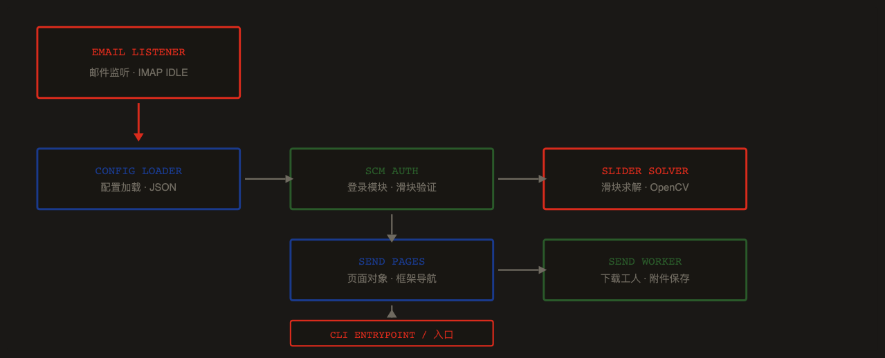
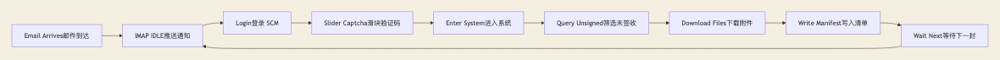
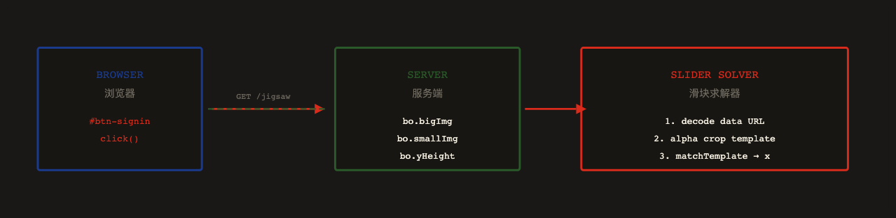
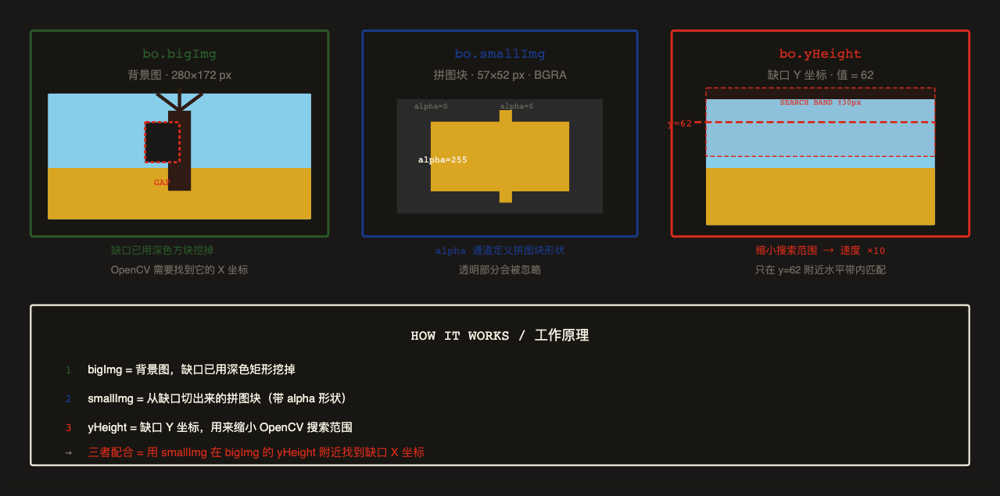
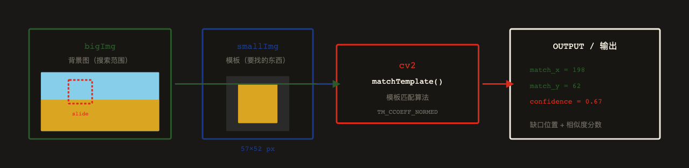
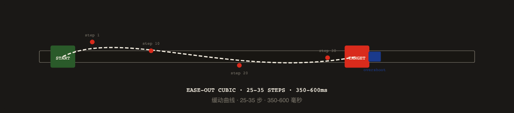
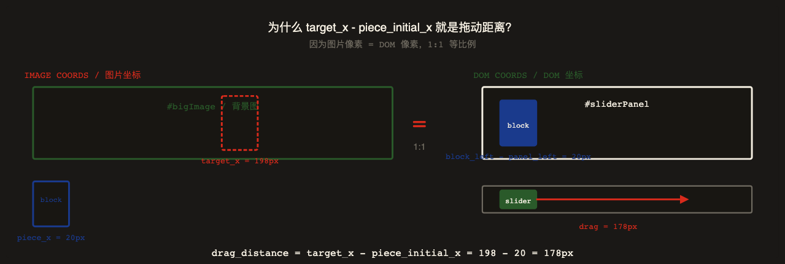
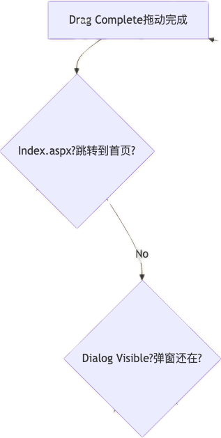
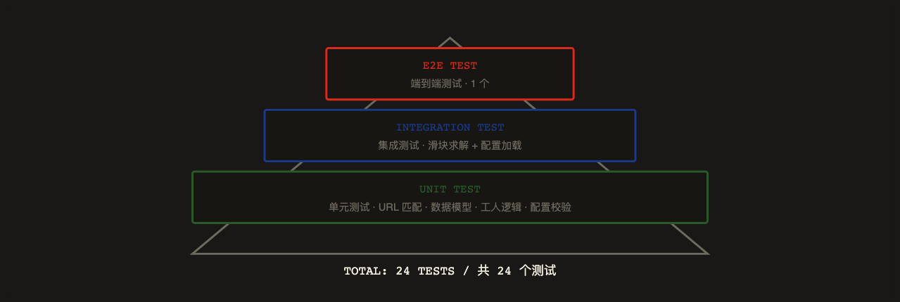

# 安全运维复盘

本文合并两篇独立复盘：上篇是供应链登录滑块自动化；下篇是公网暴露 PostgreSQL 被 `COPY FROM PROGRAM` 攻击后的止血与加固。

---

## 上篇 · ZTE SCM 滑块验证码自动化

# 为什么要做这个？

ZTE SCM 供应链平台每次登录都需要通过滑块验证码。

    人工操作：打开页面 → 输入账号 → 拖动滑块 → 进入系统 → 筛选发放单 → 下载附件 → 返回列表 → 重复。

    整个流程耗时 3-5 分钟/次，且需要持续关注。

目标：邮件到达时自动触发，完成登录、滑块验证、发放单筛选、附件下载全流程。

## 模块拆分


项目从单一 PoC 演进为 5 个独立模块，各司其职。



## 三个版本的演进

### v0.1.0 · 滑块验证 PoC

OpenCV 模板匹配求解缺口坐标 + Playwright 拟人拖动。第一次跑通完整登录流程。

### v0.2.0 · 发放单自动下载

拆分 5 个模块：auth / pages / models / worker / cli。支持筛选未签收记录、批量下载附件。

### v0.3.0 · 邮件触发集成

IMAP IDLE 监听 + JSON 配置 + 回调钩子。邮件到达即触发完整下载流程。

## 端到端自动化管线

从邮件到达到文件落盘，全程无人值守。



## 核心难关：滑块验证码怎么破？

ZTE SCM 的登录页使用了拼图式滑块验证码。

    服务端通过 /srv/kaptcha/jigsaw 接口返回背景图（bigImg）、拼图块（smallImg）、Y 坐标（yHeight）。

    用户需要把拼图块拖到缺口位置才能通过验证。

这是整个自动化流程中最大的技术难点。

## 第一步：拦截验证码接口

点击登录后，浏览器会请求 GET /srv/kaptcha/jigsaw。我们用 Playwright 的 page.on("response") 监听这个请求，拿到 JSON 数据。



## 接口返回的三个字段分别是什么？

服务端返回的 JSON 中，bo 包含三个关键字段。它们共同构成了一道"拼图题"。



## 为什么用 OpenCV？

OpenCV（Open Source Computer Vision Library）是世界上最流行的计算机视觉库。

    在这个项目中，它的核心作用只有一个：模板匹配（Template Matching）。


简单说就是——给它一张小图（模板）和一张大图（搜索图），

    它能在大图中找到"最像小图的位置"，返回该位置的坐标和相似度分数。



为什么选 OpenCV 而不是深度学习？

    因为这道滑块题的特征非常明显——缺口是深色矩形，拼图块有独特纹理。

    传统模板匹配（TM_CCOEFF_NORMED）在 yHeight 约束下，

    速度 < 5ms，准确率 95%+，完全够用。不需要训练模型，不需要 GPU。

## 第二步：OpenCV 模板匹配

拿到的 smallImg 是一个带透明通道的 PNG。拼图块区域 alpha=255，其余区域 alpha=0。

    我们先用 cv2.findNonZero(alpha) 找到有效区域，裁剪出模板。

然后在 bigImg 上用 cv2.matchTemplate(TM_CCOEFF_NORMED) 做模板匹配。

    为了加速，搜索范围限制在 yHeight ± 30px 的水平带内。


```Plain Text
# 核心求解逻辑
def solve_slider(big_img_data_url, small_img_data_url, y_height, panel_width=280):
    # 1. 解码 data URL → numpy array
    big_img = cv2.imdecode(np.frombuffer(_decode_data_url(big_url), np.uint8), cv2.IMREAD_COLOR)
    small_img = cv2.imdecode(np.frombuffer(_decode_data_url(small_url), np.uint8), cv2.IMREAD_UNCHANGED)

    # 2. alpha 通道裁剪 → 模板
    alpha = small_img[:, :, 3]
    coords = cv2.findNonZero(alpha)
    x, y, w, h = cv2.boundingRect(coords)
    template = cv2.cvtColor(small_img[y:y+h, x:x+w], cv2.COLOR_BGRA2BGR)

    # 3. 局部模板匹配（yHeight ± 30px 带状区域）
    roi = big_img[max(0, y_height-30):min(h, y_height+h+30), :]
    result = cv2.matchTemplate(roi, template, cv2.TM_CCOEFF_NORMED)
    _, max_val, _, max_loc = cv2.minMaxLoc(result)

    return SliderSolution(target_x=max_loc[0], confidence=max_val, ...)
```

关键洞察：不能在整张大图上做匹配——太慢且容易误匹配。

    利用 API 返回的 yHeight 参数，把搜索范围压缩到 ±30px 的水平带，

    匹配速度提升 10x，准确率从 60% 提升到 95%+。

## 第三步：拟人拖动


求出缺口 X 坐标后，需要把拼图块从初始位置拖到目标位置。

    但不能直接瞬间移动——服务端会检测拖动轨迹是否像人类。



### Ease-Out Curve / 缓动曲线

使用 1 - (1-t)³ 三次缓出，前期快后期慢，模拟人类手指减速

### Y-Axis Jitter / 纵向抖动

每步添加 ±1.5px 随机纵向偏移，模拟手指不稳定

### Overshoot + Settle / 过冲回弹

末尾多拖 2-5px 再回弹到目标位置，模拟手指惯性

### Random Timing / 随机时长

总时长 350-600ms 随机，步数 25-35 随机，避免固定模式

## 第四步：DOM 坐标转换


OpenCV 返回的 target_x 是图片像素坐标。

    但浏览器中拼图块的实际位置取决于 DOM 布局。

    需要读取 #sliderPanel、#block、#slider 的 getBoundingClientRect()，

    计算出真实的拖动距离。


```Plain Text
// 读取 DOM 位置
const dom = await page.evaluate(() => {
    const panel = document.querySelector('#sliderPanel');
    const block = document.querySelector('#block');
    const slider = document.querySelector('#slider');
    return {
        panel_left:  panel.getBoundingClientRect().left,
        block_left:  block.getBoundingClientRect().left,
        slider_left: slider.getBoundingClientRect().left,
        slider_top:  slider.getBoundingClientRect().top,
    };
});

// 计算拖动距离
const piece_initial_x = dom.block_left - dom.panel_left;  // 拼图块初始 X
const drag_distance = solution.target_x - piece_initial_x; // 需要拖动的距离
const start_x = dom.slider_left + slider_w / 2;           // 滑块中心 X
const start_y = dom.slider_top + slider_h / 2;            // 滑块中心 Y

// 执行拖动
await _human_drag(page, start_x, start_y, drag_distance);
```

踩坑记录：不能硬编码 280 和 20 这些值！

    不同浏览器窗口大小、不同 DPI 下，DOM 坐标会变化。

    必须每次运行时实时读取 DOM 位置。



为什么不需要缩放系数？

    因为 #bigImage 没有被 CSS transform 缩放，图片的 1 像素 = 浏览器的 1 像素。

    #block 和 #slider 在同一个 #sliderPanel 里同步移动，

    滑块拖动 178px → 拼图块也移动 178px → 正好到达缺口位置。

## 第五步：成功判定与重试

拖动完成后，需要判断是否通过验证。判定逻辑：




## TDD 驱动开发

每个模块都遵循 先写测试、再写实现 的 TDD 流程。

    使用合成图像测试滑块求解器（模拟拼图切割），

    使用 Recorder Fake 测试页面对象（无需真实浏览器）。



## 每次运行的调试文件

每次运行自动保存 7 类调试文件，便于排查问题。

| FILE / 文件 | DESCRIPTION / 说明 |
|------|------|
| uac_before_submit.png | 登录前截图 / Screenshot before login |
| jigsaw_dialog.png | 验证码弹窗截图 / Captcha dialog screenshot |
| jigsaw_raw.json | API 原始响应 / Raw API response |
| big.png | 背景图 / Background image |
| small.png | 拼图块 / Puzzle piece |
| overlay.png | 求解可视化 / Solution visualization |
| run.json | 运行日志 / Run manifest |

## 最终效果

### Login / 登录

滑块验证码一次通过率 95%+，最多 3 次重试

### Download / 下载

自动筛选未签收记录，下载 下载1 + 下载2 附件

### Trigger / 触发

邮件到达即触发，全程 0 人工干预

### Manifest / 清单

每次运行生成 run.json，记录所有下载详情


---

## 下篇 · PostgreSQL 容器 COPY FROM PROGRAM 攻击处置

> 适用场景：PostgreSQL 暴露在公网后，攻击者通过超级用户权限执行 `COPY FROM PROGRAM`，进而触发编码命令、下载器、挖矿程序或蠕虫脚本的应急处置。
> 
> 本文档基于 2026-04 至 2026-05 期间 `pgvector` 容器告警处置过程整理。文中不包含服务器登录密码或数据库明文密码。


图片说明：上图由内置 `gpt-image2` 生成，用于表达“暴露数据库容器被编码命令攻击后，通过隔离、留证、轮换密码、网络阻断完成处置”的整体思路。

## 执行摘要

本次告警不是误报。攻击者通过暴露在公网的 `pgvector` PostgreSQL 容器端口访问数据库，并利用 PostgreSQL 超级用户可执行服务端程序的能力，发起 `COPY FROM PROGRAM` 命令。该命令通过 `base64` 编码隐藏真实脚本，解码后尝试连接恶意下载源 `210.97.42.242:8088`，并下载后续脚本执行。

处置结果：

- 新 `pgvector` 容器已重建，只绑定 `127.0.0.1:54321->5432`。
- 旧感染容器已归档证据后删除。
- `pgvector` 的 `postgres` 密码已轮换。
- 容器内 XMRig 挖矿残留已隔离到 `/root/incident-quarantine/`。
- 宿主机 PostgreSQL 外部登录规则已移除。
- 数据库端口 `5432/54321` 已加本机防火墙拦截规则，并通过 systemd 服务持久化。
- 恶意下载 IP `210.97.42.242` 已加入出站阻断。
- 新 `pgvector` 的 `pg_hba.conf` 已收紧，只允许宿主机 Docker 网关 `172.17.0.1/32` 访问。

## 事件背景

### 2.1 资产信息

<sheet sheet-id="pB7GsX" token="AUV6sZUEWhLuTatdQkxcKZV5nld"></sheet>

### 2.2 告警概览

<sheet sheet-id="iVRQfa" token="AUV6sZUEWhLuTatdQkxcKZV5nld"></sheet>

两条告警属于同一攻击链，命令模式、父子进程、恶意下载 IP 均一致。2026-04-10 的告警在容器日志中对应 `2026-04-09 21:28:30 UTC`。

## 攻击链还原


核心风险点是 PostgreSQL 的 `COPY FROM PROGRAM`。该能力只允许超级用户或拥有 `pg_execute_server_program` 的角色执行。若 PostgreSQL 超级用户密码泄露、弱口令，或者服务被公网暴露，攻击者可以把数据库进程变成命令执行入口。

本次恶意脚本行为摘要：

- 试图终止常见挖矿进程：`kinsing`、`kdevtmpfsi`。
- 优先使用 `curl` 拉取恶意脚本。
- 其次使用 `wget` 拉取恶意脚本。
- 如果没有 `curl/wget`，则使用 Bash `/dev/tcp` 自实现 HTTP 下载。
- 下载源为 `210.97.42.242:8088`。
- 观察到历史挖矿配置指向 `pool.supportxmr.com:443`。

## 关键 IOC

<sheet sheet-id="dSm4xp" token="AUV6sZUEWhLuTatdQkxcKZV5nld"></sheet>

已留证文件：

<sheet sheet-id="nRIq8e" token="AUV6sZUEWhLuTatdQkxcKZV5nld"></sheet>

## 排查过程

### 5.1 确认可疑进程是否仍在运行

ps -eo pid,ppid,user,lstart,etime,cmd --sort=start_time \

  | egrep -i 'kinsing|kdevtmpfsi|210\\.97\\.42\\.242|base64 -d|curl\\.txt|wget\\.txt|pg22|xmrig|supportxmr' \

  | grep -v egrep

结论：处置时未发现告警进程仍在运行。

### 5.2 核查容器暴露面

docker ps --no-trunc --format 'table {{.ID}}\t{{.Names}}\t{{.Image}}\t{{.Status}}\t{{.Ports}}'

ss -ltnp | egrep ':5432|:54321'

发现旧 `pgvector` 容器通过 `0.0.0.0:54321->5432` 对公网开放，是主要入口。

### 5.3 读取 PostgreSQL 日志

docker logs --since '2026-04-09T21:20:00Z' \

  --until '2026-04-09T21:40:00Z' \

  pgvector

关键日志显示：

- `COPY ... FROM PROGRAM` 被执行。
- 子进程被中断。
- 事务回滚，攻击临时表删除失败但最终未残留在共享数据卷里。
- 命令尝试访问 `210.97.42.242:8088`。

### 5.4 查找落地文件

find /tmp /var/tmp /dev/shm -xdev -maxdepth 3 -type f \

  -printf '%TY-%Tm-%Td %TH:%TM:%TS %u:%g %m %s %p\n' 2>/dev/null | sort

发现容器内存在历史挖矿残留：

/tmp/.postgres/config.json

/tmp/.postgres/rediserver

`config.json` 中包含 XMRig 配置，矿池为 `pool.supportxmr.com:443`。

## 处置动作


图片说明：上图由内置 `gpt-image2` 生成，用于表达处置后的目标状态：公网入口被阻断，宿主机防火墙和 Docker 网络边界生效，PostgreSQL 容器只接受本机受控访问，证据和密码轮换独立留存。

### 6.1 临时隔离数据库端口

iptables -I INPUT 1 -i lo -p tcp -m multiport --dports 5432,54321 -j ACCEPT

iptables -I INPUT 2 -p tcp -m multiport --dports 5432,54321 -j DROP

ip6tables -I INPUT 1 -i lo -p tcp -m multiport --dports 5432,54321 -j ACCEPT

ip6tables -I INPUT 2 -p tcp -m multiport --dports 5432,54321 -j DROP

注意：本机使用的是 `iptables v1.8.5 (nf_tables)`，规则计数可以增长，但外部连通性测试容易受到本地网络环境影响。因此不能只依赖客户端 `nc` 结果，必须结合服务监听、PostgreSQL 认证规则和云安全组共同收敛暴露面。

### 6.2 轮换 `pgvector` 超级用户密码

newpw="\$(openssl rand -base64 36 | tr -d '\n')"

passfile="/root/pgvector-postgres-password-rotated-\$(date +%Y%m%d-%H%M%S).txt"

umask 077

printf 'pgvector postgres password rotated at %s CST\npassword=%s\n' "$(date '+%F %T')" "$newpw" > "\$passfile"


docker exec -i -u postgres pgvector psql -X -v ON_ERROR_STOP=1 -v newpw="\$newpw" <<'SQL'

ALTER ROLE postgres WITH PASSWORD :'newpw';

SQL

密码文件只允许 root 读取，处置记录中只记录路径，不记录明文。

### 6.3 隔离恶意落地文件

quar="/root/incident-quarantine/pgvector-\$(date +%Y%m%d-%H%M%S)"

pgpid="\$(docker inspect -f '{{.State.Pid}}' pgvector)"

mkdir -m 700 -p "\$quar"

cp -a "/proc/$pgpid/root/tmp/.postgres" "$quar/"

rm -rf --one-file-system "/proc/\$pgpid/root/tmp/.postgres"

保留证据后再删除，避免直接清理导致无法复盘。

### 6.4 重建 `pgvector` 容器

vol="\$(docker inspect -f '{{range .Mounts}}{{if eq .Destination "/var/lib/postgresql/data"}}{{.Name}}{{end}}{{end}}' pgvector)"

image="\$(docker inspect -f '{{.Config.Image}}' pgvector)"


docker update --restart=no pgvector

docker stop pgvector

docker rename pgvector pgvector-incident-\$(date +%Y%m%d-%H%M%S)


docker run -d \

  --name pgvector \

  --restart always \

  --pull=never \

  -p 127.0.0.1:54321:5432 \

  -v "$vol:/var/lib/postgresql/data" \  -e POSTGRES_PASSWORD="$pw" \

  "\$image"

关键点：

- 复用原数据卷，避免业务数据丢失。
- 丢弃旧容器可写层，去除 `/tmp`、`/var/tmp`、`/dev/shm` 等非持久目录残留。
- 新容器端口只绑定 `127.0.0.1`，不再暴露到公网。

### 6.5 删除旧感染容器

在删除前归档：

docker inspect pgvector-incident-\* > /root/incident-quarantine/pgvector-old-inspect-before-rm.json

docker logs pgvector-incident-\* > /root/incident-quarantine/pgvector-old-full-logs-before-rm.log 2>&1

docker diff pgvector-incident-\* > /root/incident-quarantine/pgvector-old-diff-before-rm.txt 2>&1

docker rm pgvector-incident-\*

### 6.6 收紧 `pg_hba.conf`

原容器规则允许任意来源：

host all all all scram-sha-256

处置后收紧为只允许宿主机 Docker 网关：

host all all 172.17.0.1/32 scram-sha-256

重新加载配置：

docker exec -u postgres pgvector psql -X -Atqc "select pg_reload_conf();"

验证规则：

docker exec -u postgres pgvector psql -X -Atqc \

  "select line_number,type,database,user_name,address,netmask,auth_method,error from pg_hba_file_rules order by line_number;"

横向访问验证：

docker run --rm --network bridge -e PGPASSWORD="\$pw" \

  ankane/pgvector:latest \

  psql -h 172.17.0.4 -p 5432 -U postgres -d postgres -X -Atqc "select 1;"

期望结果：

FATAL: no pg_hba.conf entry for host "172.17.0.5"

### 6.7 处理宿主机 PostgreSQL

宿主机 PostgreSQL 也监听 `0.0.0.0:5432`。虽然本次告警来自容器，但它同样是高风险入口。

处置动作：

- 注释 `pg_hba.conf` 中 `douya@0.0.0.0/0` 外部登录规则。
- reload 宿主机 PostgreSQL。
- 确认 `pg_hba_file_rules` 中不再存在 `0.0.0.0/0` 允许规则。

建议后续更彻底改为：

listen_addresses = 'localhost'

前提是确认没有业务依赖公网直连宿主机 PostgreSQL。

### 6.8 持久化防火墙规则

创建 systemd oneshot 服务：

/etc/systemd/system/db-containment-firewall.service

/usr/local/sbin/db-containment-firewall.sh

服务功能：

- 保留本机访问 `5432/54321`。
- 拒绝外部访问 `5432/54321`。
- 拒绝宿主机和容器转发访问 `210.97.42.242`。
- 为 Docker `DOCKER-USER` 链补充容器入口阻断规则。

启用：

systemctl daemon-reload

systemctl enable --now db-containment-firewall.service

systemctl status db-containment-firewall.service --no-pager -l

## 验证清单

### 7.1 容器状态

docker ps -a --no-trunc --format 'table {{.ID}}\t{{.Names}}\t{{.Image}}\t{{.Status}}\t{{.Ports}}'

期望：

pgvector   Up   127.0.0.1:54321->5432/tcp

不应再存在旧感染容器。

### 7.2 端口监听

ss -ltnp | egrep ':5432|:54321'

期望：

- `pgvector` 映射端口只监听 `127.0.0.1:54321`。
- 若宿主机 PostgreSQL 仍监听 `0.0.0.0:5432`，必须同时确认 `pg_hba.conf` 和云安全组已阻断外部访问。

### 7.3 可疑进程

pgrep -af 'rediserver|xmrig|kinsing|kdevtmpfsi|210\\.97\\.42\\.242|base64 -d|pg22|supportxmr' || true

期望：无输出。

### 7.4 PostgreSQL 攻击临时表

docker exec -u postgres pgvector sh -lc '

for d in $(psql -X -Atqc "select datname from pg_database where datallowconn and not datistemplate order by 1"); do  echo DB:$d

  psql -X -d "\$d" -Atqc "select schemaname,tablename from pg_tables where tablename like '\\''\\\_%'\\'' escape '\\''\\'\\'' order by 1,2"

done'

期望：无攻击临时表残留。

### 7.5 新告警观察

docker logs --since '2026-05-07T10:22:00Z' pgvector 2>&1 \

  | egrep -i 'program|base64|rediserver|xmrig|210\\.97\\.42\\.242|COPY .\*PROGRAM'

期望：无新增恶意命令。

## 复盘经验

### 8.1 根因

根因不是某个单独文件，而是数据库服务暴露面和超级用户权限组合导致的远程命令执行风险：

1. PostgreSQL 容器端口映射到 `0.0.0.0:54321`。
2. 数据库超级用户可从外部登录。
3. 超级用户具备 `COPY FROM PROGRAM` 执行能力。
4. 容器缺少最小化网络和认证限制。
5. 旧容器可写层中已有历史挖矿残留，说明攻击不是单次事件。

### 8.2 为什么不能只 kill 进程

告警进程通常是一次性命令，排查时可能已经退出。只 kill 进程无法解决：

- 数据库公网暴露。
- 数据库密码泄露或弱口令。
- PostgreSQL 超级用户被滥用。
- 容器可写层恶意文件。
- 定时任务、启动项或横向访问风险。

正确做法是按“阻断入口、保留证据、清理残留、重建可信运行环境、验证闭环”的顺序处理。

### 8.3 为什么要重建容器

容器内 `/tmp`、`/dev/shm`、`/var/tmp` 是攻击者常用落地点。即使删除已知文件，也无法证明没有未知残留。重建容器可以丢弃旧可写层，保留数据卷，降低漏清风险。

### 8.4 为什么要收紧 `pg_hba.conf`

只把 Docker 端口绑定到 `127.0.0.1` 可以阻止公网直接访问，但同一 Docker bridge 网络里的其他容器仍可能访问容器 IP。收紧 `pg_hba.conf` 后，即使其他容器能路由到 `172.17.0.4:5432`，也会被 PostgreSQL 自身拒绝。

## 后续建议

### 9.1 云安全组

在阿里云安全组中同步限制：

- 禁止公网访问 `5432`。
- 禁止公网访问 `54321`。
- 若确需远程数据库访问，只允许固定办公 IP 或 VPN 出口 IP。

### 9.2 凭据治理

- 更换服务器 root 密码。
- 检查是否存在复用的数据库密码。
- 避免把数据库超级用户用于业务连接。
- 为业务创建最小权限用户，禁止授予 `SUPERUSER` 和 `pg_execute_server_program`。

### 9.3 PostgreSQL 配置

推荐基线：

listen_addresses = 'localhost'

log_statement = 'ddl'

log_min_duration_statement = 1000

对于暴露给应用的数据库：

- 只监听内网或本机地址。
- 使用强密码或证书认证。
- 对业务用户禁用高危权限。
- 开启足够日志以追踪异常 DDL、`COPY FROM PROGRAM`、登录失败。

### 9.4 Docker 暴露面

推荐启动方式：

docker run -d \

  --name pgvector \

  --restart always \

  -p 127.0.0.1:54321:5432 \

  -v "\$vol:/var/lib/postgresql/data" \

  ankane/pgvector:latest

避免：

-p 54321:5432

-p 0.0.0.0:54321:5432

### 9.5 监控规则

建议重点监控：

- 进程命令包含 `base64 -d | bash`。
- PostgreSQL 日志包含 `COPY ... FROM PROGRAM`。
- 网络连接访问 `210.97.42.242`。
- 文件路径出现 `/tmp/.postgres/`。
- 进程名或命令包含 `xmrig`、`rediserver`、`kinsing`、`kdevtmpfsi`。
- 容器新增 `0.0.0.0` 端口映射。

## 快速应急 SOP


最小闭环：

1. 判断是否还在运行。
2. 阻断入口。
3. 保留日志和落地文件证据。
4. 轮换密码。
5. 重建容器。
6. 收紧 PostgreSQL 访问控制。
7. 验证进程、日志、端口、横向访问。
8. 在云安全组做同等限制。

## 本次生成资产

<sheet sheet-id="EKufph" token="AUV6sZUEWhLuTatdQkxcKZV5nld"></sheet>

两张配图均由内置 `gpt-image2` 生成，并复制到当前工作目录，便于文档长期引用。
